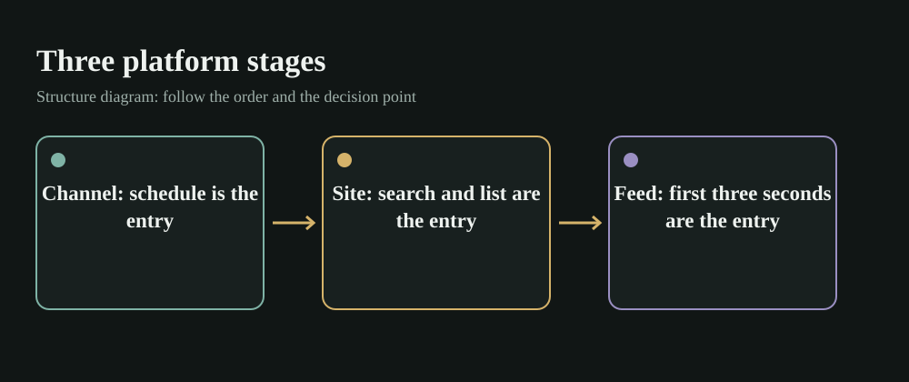

The same three-minute film should open differently on a TV channel, a video site and a feed. The audience did not change; the entry did. A channel relies on a schedule, a site on search and lists, a feed on the first three seconds. Platform history is not interface history; it is the history of viewing conditions.

<!-- DIAGRAM_START -->
<h2 id="diagram">Diagram</h2>
<figure class="diagram">
  
  <figcaption>Check the entry shift across channel, site and feed. When the entry changes, the opening, duration and ending must be rewritten.</figcaption>
</figure>
<!-- DIAGRAM_END -->

<section><h2 id="section-1">On location</h2>
A director puts the same three-minute short in three places: a late-night TV slot, a video-site front page and a short-video feed. The TV cut opens with twenty seconds of black and titles; the site cut opens with ten seconds of logo; the feed cut has no person in the first three seconds and completion is very low. The director says the film did not change; the platform says the audience did not wait.
</section>
<section><h2 id="section-2">What to look for</h2><ul><li><strong>Where the entry is:</strong> does the viewer open a channel, search a title or get pushed by a feed? The entry decides the opening.</li><li><strong>What sets duration:</strong> a schedule gives a fixed slot, a site gives a progress bar, a feed gives the cost of swiping away.</li><li><strong>Person or problem in the first three seconds:</strong> a feed with no person leaves the viewer unsure who they are watching.</li><li><strong>Whether the ending loops:</strong> a feed replays and the ending meets the opening; a channel does not.</li></ul></section>
<section><h2 id="section-3">What to do</h2><ol><li>List the platform stages: channel, site, feed, and write one sentence for how the viewer finds the film in each.</li><li>Compare openings for the same subject: channel can be slow, site needs information, feed needs a person or conflict; do not use one opening everywhere.</li><li>Mark grammar changes: shot length, subtitle position, vertical safe area, sound-first or picture-first.</li><li>Treat platform rules as conditions, not aesthetics: “first three seconds” does not mean “explode in three seconds”.</li><li>Make two endings: a channel ending that closes, a feed ending with a loopable action or question.</li></ol></section>
<section><h2 id="section-4">Failure modes</h2><ul><li><strong>Treating the algorithm as the work:</strong> cutting the film into a reversal every three seconds for completion, until the story is gone.</li><li><strong>Only seeing interfaces:</strong> mistaking app redesigns for platform history, missing the change in entry, attention and distribution.</li><li><strong>Ignoring distribution:</strong> releasing only in the feed, with no channel or site version, so long-tail viewers cannot find it.</li></ul></section>
<section><h2 id="section-5">Limits</h2>
This is a framework for viewing conditions, not an industry study, and it does not replace the platform's current rules. Regions and platforms do not move in sync; the channel, site and feed timelines differ across China, the US and Europe. Mark region and period when writing platform history; do not flatten the world into one line.
</section>
<section><h2 id="section-6">Check</h2><ul><li>Can name the entry for each of the three stages.</li><li>The same subject has three different openings, driven by entry, not showing off.</li><li>Platform rules are written as conditions, not as style.</li><li>At least one long-tail version exists, not only the feed cut.</li></ul></section>
<!-- DEEP_DIVE_START -->
## Deep dive

<strong>About 8 minutes.</strong> This section places the same judgement in two different conditions, then gives a counterexample and a reusable model. It does not repeat the page; it decides when to change the method.

### Condition A: the channel era

In the channel era the entry is the schedule: the viewer chooses a channel first, then whether to watch this film. The opening can be slow because the viewer is already seated; the ending must be on time because the next programme will not wait. Duration is set by the slot, not the content; the director completes a change inside a fixed length.

The grammar is segment-based: a film is several self-contained passages so a viewer who joins late can follow. Subtitles carry who is speaking because screens are small and sound is poor; music carries emotional continuity because it cannot stop. The feed changed both.

### Condition B: the feed era

The feed entry is the cost of swiping: the viewer does not know you and has made no commitment; without a person, problem or conflict in three seconds, they leave. The opening is not background; it is the character wanting something first. Background can arrive at second eight, second twenty, or never. Duration is set by retention, not by story.

The grammar is hook, payoff, hook: a small payoff every ten to twenty seconds, and a loopable action or question at the end. Not every subject fits; slow documentary, long takes and mood pieces get shredded in a feed and should return to the site or channel cut.

### Counterexample: the platform changed, the opening did not

A director uploads a TV documentary straight to a feed, keeping forty seconds of drone and voice-over at the opening. The TV cut completes normally; the feed cut loses more than half in three seconds. The director says the content is good and the audience has no taste; the platform says the audience never reached the content.

The problem is the entry, not the content. The fix is not deleting the drone; move it later. Give a person one line or one action in the first three seconds; the drone becomes a breath at second fifteen. Same material, two entries, two openings.

### Reusable model

<strong>Entry → attention → duration → feedback.</strong> Entry decides how the viewer arrives; attention decides what the first seconds give; duration decides how the story closes; feedback decides whether the ending loops. The four change by platform stage, not by director preference.

Make a platform version sheet: one row each for channel, site and feed, with entry, first three seconds, duration, ending and subtitle position. One film can have three versions but only one core change. Versions change the entry, not the theme.

<!-- DEEP_DIVE_END -->
<!-- SOURCES_START -->
## Further reading

- [S10] [Film history and moving-image research: Film history and moving-image research](https://www.bfi.org.uk/) — accessed 2026-11-26. Used to check the terms, method or rule in the “What to look for” section; not the page's field numbers, gear models or conclusions, and not a substitute for a test or contract.
- [S14] [YouTube Community Guidelines: YouTube Community Guidelines](https://support.google.com/youtube/answer/2801973) — accessed 2026-11-26. Used to check the terms, method or rule in the “Limits” section; not the page's field numbers, gear models or conclusions, and not a substitute for a test or contract.
<!-- SOURCES_END -->
