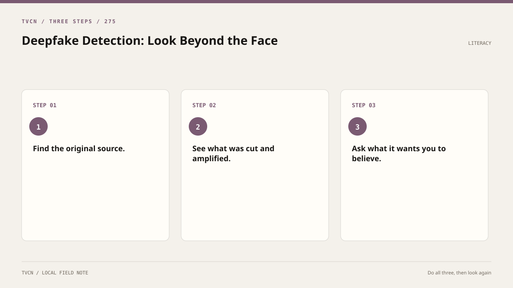

Deepfakes usually fail on physics, not features: mismatched shadow direction, wrong glasses reflection, changing tooth count, hair passing through a shoulder, a neck that does not move with speech. Frame-by-frame relationships are more reliable than “does it look like them.”

<!-- DIAGRAM_START -->
<h2>Diagram</h2>
<figure>
  
  <figcaption>Watch “Step through five seconds: are teeth a single” and “Check background text, signs, and reflections in glasses”; judge what old problem it replaced and what new limit it added.</figcaption>
</figure>
<!-- DIAGRAM_END -->
<section><h2 id="section-1">Check physics before the face</h2>
Then check provenance: where is the original, who shot it, is there an uncompressed copy? Without a source chain, the eye alone cannot conclude.
<h2 id="section-2">Limits</h2>
Do not treat an AI artifact as proof of a fake. Compression, beauty filters and low light create similar flaws. State probability and evidence, not “obviously fake.”
</section><section><h2 id="section-3">On set</h2>
Check teeth, ears, blinks, background text, and light direction. Watch five seconds frame by frame for anomalies.
</section><section><h2 id="section-4">Do this</h2>
Deepfakes are not only about the face. Check teeth, ears, blinking, background text, and light direction.
<ol><li>Step through five seconds: are teeth a single row, ears symmetric, blinks natural?</li><li>Check background text, signs, and reflections in glasses for continuity.</li><li>Find the original source, a response from the person, or a second angle; if all three fail, treat it as high risk.</li></ol></section><section><h2 id="section-5">Avoid</h2>
Do not conclude “it looks fake”; name the specific mismatches.
</section><aside class="regional-note">
<strong>Regional note for US / UK / EU readers</strong>

This English page keeps mainland-China examples where they are part of the method. Read platform names as examples, not as the only market: Douyin ↔ TikTok/Reels, Bilibili ↔ YouTube, Xiaohongshu ↔ Instagram/Pinterest; RMB figures are not converted here. Film-history examples are kept in their original market context; distribution and rights clearance still follow your local law.
</aside><section><h2>Use it today</h2>
Put the history back into a job: archive, restoration, teaching or a short film. Ask what it solved, then what it still cannot do.
<ul><li>Find one contemporary work and mark one old limit it inherited.</li><li>Find one condition it no longer needs and say why.</li><li>Write one thing it still cannot do today.</li></ul></section><section><h2>Source boundary</h2>
This is interpretation, not a primary archive. Check years, people and statutes against the original links in <a href="../../about/">SOURCES.md</a>. A secondhand summary is a lead, not evidence.
</section>
<h2>Check</h2><ul><li>Five seconds were stepped through for teeth, ears, and blinking.</li><li>Background text, signs, and glasses reflections were checked for continuity.</li><li>Original source, a response from the person, and a second angle all fail.</li></ul>

<!-- DEEP_DIVE_START -->
<section class="editorial-depth">
<h2>Deep dive: a deepfake is not a true/false switch</h2>

<strong>About 6 minutes.</strong> The goal is not a verdict but an evidence grade: can this clip be used as evidence, within what scope, and which check is still missing. “It looks fake” and “it has an AI artifact, so it is fake” both keep errors moving.

<h2>A three-layer evidence model</h2>

<strong>Physics:</strong> check whether the image is internally consistent. Are teeth a single row, ears symmetric, blinks natural, background text continuous, reflections in glasses aligned with the light, and the neck moving with speech? Physics produces suspicions, not a verdict.

<strong>Provenance:</strong> ask where the file came from. Is there an original camera file, is the uploading account the person it claims to be, does the timestamp match the event, and is there a second angle or an uncompressed copy? Provenance decides whether the clip can be traced, not whether it looks good.

<strong>Social chain:</strong> ask who has a motive, who is spreading it, and whether the subject has responded. Deepfakes are often a distribution problem: a ten-second excerpt out of context travels further than the full video.

<h2>Two conditions, two methods</h2>

<strong>Breaking news, decide within 30 minutes:</strong> freeze the original file and a screenshot of the page; record the URL, publish time, account and download time; do not repost before verification; keep “suspicious” and “verified” in two columns. The goal here is to stop secondary spread, not to complete a forensic examination.

<strong>Published material, 1–2 days:</strong> ask the publisher for the original file; find a second angle, event photo or long version; mark at least three physical inconsistencies frame by frame; draw the provenance chain as a timeline. You can now give a high/medium/low risk grade, but it is still not a court-grade examination.

<h2>Failure table</h2>
<table class="spec-table col-3"><thead><tr><th>Failure</th><th>Why it happens</th><th>Fix first</th></tr></thead><tbody><tr><td>Look only at the face and say “fake”</td><td>Treating taste as evidence</td><td>Return to physics; mark three observable inconsistencies</td></tr><tr><td>Treat an AI artifact as proof</td><td>Compression, beauty filters and low light create similar flaws</td><td>Add provenance; find the original and a second angle</td></tr><tr><td>Stop after finding the original</td><td>The original can still be cut or re-voiced</td><td>Check audio, timecode, upload account and full version</td></tr><tr><td>Call “cannot tell” the same as “true”</td><td>Binary thinking; refusing to admit insufficient evidence</td><td>Write “insufficient evidence,” not “verified”</td></tr></tbody></table>
<h2>Ten checks</h2>
<ol><li>At least five seconds were examined frame by frame, not just the thumbnail.</li><li>Teeth, ears and blinking were checked separately.</li><li>Background text, signs and glasses reflections were checked against the light direction.</li><li>The original URL, publish time, account and download time were recorded.</li><li>The original file was found, or “not found” was written down.</li><li>A second angle or long version was found, or “none” was written down.</li><li>The subject or publisher responded, or “no response” was written down.</li><li>Suspicions and verified facts sit in separate columns.</li><li>The result is high/medium/low risk, not true/false.</li><li>Publication says “suspected” or “verified”; speculation is not written as a conclusion.</li></ol>
<h2>Alternative</h2>

If the original source cannot be found, do not run a “true/false” examination. Produce an evidence-grade note instead: known facts, unknown facts, suspicious points and the next check. “Cannot confirm at this time” is more responsible than a forced verdict. If the material involves law, elections or personal safety, hand it to a qualified institution; do not conclude inside the page.

</section>
<!-- DEEP_DIVE_END -->
<!-- SOURCES_START -->
## References and further reading

- [S01] [UNESCO: Media and Information Literacy](https://www.unesco.org/mil4teachers/en/module1) — Accessed 2026-11-26. Used to check the terminology/method/rule in the “Check physics before the face” section against media and information literacy framework, not platform-specific rules; it does not verify numbers, model choices or on-set conclusions derived from this page, and is not a substitute for a test.
- [S16] [BBC: Editorial Guidelines](https://www.bbc.co.uk/editorialguidelines/) — Accessed 2026-11-26. Used to check the terminology/method/rule in the “Limits” section against BBC editorial guidelines, not platform growth rules; it does not verify numbers, model choices or on-set conclusions derived from this page, and is not a substitute for a test.
- [S17] [Reuters: Trust Principles](https://reutersagency.com/about/our-trust-principles/) — Accessed 2026-11-26. Used to check the terminology/method/rule in the “Source boundary” section against Reuters trust principles, not general creative advice; it does not verify numbers, model choices or on-set conclusions derived from this page, and is not a substitute for a test.
<!-- SOURCES_END -->

