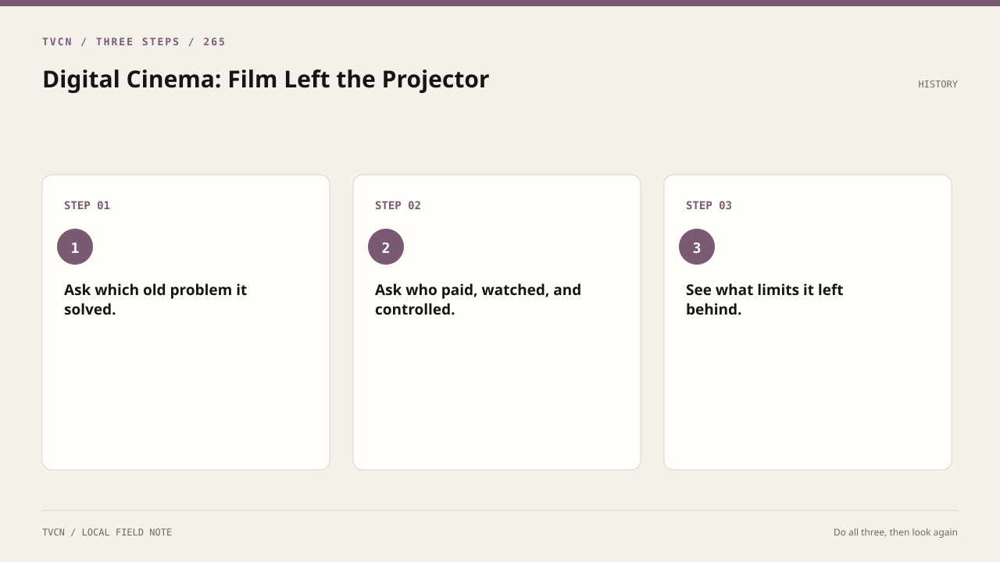

Digital cinema removed film from projection; theaters began running from drives and servers.

<!-- DIAGRAM_START -->
<h2>Diagram</h2>
<figure>
  
  <figcaption>Do the three steps in order, then look again at the image or file.</figcaption>
</figure>
<!-- DIAGRAM_END -->
<h2>On set</h2>

DCI 2K or 4K in P3. Digital projection removes film weave but adds compression and server keys.

<h2>Do this</h2>

Digital cinema removed film from projection; theaters began screening from drives and servers.
<ol><li>Check whether the projector is DCI 2K or 4K.</li><li>Confirm P3 gamut and the server key's validity window.</li><li>Note the absence of film weave but the presence of compression and key limits.</li></ol>
<h2>Avoid</h2>

Do not assume digital projection has no limits; an expired key cancels the show.

<h2>Check</h2>
<ul><li>Projection resolution is identified as DCI 2K or 4K.</li><li>P3 gamut and key validity are recorded.</li><li>One new digital failure point is named, such as key or compression.</li></ul>

<!-- SOURCES_START -->
## References

- [S13] DCI: Digital Cinema System Specification

Full links and notes: [`SOURCES.md`](../../SOURCES.md).
<!-- SOURCES_END -->
