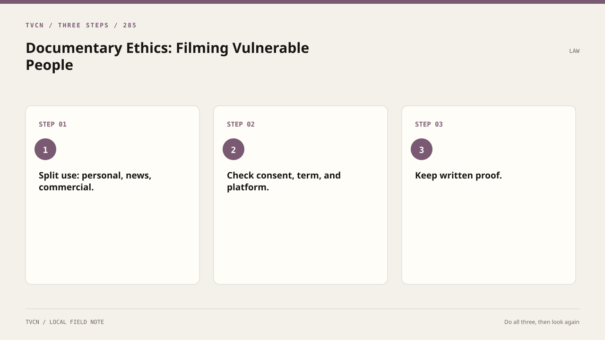

Consent with a real person is not a signature. They need to know who will see the film, what trouble it may bring, and whether they can watch it before the cut. Be extra careful with people who cannot carry the consequences.

<!-- DIAGRAM_START -->
<h2>Diagram</h2>
<figure>
  
  <figcaption>Watch “Explain in plain language who will see the” and “State in writing that they can withdraw at”; judge what old problem it replaced and what new limit it added.</figcaption>
</figure>
<!-- DIAGRAM_END -->
<section><h2 id="section-1">Ask whether they can carry being seen</h2>
Judge “good for the audience” separately from “safe for the subject.” When they conflict, protect the person first.
<h2 id="section-2">Limits</h2>
Real does not mean pushing the lens into a face. You can refuse to shoot, stop, or delete footage. Documentary power is not bought with harm.
</section><section><h2 id="section-3">On set</h2>
Ask three things: do they know the consequences, can they withdraw, and could the film hurt them? If unclear, do not shoot.
</section><section><h2 id="section-4">Do this</h2>
Filming vulnerable people starts with three questions: do they know the consequences, can they withdraw, could the film harm them.
<ol><li>Explain in plain language who will see the film after release.</li><li>State in writing that they can withdraw at any time.</li><li>Predict possible harm after release; if unclear, do not shoot.</li></ol></section><section><h2 id="section-5">Avoid</h2>
Do not treat “he agreed” as ethical clearance; he may not know who sees it after release.
</section><section><h2>Use it today</h2>
Put the history back into a job: archive, restoration, teaching or a short film. Ask what it solved, then what it still cannot do.
<ul><li>Find one contemporary work and mark one old limit it inherited.</li><li>Find one condition it no longer needs and say why.</li><li>Write one thing it still cannot do today.</li></ul></section><section><h2>Source boundary</h2>
This is interpretation, not a primary archive. Check years, people and statutes against the original links in <a href="../../about/">SOURCES.md</a>. A secondhand summary is a lead, not evidence.
</section>
<h2>Check</h2><ul><li>Release scope and consequences are explained in plain language.</li><li>Withdrawal is written and available at any time.</li><li>At least one potential harm and response are written; if unclear, no shoot.</li></ul>

<!-- SOURCES_START -->
## References

- [S18] Dangerous Documentaries (CMSI)

Full links and notes: [`SOURCES.md`](../../about/).
<!-- SOURCES_END -->

<!-- DEEP_DIVE_START -->
## Deep dive

<strong>About 8 minutes.</strong> Documentary ethics is not “I got the shot.” It is “do I have the right to shoot it, cut it, and release it this way.”

### Informed consent is specific

Tell them what the film is about, where it will appear, who might see it, and the worst outcome. Do not say “just a video.” Consent must be withdrawable, especially for minors, patients, and people in distress.

Consent is not permanent after one signature. If they change their mind after the rough cut, respect it. Cutting a scene may hurt the film; keeping it may hurt a person.

### Power asymmetry

You hold the camera; they are filmed. You leave; they stay with the consequences. Before shooting ask who carries more risk, who has fewer choices, whose voice is easier to cut.

Money, resources, and promises can become pressure. Do not trade “fame” for sensitive material. Reconfirm consent with vulnerable subjects when the camera is off.

### Editing is shooting

Which segment, whose reaction follows, what music plays: all define character. Do not cut words into a sentence they never said, and do not let music pass the verdict.

Serious accusations need a chance to respond. If no response, say so in the film. Writing “could not be reached” is more honest than pretending balance.

### Five-minute drill: three questions for one subject

Write three questions: what worries you most after this airs, which line would you remove, and can you still change your mind now? Put the answers in the consent record.

If one cannot be answered, pause the shoot. Do not trade “we will see” for a shot that cannot be taken back.

### When ethics clears

Ethics clears when the subject has seen the film, knows where it goes, and still consents; the person at greatest risk was not sacrificed; accusations got a response; sensitive information was minimized. Four pass.

If one fails, do not convince yourself with “art needs it.” The film can be late; a person's life cannot be redone.

### Ten documentary-ethics checks
<ul><li>Say what the film is about before consent</li><li>Say where it will appear</li><li>Say the worst outcome</li><li>Consent can be withdrawn</li><li>Extra protection for minors and patients</li><li>Ask who carries more risk</li><li>No promises for content on camera</li><li>Edit does not invent speech</li><li>Accusations get a response</li><li>Subject saw it and still consents</li></ul>
The floor of documentary is not getting the truth. It is not treating a person as a tool while getting it.

<!-- DEEP_DIVE_END -->
