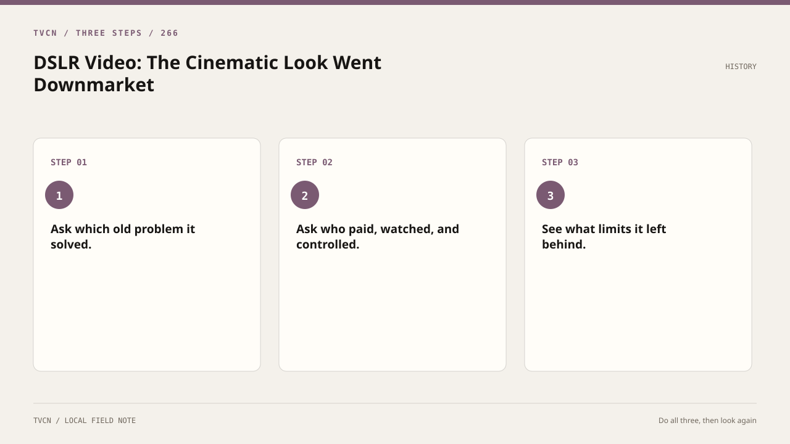

DSLR video put big sensors and interchangeable lenses in ordinary hands; the cinematic look went downmarket.

<!-- DIAGRAM_START -->
<h2>Diagram</h2>
<figure>
  
  <figcaption>Do the three steps in order, then look again at the image or file.</figcaption>
</figure>
<!-- DIAGRAM_END -->
<h2>On set</h2>

The 5D Mark II brought shallow depth and low light, at the cost of rolling shutter, moire, and audio. Watch the early shorts.

<h2>Do this</h2>

DSLR video put large sensors and interchangeable lenses in ordinary hands, pushing cinematic look downward.
<ol><li>Shoot shallow depth and low light on a 5D Mark II.</li><li>Whip pan to expose rolling shutter.</li><li>Shoot fine patterns for moiré and record audio separately.</li></ol>
<h2>Avoid</h2>

Do not look only at shallow depth; rolling shutter, moiré, and onboard audio are the cost.

<h2>Check</h2>
<ul><li>Shallow depth and low-light performance are visible.</li><li>Rolling shutter appears in a whip pan and is recorded.</li><li>Fine patterns show moiré, and audio is recorded separately.</li></ul>

<!-- SOURCES_START -->
## References

- [S10] BFI: Film history and moving-image research

Full links and notes: [`SOURCES.md`](../../SOURCES.md).
<!-- SOURCES_END -->
