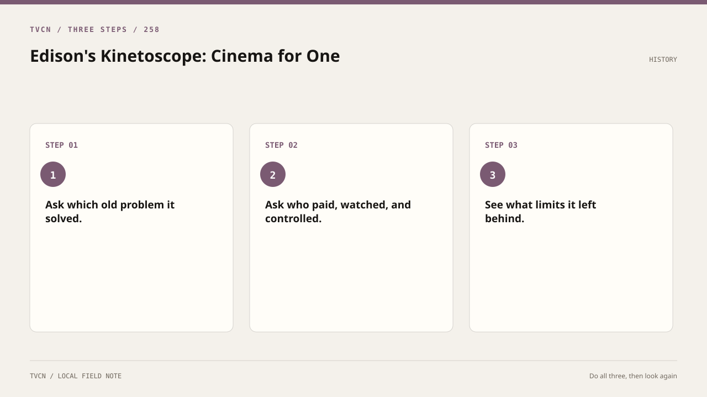

The Kinetoscope put moving images in a box for one viewer; cinema had not become a public space yet.

<!-- DIAGRAM_START -->
<h2>Diagram</h2>
<figure>
  
  <figcaption>Do the three steps in order, then look again at the image or file.</figcaption>
</figure>
<!-- DIAGRAM_END -->
<h2>On set</h2>

A Kinetoscope served one viewer at a time, ran about twenty seconds, and looped. Look through the peephole, not at a projection.

<h2>Do this</h2>

The Kinetoscope put moving pictures in a box for one viewer at a time; cinema was not yet a public space.
<ol><li>Build a box model with a peephole.</li><li>Keep the film around twenty seconds and loop it.</li><li>Admit one viewer at a time and record the reaction.</li></ol>
<h2>Avoid</h2>

Do not describe it as projection; the Kinetoscope is a single-viewer peep box.

<h2>Check</h2>
<ul><li>The model has a peephole and admits one viewer at a time.</li><li>The film runs about twenty seconds and loops.</li><li>It differs from projection: no screen and no collective audience.</li></ul>

<!-- SOURCES_START -->
## References

- [S10] BFI: Film history and moving-image research

Full links and notes: [`SOURCES.md`](../../SOURCES.md).
<!-- SOURCES_END -->
