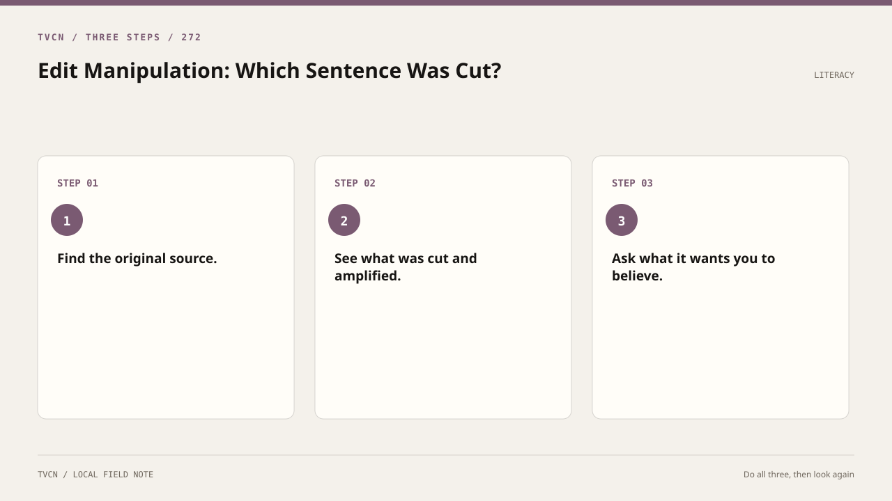

Look for three cuts first: picture jump, sound break, lip mismatch. Watch two seconds before and after each and ask what is missing.

<!-- DIAGRAM_START -->
<h2>Diagram</h2>
<figure>
  
  <figcaption>Watch “Find the unedited footage or full interview and” and “Mark the removed premise, the opposing view, and”; judge what old problem it replaced and what new limit it added.</figcaption>
</figure>
<!-- DIAGRAM_END -->
<section><h2 id="section-1">Find the cuts, then ask what was removed</h2>
Then check speed: stretched audio waveform, unnatural motion, looping ambience. Editing can create cause and remove it.
<h2 id="section-2">Limits</h2>
A cut is not automatically deception. Normal editing removes time; the test is whether the removal changes meaning, not whether it was cut.
</section><section><h2 id="section-3">On set</h2>
Find the missing premise: watch ten seconds before and after the same interview and ask which cut changes the conclusion.
</section><section><h2 id="section-4">Do this</h2>
Editing manipulation often removes one sentence: take away the premise and the conclusion changes.
<ol><li>Find the unedited footage or full interview and watch ten seconds on each side.</li><li>Mark the removed premise, the opposing view, and the time gap.</li><li>Ask whether the conclusion changes without that line; if it does, it is manipulation.</li></ol></section><section><h2 id="section-5">Avoid</h2>
Do not just say “it was edited”; name what was removed and how the meaning changed.
</section><section><h2>Use it today</h2>
Put the history back into a job: archive, restoration, teaching or a short film. Ask what it solved, then what it still cannot do.
<ul><li>Find one contemporary work and mark one old limit it inherited.</li><li>Find one condition it no longer needs and say why.</li><li>Write one thing it still cannot do today.</li></ul></section><section><h2>Source boundary</h2>
This is interpretation, not a primary archive. Check years, people and statutes against the original links in <a href="../../about/">SOURCES.md</a>. A secondhand summary is a lead, not evidence.
</section>
<h2>Check</h2><ul><li>The unedited footage or full interview was found and ten seconds on each side watched.</li><li>The removed premise, opposing view, and time gap are marked.</li><li>You can say whether the conclusion changes without that line.</li></ul>

<!-- SOURCES_START -->
## References and further reading

- [S01] [Media and Information Literacy](https://www.unesco.org/mil4teachers/en/module1) — Accessed 2026-11-26. Used to check the terminology and public context in the opening paragraph (“Editing manipulation often removes one sentence; cut the pre”) against Definitions, teacher modules and critical questions; not a substitute for an on-set test.
- [S02] [Copyright FAQ](https://www.wipo.int/en/web/copyright/faq-copyright) — Accessed 2026-11-26. Used to check the terminology and public context in the opening paragraph (“Editing manipulation often removes one sentence; cut the pre”) against What copyright protects, economic rights and moral rights; not a substitute for an on-set test.
- [S03] [National People's Congress: Personal Information Protection Law](http://www.npc.gov.cn/npc/c2/c30834/202108/t20210820_313088.html) — Accessed 2026-11-26. Used to check the terminology and public context in the opening paragraph (“Editing manipulation often removes one sentence; cut the pre”) against The statutory text on personal data, sensitive data, notice and consent; not a substitute for an on-set test.
- [S16] [BBC Editorial Guidelines](https://www.bbc.co.uk/editorialguidelines/) — Accessed 2026-11-26. Used to check the terminology and public context in the opening paragraph (“Editing manipulation often removes one sentence; cut the pre”) against Editorial standards on accuracy, fairness, privacy and secret recording; not a substitute for an on-set test.
- [S10] [Film history and moving-image research](https://www.bfi.org.uk/) — Accessed 2026-11-26. Used to check the terminology and public context in the opening paragraph (“Editing manipulation often removes one sentence; cut the pre”) against Entry point to BFI film history, archives and moving-image research; not a substitute for an on-set test.
<!-- SOURCES_END -->

