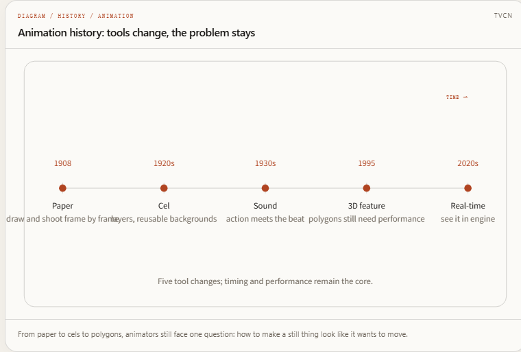

<!-- DIAGRAM_START -->
## Diagram

<figure>
  
  <figcaption>From paper to cels to polygons, animators still face one question: how to make a still thing look like it wants to move.</figcaption>
</figure>
<!-- DIAGRAM_END -->

Animation is not a style; it is a method for controlling time frame by frame. The medium moved from paper to cels to polygons; the problem stayed.

## Frame by frame

The core of early animation was not realistic drawing; it was making still images produce motion. Twelve or twenty-four drawings per second turned action into units of time.

That is the fundamental difference from live action: live action records motion that already happened; animation has to decide how motion happens.

## Cel animation

Cel animation separated character, foreground, and background so one background could be reused. Layering saved money and built an industrial method for putting a character in space.

The logic survives: character layer, background layer, effects layer, text layer. The software changed; the layer thinking did not.

## 3D

3D turned “what do I draw in each frame” into “what is in the scene, where is the camera, where is the light.” Control moved from line to space, but timing remained central.

Do not chase realism. Audiences remember weight and rhythm, not polygon count. Block out a readable action first, then talk about materials.

## Three checks

- You can explain the difference between animation and live action in the source of motion.
- You can explain why cel layering was an industrial method.
- You block out in 3D before doing materials.

<!-- SOURCES_START -->
## References

- [S12] Britannica: Animation

Full links and notes: [`SOURCES.md`](../../../../SOURCES.md).
<!-- SOURCES_END -->
