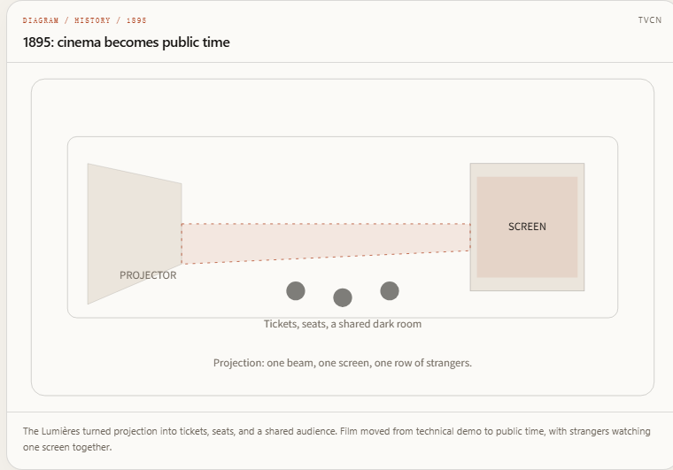

<!-- DIAGRAM_START -->
## Diagram

<figure>
  
  <figcaption>The Lumières turned projection into tickets, seats, and a shared audience. Film moved from technical demo to public time, with strangers watching one screen together.</figcaption>
</figure>
<!-- DIAGRAM_END -->

The Lumières turned projection into a ticket, a seat, and a shared audience. Cinema moved from technical demo to public time.

## The first public screening

In December 1895, the Lumière brothers held a ticketed screening in a Paris café basement. An audience sat in the dark and watched moving images on a screen together.

It was not the first film, but it was the first time “going to the movies” became a repeatable public event: buy a ticket, enter, sit, laugh together, leave together.

## Duration and audience

Early films ran only tens of seconds, often “a train arriving” or “workers leaving.” Audiences came not for a story but to see a real place.

Once projection became a program, editing, music, narration, and audience reaction began to shape one another. Cinema was not just an image; it was a room.

## Today

Today we watch on phones, but “sit down and watch together” still has power. When you make a short, decide whether you want a swipe or sixty seconds of attention.

The two goals need different openings, rhythms, and endings. Do not use a cinema trailer grammar for a feed video that will be swiped away with sound off.

## Three checks

- You can explain why the 1895 screening marks public entertainment.
- You can distinguish a technical demo from a program.
- You can choose “swipe” or “stay” for a specific film.

<!-- V11_DEEPEN -->

<!-- DEEP_DIVE_START -->
## Deep dive

<strong>About 7 minutes.</strong> This section does not repeat the method above. It adds three things: two conditions, a counterexample and a reusable model, so you can decide when to change the method.

### Condition A: exhibition and audience history

1895 is not a single point called “the invention of cinema”; it is the start of cinema as public entertainment. The Lumière screenings had a venue, tickets, a programme and an audience; the audience was not passive, they laughed, flinched and talked. Cinema was collective viewing from the beginning.

Treating 1895 as a technical miracle misses the business conditions: projector, film, venue, distribution, audience flow. Technology offers possibility; business turns it into a habit. Understand that and you understand later cinema, television and feeds.

### Condition B: production and technology history

From production history, 1895 films are short because film loads were limited; the camera is fixed because it was heavy; the subject is daily life because sets and actors were not needed. Creators did not choose shortness; equipment did. Technical limits shaped early grammar.

Today's short video returns to “short, fixed, daily”, not because history repeats but because conditions rhyme: low barrier, fragmented viewing, platform distribution. Compare the two eras by who shoots, who watches and how it is distributed, not by length alone.

### Counterexample: one film changed the world

The popular story is “the train arrival frightened the audience, so cinema was born”. It is a good story that flattens complex history into a moment. The audience may have flinched, but the screening also needed a venue, tickets, a programme and word of mouth; without them, a film is only a novelty.

The fix is not denying the story; put it back into conditions: technology, exhibition, audience and business all had to align for cinema to become public entertainment. Tell the story, but do not mistake it for cause.

### Reusable model

<strong>Technology → exhibition → audience → business.</strong> Read the four lines together and history is not “who invented what”. Technology gives possibility, exhibition gives a place, audience gives meaning, business gives persistence.

For any image change, ask four questions: what technology changed, where it was watched, who watched and who paid. All four answers make a change; only one is usually a lab event.

<!-- DEEP_DIVE_END -->

<!-- SOURCES_START -->
## References and further reading

- [S09] [Institut Lumière: Cinematograph and Museum](https://www.institut-lumiere.org/en/lumiere-museum) — Accessed 2026-11-26. Used to check the terminology/method/rule in the “The first public screening” section against Lumière cinematograph history, not modern shooting rules; it does not verify numbers, model choices or on-set conclusions derived from this page, and is not a substitute for a test.
- [S10] [BFI: Film History and Moving Image Research](https://www.bfi.org.uk/) — Accessed 2026-11-26. Used to check the terminology/method/rule in the “Duration and audience” section against BFI film history and archive, not gear reviews; it does not verify numbers, model choices or on-set conclusions derived from this page, and is not a substitute for a test.
<!-- SOURCES_END -->

