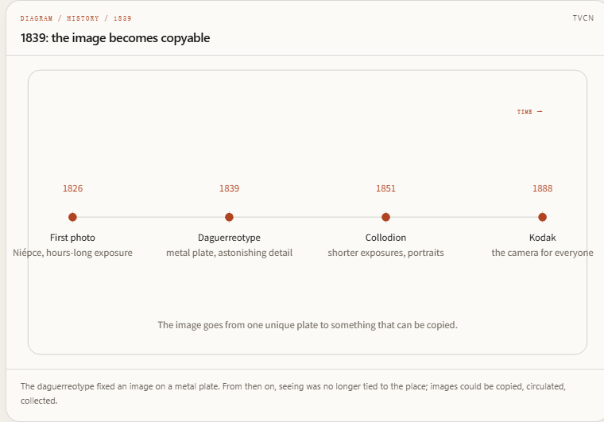

<!-- DIAGRAM_START -->
## Diagram

<figure>
  
  <figcaption>The daguerreotype fixed an image on a metal plate. From then on, seeing was no longer tied to the place; images could be copied, circulated, collected.</figcaption>
</figure>
<!-- DIAGRAM_END -->

## What happened

In 1839, the French government announced the Daguerreotype process. It was not the first photograph, but it was the first photographic method made public by a state and systematically circulated. Images could be fixed on a metal plate and copied, framed, mailed, and collected.

## Why it matters

Before photography, images were drawn by hand. Drawing is an interpretation. Photography left light itself on a material and produced an image that looked like evidence. That shift belongs not only to art history, but to evidence, journalism, portraiture, and power.

## What it changed

- Portraits were no longer only for aristocrats and painters; the middle class began to photograph itself.
- Journalism gained the idea of an image from the scene, even if exposures were still long.
- Painting had to answer “why paint” rather than “how to look real.”

## How to use it today

When you shoot your first film, you do a version of the same thing: fix a piece of light, an action, a moment. Ask “what do I want to keep” before “what camera do I use.”

## Three checks

- You can say the Daguerreotype was not “the first photograph,” but “the first widely publicized photographic method.”
- You can explain the difference between photography and drawing in their claim to evidence.
- You can connect this shift to today’s phone cameras and AI-generated images.

## Boundary

This entry covers one node in photography history. It does not detail the chemistry of the silver plate; that belongs in the long photography history.

<!-- SOURCES_START -->
## References

- [S07] Library of Congress: Daguerreotypes
- [S08] The Met: Daguerre and the Invention of Photography

Full links and notes: [`SOURCES.md`](../../../../about/).
<!-- SOURCES_END -->
