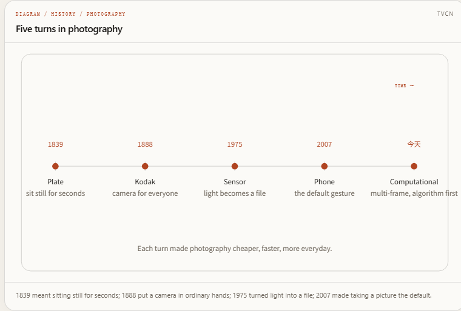

<!-- DIAGRAM_START -->
## Diagram

<figure>
  
  <figcaption>1839 meant sitting still for seconds; 1888 put a camera in ordinary hands; 1975 turned light into a file; 2007 made taking a picture the default.</figcaption>
</figure>
<!-- DIAGRAM_END -->

## 1839: Make people believe the photograph

Exposures ran for dozens of seconds; sitters used braces to stay still. A photograph was closer to a unique object than to today’s infinite copy.

That is also when photographs became “evidence.” People quickly learned to pose and retouch, so proof and performance arrived together.

## 1888: The camera leaves the studio

Kodak’s roll film and “you press the button, we do the rest” turned photography into a daily act. You no longer needed to mix chemicals or calculate exposure.

As cameras shrank, the world inside photographs changed: streets, trips, and family gatherings entered ordinary people’s own albums.

## 1925: A small camera that moves with people

The 35mm camera let reporters carry a machine into a crowd, and photojournalism began to catch people mid-action. Smaller gear made a bigger world fit in the frame.

Cartier-Bresson’s generation did more than compose: they proved the “decisive moment” could happen in the street, not only in a studio setup.

## 1975: Light becomes a file

A Kodak engineer built the first digital camera prototype; at the time, few believed it would replace film. Then the cost curve made the decision for everyone.

From that point, photographs could be copied without loss, transmitted instantly, and tracked through metadata. The time sense of photography shifted from “develop” to “upload.”

## 2007: The phone makes photographing the default

After the iPhone, the camera stopped being a destination and became part of speech. Computational photography made “sharp” the default, and “processed” the default too.

Everyone now carries a camera that shoots, edits, and publishes immediately. Photography history did not end; it moved into everyone else’s hands.

## Three checks

- You can say what happened in 1839, 1888, 1925, 1975, and 2007.
- You can explain why “photographs are evidence” was unstable from the start.
- You know phones changed not only gear but publishing speed.

<section><h2>Boundary</h2>
This page only covers “From Daguerreotype to Phone: Five Turns in Photography”; it does not replace Platform Rules: What Gets Throttled, Likeness, Location, and Minors: What a Release Must Say, Documentary Template: One Person, One Thing, One Change. When the problem belongs to one of those pages, use that page instead of adding more parameters here.
</section>
<section><h2>Three failures</h2>
The three common failures in photography-history writing are not just “wrong date”:
<ul><li><strong>1. Giving the invention to one person.</strong> The 1839 announcement sits on different lines of work by Daguerre, Niépce and Talbot; one name turns technical competition into a hero story.</li><li><strong>2. Judging early processes by today's sharpness.</strong> Daguerreotype, calotype and wet plate each had material and exposure limits; modern pixel standards hide the real constraints.</li><li><strong>3. Listing dates without materials or circulation.</strong> A process works only through its sensitive material, exposure time, viewing method and reproduction cost; drop one and the timeline becomes an empty shell.</li></ul></section>
<!-- SOURCES_START -->
## References and further reading

- [S07] [Library of Congress: Daguerreotypes](https://www.loc.gov/pictures/collection/dag/background.html) — Accessed 2026-11-26. Used to check the terminology/method/rule in the “1839: Make people believe the photograph” section against Library of Congress daguerreotype history, not a shooting tutorial; it does not verify numbers, model choices or on-set conclusions derived from this page, and is not a substitute for a test.
- [S08] [The Met: Daguerre and the Invention of Photography](https://www.metmuseum.org/TOAH/hd/dagu/hd_dagu.htm) — Accessed 2026-11-26. Used to check the terminology/method/rule in the “1888: The camera leaves the studio” section against Met museum photography history, not current camera settings; it does not verify numbers, model choices or on-set conclusions derived from this page, and is not a substitute for a test.
- [S11] [Britannica: Photography](https://www.britannica.com/technology/photography) — Accessed 2026-11-26. Used to check the terminology/method/rule in the “1925: A small camera that moves with people” section against Britannica photography entry, not a how-to manual; it does not verify numbers, model choices or on-set conclusions derived from this page, and is not a substitute for a test.
<!-- SOURCES_END -->

