<!-- DIAGRAM_START -->
<h2>Diagram</h2>
<figure>
  
  <figcaption>Diagram: equipment, breakdown, liability, and transit are different risks; one policy rarely covers all.</figcaption>
</figure>
<!-- DIAGRAM_END -->
<h2>Scope</h2>
This page covers general equipment/production insurance in China mainland; it is not insurance or legal advice. The policy, endorsements, deductibles, and exclusions govern. Confirm territory for cross-province/border shoots.
<h2>Key terms: four risks</h2>
<strong>Property all-risks</strong>: fire, theft, accidental impact, water; insured at replacement or agreed value. <strong>Machinery breakdown</strong>: sudden mechanical/electrical failure; voltage and maintenance exclusions. <strong>Public liability</strong>: third-party injury/property on set; employee/contractual exclusions. <strong>Transit</strong>: loss in transport/loading; bad packing and delay usually excluded. For rentals, confirm the owner’s policy and who claims.
<h2>Process: policy to claim</h2>
List gear (model, serial, purchase price, current value), photograph/video it, keep invoices. Declare high-risk uses (aerial, underwater, fire, vehicles, drones). After a loss, secure the scene, photograph, report to police/insurer, do not self-repair; collect incident note, photos, police/venue statement, repair quote, invoice, serial, rental contract. Confirm deductible/depreciation before repair.
<h2>Common disputes: four denial points</h2>
<strong>Undeclared high-risk use</strong>: drone crash or water ingress is often excluded. <strong>Deductible exceeds repair</strong>: small repairs may be self-paid, but still report. <strong>Depreciation</strong>: old gear pays actual value, not new price. <strong>Rental liability</strong>: who insures and who pays the deductible must be in the contract.
<h2>Template: gear list and incident pack</h2>
Gear list: name/model/serial/purchase date/invoice price/current value/photo. Incident pack: policy no., time/place, statement, photos/video, police or venue statement, third-party loss list, repair quote, rental contract, correspondence. Update quarterly.
<h2>Check</h2><ul><li>Gear list has serials and values.</li><li>High-risk uses are declared.</li><li>Deductible and depreciation are confirmed.</li><li>Public liability covers third parties.</li><li>Rental liability and claimant are written.</li><li>Incident pack is complete.</li></ul>

<!-- SOURCES_START -->
## References and further reading

- [S02] [WIPO: Copyright FAQ](https://www.wipo.int/en/web/copyright/faq-copyright) — Accessed 2026-11-26. Used to check the terminology/method/rule in the “Scope” section against WIPO copyright FAQ, not Chinese statute; it does not verify numbers, model choices or on-set conclusions derived from this page, and is not a substitute for a test.
- [S03] [NPC: Personal Information Protection Law](http://www.npc.gov.cn/npc/c2/c30834/202108/t20210820_313088.html) — Accessed 2026-11-26. Used to check the terminology/method/rule in the “Key terms: four risks” section against China's Personal Information Protection Law, not content copyright; it does not verify numbers, model choices or on-set conclusions derived from this page, and is not a substitute for a test.
- [S22] [NPC: Civil Code](http://www.npc.gov.cn/npc/c2/c30834/202006/t20200602_306457.html) — Accessed 2026-11-26. Used to check the terminology/method/rule in the “Process: policy to claim” section against China's Civil Code, not industry custom; it does not verify numbers, model choices or on-set conclusions derived from this page, and is not a substitute for a test.
<!-- SOURCES_END -->

