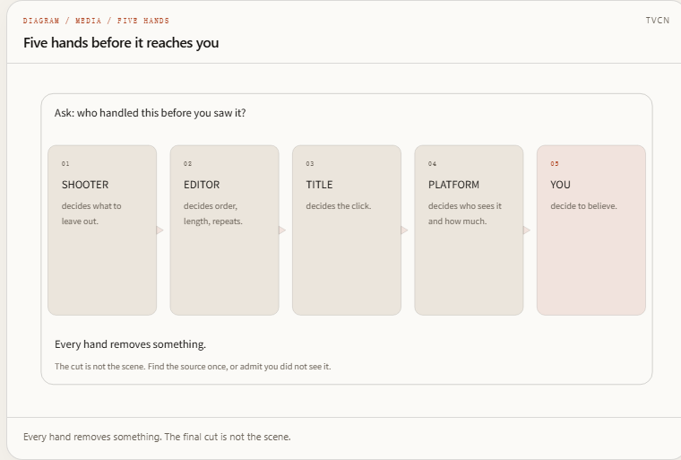

<!-- DIAGRAM_START -->
## Diagram

<figure>
  
  <figcaption>Every hand removes something. The final cut is not the scene.</figcaption>
</figure>
<!-- DIAGRAM_END -->

Do not start with “is it real.” Start with: who made it, what was cut, what context, and why it reached me now.

## Five questions

Source: who shot it, who paid, who is spreading it. Edit: what was removed before and after. Context: do title, music, and subtitles change the meaning. AI: are there generation traces. Copyright: can I use it, and how.

You do not need to answer all five. If one cannot be answered, pause before sharing.

## How editing changes meaning

The same footage becomes comedy with a laugh track and tragedy with a pause. Editing creates cause and effect by what it removes and what it places next to what.

When a video makes you feel strongly, find the cut: when did it make you laugh or get angry. That timing is the author’s hand.

## AI traces

Hands, text, physics, reflections, and repeated textures are common generation traces. But traces do not prove the whole is fake, and no traces do not prove it is real.

Treat AI traces as an entry point for questions, not a verdict. Source and context matter more: who has a motive to make this video.

## Three checks

- You can ask at least three source questions about a video.
- You can find a key cut in a video.
- You do not treat an AI trace as a truth verdict.

<!-- SOURCES_START -->
## References

- [S01] UNESCO: Media and Information Literacy

Full links and notes: [`SOURCES.md`](../../../SOURCES.md).
<!-- SOURCES_END -->

<!-- DEEP_DIVE_START -->
## Deep dive

<strong>About 7 minutes.</strong> Media literacy is not doubting everything. It is asking, for every video, who made it, who paid, and what is missing.

### Ask three people

Who shot it, who paid, who benefits. They are not always the same person. The payer decides what the film must prove, the maker decides how, the platform decides who sees it.

If none of the three can be found, treat the video as “unknown source,” not evidence. Unknown is not automatically false, but it is not ready to share.

### Look for what is missing

A video shows you thirty seconds of choices. Ask what was cut: the cause, the opponent, the failure, the time span. In conflict stories, the missing side is often the answer.

Read the camera: who is shot from below, who from above, when the music enters. Form is not neutral; it takes sides before you notice.

### Why the platform pushed it

Platforms push retention, shares, comments, not accuracy. Strong emotion, clear sides, conflict in three seconds travel farther; accurate but slow work often disappears.

When a video proves exactly what you already believe, pause three seconds: did the content persuade you, or did the recommender know you would like it? That pause is media literacy.

### Five-minute drill: three questions on one video

Take one video from today and write three lines: who made it, who paid, what is missing. If unknown, write “unknown”; do not invent.

Watch it muted, then listen with the image covered. Which pass made you believe it more? Note that; next time check that channel first.

### When you understand a video

You can say in one line what it wants you to do, and in one line what it did not show you. Both lines exist, and you understand it.

If you can only say “moving” or “fake,” you are still at the reaction layer. Return to the three people and three omissions, and turn reaction into evidence.

### Ten media-literacy checks
<ul><li>Ask who shot it</li><li>Ask who paid</li><li>Ask who benefits</li><li>Unknown source is not evidence</li><li>List the missing cause</li><li>Find the missing opponent</li><li>Read high/low angles and music</li><li>Platforms push emotion</li><li>Pause when it proves your view</li><li>Watch muted and image-covered</li></ul>
Media literacy is not suspicion. It is being able to say, before sharing, what the video wants you to do.

<!-- DEEP_DIVE_END -->
