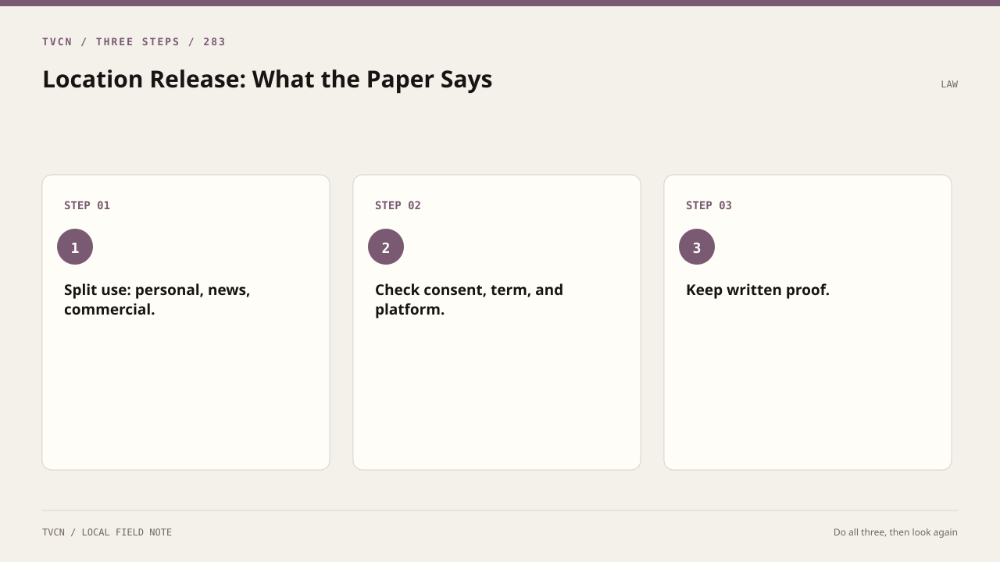

One page: address and exact area, dates and hours, crew size and gear, commercial use, permission to edit and publish, damage and restoration, contact.

<!-- DIAGRAM_START -->
<h2>Diagram</h2>
<figure>
  
  <figcaption>Watch “State dates, hours, and exact areas.” and “State allowed disruption, such as how many passages”; judge what old problem it replaced and what new limit it added.</figcaption>
</figure>
<!-- DIAGRAM_END -->
<section><h2 id="section-1">A location release names what, how long and who enters</h2>
Photograph the space before and after. Those two images are worth more than a verbal promise.
<h2 id="section-2">Limits</h2>
Verbal yes is not a permit. Landlord, property manager, shop owner and neighbors may hold different rights; “I know the owner” does not cover everyone.
</section><section><h2 id="section-3">On set</h2>
Write time, area, disruption, damage liability, and film usage rights. Add a contact.
</section><section><h2 id="section-4">Do this</h2>
A location release states shoot time, area, disruption, damage liability, and footage use.
<ol><li>State dates, hours, and exact areas.</li><li>State allowed disruption, such as how many passages may be closed.</li><li>State damage liability, footage use, and an on-site contact.</li></ol></section><section><h2 id="section-5">Avoid</h2>
Do not write only “permission to shoot”; without time, area, and damage terms, the set argues.
</section><aside class="regional-note">
<strong>Regional note for US / UK / EU readers</strong>

This English page keeps mainland-China examples where they are part of the method. Read platform names as examples, not as the only market: Douyin ↔ TikTok/Reels, Bilibili ↔ YouTube, Xiaohongshu ↔ Instagram/Pinterest; RMB figures are not converted here. Film-history examples are kept in their original market context; distribution and rights clearance still follow your local law.
</aside><section><h2>Use it today</h2>
Put the history back into a job: archive, restoration, teaching or a short film. Ask what it solved, then what it still cannot do.
<ul><li>Find one contemporary work and mark one old limit it inherited.</li><li>Find one condition it no longer needs and say why.</li><li>Write one thing it still cannot do today.</li></ul></section><section><h2>Source boundary</h2>
This is interpretation, not a primary archive. Check years, people and statutes against the original links in <a href="../../about/">SOURCES.md</a>. A secondhand summary is a lead, not evidence.
</section>
<h2>Check</h2><ul><li>The release states dates, hours, and exact areas.</li><li>Disruption has numbers, such as passages closed.</li><li>Damage liability, footage use, and an on-site contact are present.</li></ul>

<!-- SOURCES_START -->
## References and further reading

- [S22] [National People's Congress: Civil Code](http://www.npc.gov.cn/npc/c2/c30834/202006/t20200602_306457.html) — Accessed 2026-11-26. Used to check the terminology and public context in the opening paragraph (“A location release states hours, areas, disruption, damage, ”) against Statutory text on portrait rights, privacy, contracts and location rights; not a substitute for an on-set test.
- [S01] [Media and Information Literacy](https://www.unesco.org/mil4teachers/en/module1) — Accessed 2026-11-26. Used to check the terminology and public context in the opening paragraph (“A location release states hours, areas, disruption, damage, ”) against Definitions, teacher modules and critical questions; not a substitute for an on-set test.
- [S02] [Copyright FAQ](https://www.wipo.int/en/web/copyright/faq-copyright) — Accessed 2026-11-26. Used to check the terminology and public context in the opening paragraph (“A location release states hours, areas, disruption, damage, ”) against What copyright protects, economic rights and moral rights; not a substitute for an on-set test.
- [S03] [National People's Congress: Personal Information Protection Law](http://www.npc.gov.cn/npc/c2/c30834/202108/t20210820_313088.html) — Accessed 2026-11-26. Used to check the terminology and public context in the opening paragraph (“A location release states hours, areas, disruption, damage, ”) against The statutory text on personal data, sensitive data, notice and consent; not a substitute for an on-set test.
- [S16] [BBC Editorial Guidelines](https://www.bbc.co.uk/editorialguidelines/) — Accessed 2026-11-26. Used to check the terminology and public context in the opening paragraph (“A location release states hours, areas, disruption, damage, ”) against Editorial standards on accuracy, fairness, privacy and secret recording; not a substitute for an on-set test.
<!-- SOURCES_END -->

