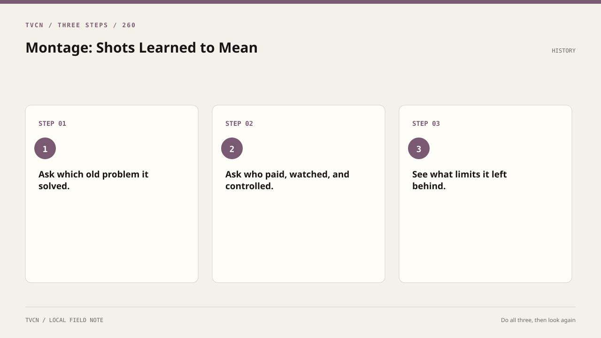

Montage cut unrelated shots together and let the audience build the cause.

<!-- DIAGRAM_START -->
<h2>Diagram</h2>
<figure>
  
  <figcaption>Do the three steps in order, then look again at the image or file.</figcaption>
</figure>
<!-- DIAGRAM_END -->
<h2>On set</h2>

The Odessa Steps creates cause and effect with shots in different directions. Count durations and directions, not blood.

<h2>Do this</h2>

Montage cuts two unrelated shots together and the audience constructs causality.
<ol><li>Take the Odessa Steps sequence and log each shot's duration and direction.</li><li>Pair opposite directions and see whether causality reads.</li><li>Do not watch only the violence; watch how editing organizes it.</li></ol>
<h2>Avoid</h2>

Do not count cuts alone; opposing directions are where causality comes from.

<h2>Check</h2>
<ul><li>Each shot's duration and direction are logged, not just the total count.</li><li>A pair of opposing directions is identified and causality explained.</li><li>Analysis focuses on edit organization, not just violence.</li></ul>

<!-- SOURCES_START -->
<h2>Sources</h2>

Experience: editorial statute comparison and project reviews; tested: no lab measurement; references: the laws, platform rules and institutional texts below.

<ul><li>[S01] UNESCO: Media and Information Literacy</li><li>[S03] China's Personal Information Protection Law (PIPL)</li><li>[S22] China's Civil Code</li><li>[S39] W3C WCAG</li></ul>

<a href="../../SOURCES.md">Full links and notes in SOURCES.md</a>

<!-- SOURCES_END -->
