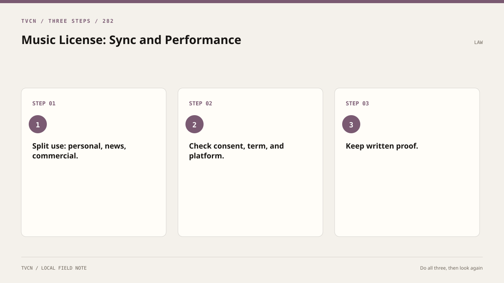

<!-- DIAGRAM_START -->
<h2>Diagram</h2>
<figure>
  
  <figcaption>Diagram: composition, master, sync, and public performance are licensed separately.</figcaption>
</figure>
<!-- DIAGRAM_END -->
<h2>Scope</h2>
This page covers music clearance for commercial video in China mainland; it is not legal advice. Confirm by territory, platform, duration, and paid media; overseas distribution involves local collecting societies.
<h2>Key terms: four rights</h2>
<strong>Sync</strong>: combining composition/master with picture; clear with the writer/rightsholder or collective. <strong>Performance</strong>: public venue or platform playback; the platform/venue may settle, but the producer still confirms. <strong>Mechanical</strong>: copying audio to DVD/download/master. <strong>Master</strong>: using the original recording needs a separate license. Ads often need adaptation and online communication rights too.
<h2>Process: from track selection to archive</h2>
Confirm use (film/ad/paid/overseas), then choose. Prefer platform libraries or paid libraries; save license ID, invoice, and scope screenshot. For a popular original, allow 4–8 weeks and contact composition and master holders separately; do not just contact the artist/manager. Credit as contracted and archive the license with the delivery package.
<h2>Common disputes: three risks</h2>
<strong>“CC0/free commercial”</strong>: many sites claim free use but the uploader lacks rights; check provenance and license text. <strong>“Platform library”</strong>: usually covers use inside that platform; ads/offline may exceed it. <strong>“Change a few notes”</strong>: substantial similarity can still infringe; adaptation needs clearance. AI music also needs training-source and platform terms; do not assume no risk.
<h2>Template: license checklist</h2>
Title/version/ISRC; writer and composition holder; master holder; use (sync/ad/paid/overseas); media and territory; term; exclusive/non-exclusive; adaptation; credit; fee/payment; liability; license ID. Do not start without these.
<h2>Check</h2><ul><li>Use, media, territory, term are written.</li><li>Composition and master cleared separately.</li><li>Platform library scope is confirmed.</li><li>Adaptation/paid/overseas checked separately.</li><li>Credit matches contract.</li><li>License archived with delivery.</li></ul>

<!-- SOURCES_START -->
## References and further reading

- [S02] [WIPO: Copyright FAQ](https://www.wipo.int/en/web/copyright/faq-copyright) — Accessed 2026-11-26. Used to check the terminology/method/rule in the “Scope” section against WIPO copyright FAQ, not Chinese statute; it does not verify numbers, model choices or on-set conclusions derived from this page, and is not a substitute for a test.
- [S03] [NPC: Personal Information Protection Law](http://www.npc.gov.cn/npc/c2/c30834/202108/t20210820_313088.html) — Accessed 2026-11-26. Used to check the terminology/method/rule in the “Key terms: four rights” section against China's Personal Information Protection Law, not content copyright; it does not verify numbers, model choices or on-set conclusions derived from this page, and is not a substitute for a test.
- [S22] [NPC: Civil Code](http://www.npc.gov.cn/npc/c2/c30834/202006/t20200602_306457.html) — Accessed 2026-11-26. Used to check the terminology/method/rule in the “Process: from track selection to archive” section against China's Civil Code, not industry custom; it does not verify numbers, model choices or on-set conclusions derived from this page, and is not a substitute for a test.
<!-- SOURCES_END -->

