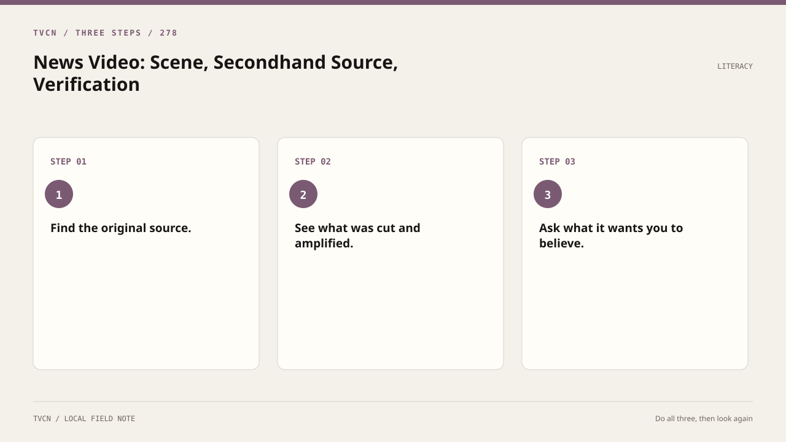

Separate scene, secondhand source, and verification; an unverified scene is just footage.

<!-- DIAGRAM_START -->
<h2>Diagram</h2>
<figure>
  
  <figcaption>Do the three steps in order, then look again at the image or file.</figcaption>
</figure>
<!-- DIAGRAM_END -->
<h2>On set</h2>

Separate scene, second-hand, and verification. Label reused footage and write the time and source for verification.

<h2>Do this</h2>

News video separates first-hand footage, second-hand sources, and verification. An unverified “scene” is only material.
<ol><li>Label which part is the reporter on scene and which is a user repost.</li><li>Find a second independent source, the original uploader, and the time and place.</li><li>Mark unverified images as unverified and do not attach a definite conclusion.</li></ol>
<h2>Avoid</h2>

Do not treat a repost as first-hand footage; show the source chain.

<h2>Check</h2>
<ul><li>Reporter footage and user reposts are labeled.</li><li>A second independent source, original uploader, time, and place were sought.</li><li>Unverified images are marked unverified with no definite conclusion.</li></ul>

<!-- SOURCES_START -->
## References

- [S17] Reuters Trust Principles
- [S16] BBC Editorial Guidelines

Full links and notes: [`SOURCES.md`](../../SOURCES.md).
<!-- SOURCES_END -->
