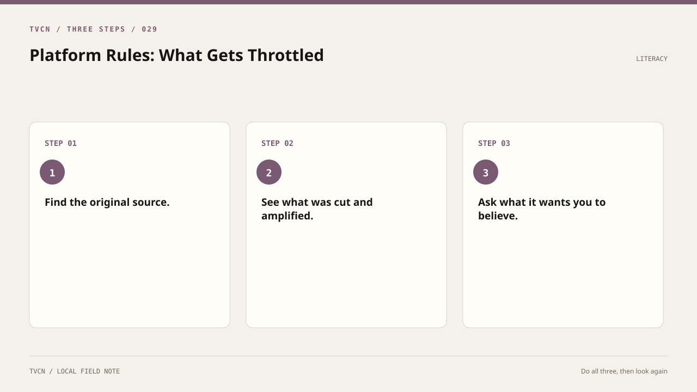

Platform limits are not magic: reposts, exaggerated promises, engagement bait, and sensitive images get throttled.

<!-- DIAGRAM_START -->
<h2>Diagram</h2>
<figure>
  
  <figcaption>Do the three steps in order, then look again at the image or file.</figcaption>
</figure>
<!-- DIAGRAM_END -->
<h2>On set</h2>

Check four things before posting: reused content, exaggerated promises, engagement bait, and sensitive images. Fix each item, not just the title.

<h2>Do this</h2>

Platform limits usually come from four things: reposting, exaggerated promises, engagement bait, and sensitive imagery. Fix them one at a time, not just the title.
<ol><li>Check for reposted or re-edited material; add your own narration, footage, or verifiable material.</li><li>Remove absolute and promise-based claims; replace them with something testable.</li><li>Drop like-and-comment bait, and mask or explain sensitive images.</li></ol>
<h2>Avoid</h2>

Do not change only the title; images and claims trigger limits too.

<h2>Check</h2>
<ul><li>Reposted or re-edited material now carries narration, original footage, or verifiable material.</li><li>Absolute and promise-based claims are replaced with testable statements.</li><li>Engagement bait is gone and sensitive images are masked or explained.</li></ul>

<!-- SOURCES_START -->
## References

- [S14] YouTube Community Guidelines
- [S15] TikTok Community Guidelines

Full links and notes: [`SOURCES.md`](../../SOURCES.md).
<!-- SOURCES_END -->
