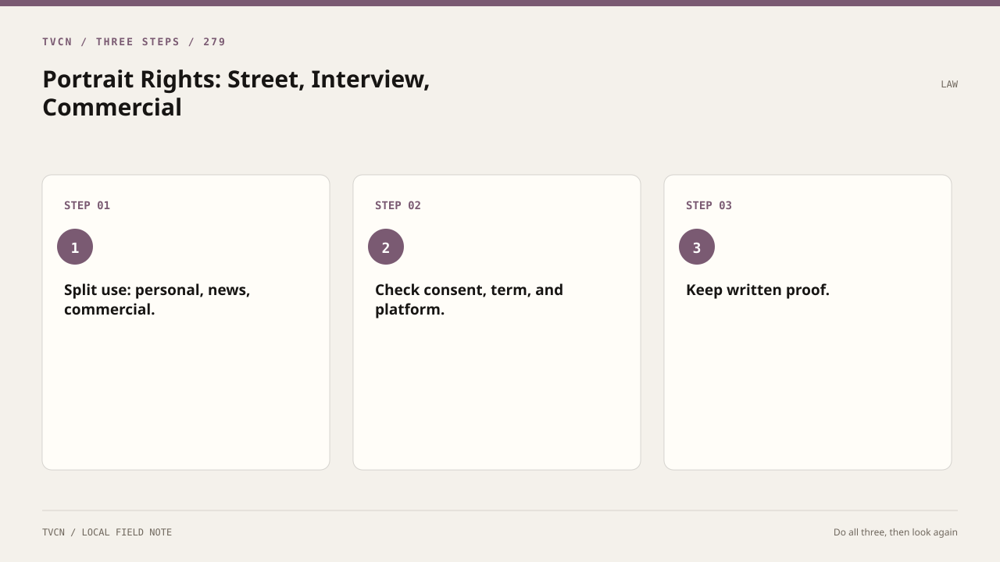

Portrait rights depend on use: street, interview, and commercial have different boundaries; commercial needs written consent.

<!-- DIAGRAM_START -->
<h2>Diagram</h2>
<figure>
  
  <figcaption>Do the three steps in order, then look again at the image or file.</figcaption>
</figure>
<!-- DIAGRAM_END -->
<h2>On set</h2>

Separate street photography, interviews, and commercial use. Commercial use needs written portrait permission with term and platforms.

<h2>Do this</h2>

Portrait rights depend on use: street, interview, commercial; commercial needs written consent most.
<ol><li>Separate uses: street, interview, commercial.</li><li>Commercial use needs written portrait consent with term and platforms.</li><li>Keep the release next to the shot numbers it covers.</li></ol>
<h2>Avoid</h2>

Do not use “no one will sue” as a license; that is gambling.

<h2>Check</h2>
<ul><li>Every shot with a person is tagged by use category.</li><li>Commercial use has written consent with term and platforms.</li><li>Releases map to specific shot numbers.</li></ul>

<!-- SOURCES_START -->
## References

- [S22] China's Civil Code

Full links and notes: [`SOURCES.md`](../../SOURCES.md).
<!-- SOURCES_END -->
