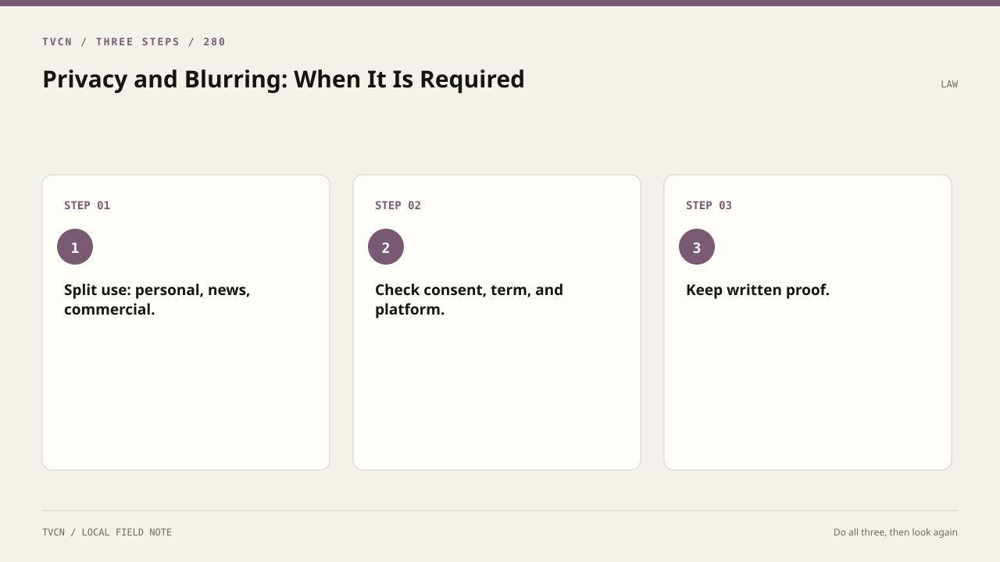

Blurring is not a static box. Track faces, plates, house numbers and screens frame by frame; check edges through motion, turns and occlusion. Use enough radius that the outline is not recognizable.

<!-- DIAGRAM_START -->
<h2>Diagram</h2>
<figure>
  
  <figcaption>Watch “Find house numbers, plates, medical records, and minors” and “Cover reflections and water mirroring, not just the”; judge what old problem it replaced and what new limit it added.</figcaption>
</figure>
<!-- DIAGRAM_END -->
<section><h2 id="section-1">The blur must track the face and the shadow</h2>
Zoom to 100% before export: check leaks and drift, and fix keys manually.
<h2 id="section-2">Limits</h2>
Blurring is not consent. A recognizable person in public may still need a likeness release for commercial use; blur lowers recognition, not the legal requirement.
</section><section><h2 id="section-3">On set</h2>
Treat addresses, plates, medical records, and minors as identifiable. Blur reflections in the background too.
</section><section><h2 id="section-4">Do this</h2>
Blurring is not politeness but duty: addresses, plates, medical records, minors must be treated when identifiable.
<ol><li>Find house numbers, plates, medical records, and minors frame by frame.</li><li>Cover reflections and water mirroring, not just the subject.</li><li>Play back after treatment to confirm nothing readable remains.</li></ol></section><section><h2 id="section-5">Avoid</h2>
Do not blur only the subject; a plate in a reflection is still readable.
</section><aside class="regional-note">
<strong>Regional note for US / UK / EU readers</strong>

This English page keeps mainland-China examples where they are part of the method. Read platform names as examples, not as the only market: Douyin ↔ TikTok/Reels, Bilibili ↔ YouTube, Xiaohongshu ↔ Instagram/Pinterest; RMB figures are not converted here. Film-history examples are kept in their original market context; distribution and rights clearance still follow your local law.
</aside><section><h2>Use it today</h2>
Put the history back into a job: archive, restoration, teaching or a short film. Ask what it solved, then what it still cannot do.
<ul><li>Find one contemporary work and mark one old limit it inherited.</li><li>Find one condition it no longer needs and say why.</li><li>Write one thing it still cannot do today.</li></ul></section><section><h2>Source boundary</h2>
This is interpretation, not a primary archive. Check years, people and statutes against the original links in <a href="../../about/">SOURCES.md</a>. A secondhand summary is a lead, not evidence.
</section>
<h2>Check</h2><ul><li>Addresses, plates, records, and minors are checked frame by frame.</li><li>Reflections and mirrored surfaces are covered too.</li><li>Playback reveals no readable sensitive information.</li></ul>

<!-- SOURCES_START -->
## References

- [S03] China's Personal Information Protection Law (PIPL)

Full links and notes: [`SOURCES.md`](../../about/).
<!-- SOURCES_END -->

<!-- DEEP_DIVE_START -->
## Deep dive

<strong>About 7 minutes.</strong> Blurring is not smudging a face. It is keeping only what the audience needs and removing personal identity.

### Ask whether they need to appear

Passersby, minors, patients, parties in a case: first ask whether they need to be in the shot. If you cannot avoid them, then ask whether to blur. Blur is a remedy, not consent.

Public space still carries reasonable privacy expectations. Hospitals, schools, residential entrances, plates, badges are identity clues, not background.

### Blur cleanly

Check face, plate, door number, badge, tattoo, distinctive clothing, voice. The blur must cover the whole feature, not half. Track it through movement; do not miss frames.

After blurring, check reflections, glass, mirrors, phone screens. Identity often leaks from there.

### Sound and metadata leak too

Pitch-shift voices; lowering volume is not enough. Remove names, addresses, phone numbers, hospital announcements in the background. Subtitles with real names, schools, employers need handling too.

File metadata can carry GPS, device ID, and shoot time. Strip it before publishing. Keep screenshots and originals separate; do not send everything together.

### Five-minute drill: find identity in one frame

Take one frame with people and circle five identity clues: face, plate, door number, badge, tattoo. Then circle three reflective surfaces.

Decide keep, blur, or crop for each, with a reason. If you cannot write the reason, blur. Blurring is risk management, not aesthetics.

### When privacy is clean

Watch frame by frame, pause on every person, reflection, and subtitle. When you cannot find a real name, full face, plate, or address, it is clean.

Show it to someone who does not know the subject and ask if they can guess who it is. If yes, keep working; do not gamble on “nobody will recognize them.”

### Ten privacy-blur checks
<ul><li>Ask whether they need to be shot</li><li>Blur is not consent</li><li>Face, plate, door, badge checked</li><li>Tattoos and distinctive clothes too</li><li>Pitch-shift voice, not just lower volume</li><li>Remove background names, addresses, phones</li><li>Handle real names, schools, employers in subtitles</li><li>Check reflections, glass, mirrors, screens</li><li>Strip metadata before publishing</li><li>A stranger cannot guess who</li></ul>
The purpose of blurring is not a prettier frame. It is that the person in the frame cannot be identified.

<!-- DEEP_DIVE_END -->
