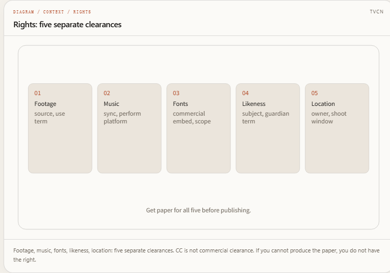

<!-- DIAGRAM_START -->
## Diagram

<figure>
  
  <figcaption>Footage, music, fonts, likeness, location: five separate clearances. CC is not commercial clearance. If you cannot produce the paper, you do not have the right.</figcaption>
</figure>
<!-- DIAGRAM_END -->

## The five-item list

Footage: did you shoot it, or is it stock? Music: platform library, CC, or purchased? Fonts: personal free or commercial license?

Likeness: did the on-camera person sign? Location: does the mall, subway, or restaurant allow filming and publishing? One missing item can get the video pulled.

## CC is not free commercial use

CC BY requires credit; CC BY-SA requires derivatives to share alike; CC BY-NC forbids commercial use; CC BY-ND forbids adaptations. These conditions often combine.

“Findable online” does not mean “licensed for commercial use.” For commercial work, buy a clear license or use only what you shot or made.

## Platform rules and disclosure

Each platform has separate rules for music, ads, AI-generated content, health, and finance. Read the creator policy before publishing, not just other people’s videos.

Label AI generation, digital humans, and synthetic voice as required. Disclosure is not an apology; it tells the audience what they are watching.

## Three checks

- All five permissions have records or clear sources.
- Commercial scope for music and fonts is written down.
- AI generation or synthetic voice is labeled per platform.

<!-- V11_DEEPEN -->

<!-- SOURCES_START -->
## References and further reading

- [S02] [Copyright FAQ](https://www.wipo.int/en/web/copyright/faq-copyright) — Accessed 2026-11-26. Used to check the terminology and public context in the opening paragraph (“Footage, music, fonts, likeness, and location are five separ”) against What copyright protects, economic rights and moral rights; not a substitute for an on-set test.
- [S01] [Media and Information Literacy](https://www.unesco.org/mil4teachers/en/module1) — Accessed 2026-11-26. Used to check the terminology and public context in the opening paragraph (“Footage, music, fonts, likeness, and location are five separ”) against Definitions, teacher modules and critical questions; not a substitute for an on-set test.
- [S03] [National People's Congress: Personal Information Protection Law](http://www.npc.gov.cn/npc/c2/c30834/202108/t20210820_313088.html) — Accessed 2026-11-26. Used to check the terminology and public context in the opening paragraph (“Footage, music, fonts, likeness, and location are five separ”) against The statutory text on personal data, sensitive data, notice and consent; not a substitute for an on-set test.
- [S16] [BBC Editorial Guidelines](https://www.bbc.co.uk/editorialguidelines/) — Accessed 2026-11-26. Used to check the terminology and public context in the opening paragraph (“Footage, music, fonts, likeness, and location are five separ”) against Editorial standards on accuracy, fairness, privacy and secret recording; not a substitute for an on-set test.
- [S10] [Film history and moving-image research](https://www.bfi.org.uk/) — Accessed 2026-11-26. Used to check the terminology and public context in the opening paragraph (“Footage, music, fonts, likeness, and location are five separ”) against Entry point to BFI film history, archives and moving-image research; not a substitute for an on-set test.
<!-- SOURCES_END -->

