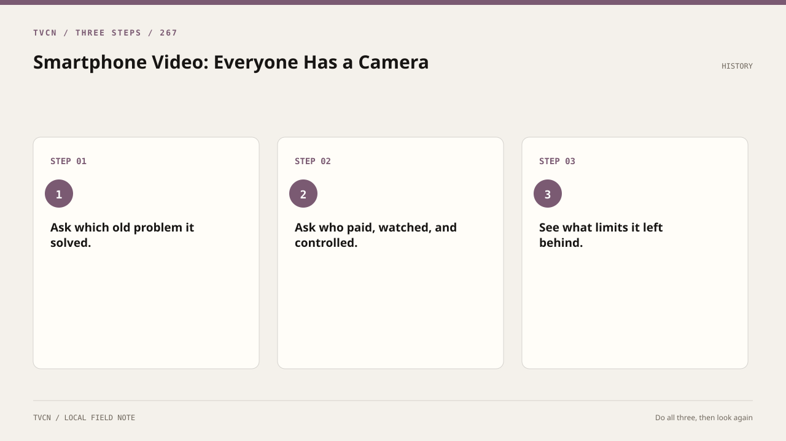

Smartphone video made the camera wearable; shooting moved from event to everyday.

<!-- DIAGRAM_START -->
<h2>Diagram</h2>
<figure>
  
  <figcaption>Do the three steps in order, then look again at the image or file.</figcaption>
</figure>
<!-- DIAGRAM_END -->
<h2>On set</h2>

Phone sensors rely on multi-frame processing. Watch HDR, stabilization, and low light; do not copy large-format lighting.

<h2>Do this</h2>

Smartphone video made the camera a everyday object, turning shooting from event into daily act.
<ol><li>Shoot the same scene on a phone and a large-format camera.</li><li>Watch HDR, stabilization, and night-mode algorithm traces.</li><li>Do not copy large-format lighting; phones cannot hold that contrast.</li></ol>
<h2>Avoid</h2>

Do not light a phone like a cinema camera; high contrast makes the algorithm smear.

<h2>Check</h2>
<ul><li>Phone and large-format footage cover the same scene.</li><li>Specific HDR, stabilization, or night-mode artifacts are named.</li><li>Phone lighting stays within its contrast range instead of copying cinema.</li></ul>

<!-- SOURCES_START -->
## References

- [S10] BFI: Film history and moving-image research

Full links and notes: [`SOURCES.md`](../../SOURCES.md).
<!-- SOURCES_END -->
