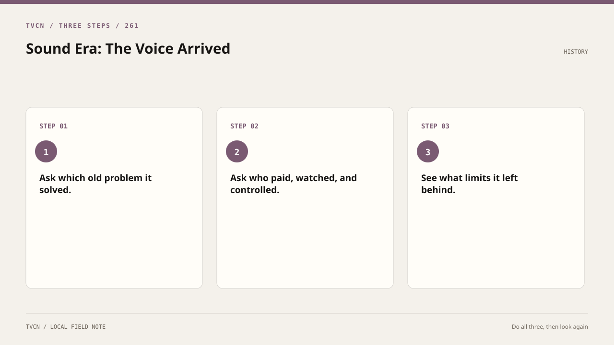

Sound film made dialogue central and tied the stage, recording gear and actor vocal training together. Cameras lost freedom because early microphones picked up machine noise; sound constrained the image before the image tamed sound.

<!-- DIAGRAM_START -->
<h2>Diagram</h2>
<figure>
  
  <figcaption>Watch “Watch The Jazz Singer and count minutes of” and “Count how many title cards remain.”; judge what old problem it replaced and what new limit it added.</figcaption>
</figure>
<!-- DIAGRAM_END -->
<section><h2 id="section-2">How to use it now</h2><ul><li>Read dialogue aloud and break lines by breath and pause; do not trust how it looks on paper.</li><li>On set, solve mic distance, direction and noise floor before thinking about music.</li><li>When studying early sound, note how technical limits shaped camera language, not only “the first time we heard it.”</li></ul><h2 id="section-3">Do not misread</h2>
Do not cover unintelligible dialogue with music. Audiences accept silence; they do not accept guessing lines.
<h2 id="section-4">Sound film did not add sound to silent film; it rewrote how films were shot</h2>

After 1927, synchronized sound made cameras heavy, reduced setups, and made actors speak on blocking. Sound was not a post add-on; it changed staging, sets and performance.

<h3>Common misreading</h3>

“Silent film vanished the moment sound arrived” is inaccurate. The transition took years; many cinemas still showed silents, and some films were part-sound. Another misreading says early sound films were all stagey; some directors broke the stage with movement and framing quickly.

<h3>One use today</h3>

Decide before the shoot whether you need sync sound. If yes, design camera and blocking around sound. If no, do not ask actors to pretend they are speaking.
</section><section><h2 id="section-5">On set</h2>
The Jazz Singer had only a few synchronized lines and songs. Most of it still used title cards; sound was the attraction, not the whole film.
</section><section><h2 id="section-6">Do this</h2>
Sound cinema moved film from watching action to hearing people speak, and forced studios to change how they shot.
<ol><li>Watch The Jazz Singer and count minutes of synchronized dialogue and song.</li><li>Count how many title cards remain.</li><li>Note how microphones constrain camera and blocking.</li></ol></section><section><h2 id="section-7">Avoid</h2>
Do not assume sound films talk throughout; early features still rely mostly on title cards.
</section><section><h2>Timeline</h2>
Three nodes only; each needs one “replaced” and one “added” line.
<ul><li>1927: return to the text and name one old problem it replaced and one new limit it added.</li></ul></section><section>
<strong>Use it today</strong>

Put the history back into a job: archive, restoration, teaching or a short film. Ask what it solved, then what it still cannot do.
<ul><li>Find one contemporary work and mark one old limit it inherited.</li><li>Find one condition it no longer needs and say why.</li><li>Write one thing it still cannot do today.</li></ul></section><section><h2>Source boundary</h2>
This is interpretation, not a primary archive. Check years, people and statutes against the original links in <a href="../../about/">SOURCES.md</a>. A secondhand summary is a lead, not evidence.
</section>
<h2>Check</h2><ul><li>The Jazz Singer has only limited synchronized dialogue and song.</li><li>Remaining title-card passages are counted.</li><li>A specific microphone constraint on camera or blocking is named.</li></ul>

<!-- DEEP_DIVE_START -->
<section class="editorial-depth">
<h2>Deep dive: sound was not an accessory to the image</h2>

<strong>About 5 minutes.</strong> The coming of sound did not simply add an audio track to silent films. It changed the order of production, the scale of performance and the space of exhibition. That is the frame for judging whether a bad-sounding film today is a gear, workflow or story problem.

<h2>Three shifts</h2>

<strong>Production:</strong> synchronous recording put the camera in a blimp, made it heavier and stopped actors from turning and talking at the same time. Dialogue entered the script; rehearsal became about being intelligible, not only about movement.

<strong>Performance:</strong> silent cinema lived on faces and bodies; sound cinema lived on tone, pause and breath. With a fixed microphone, actors had to sound natural inside a smaller physical space.

<strong>Exhibition:</strong> a cinema went from a piano or a band to an amplification system. Studios separated dialogue, music and effects, and mixing became its own craft.

<h2>Two conditions, two methods</h2>

<strong>Silent exhibition:</strong> protect visual storytelling first; intertitles carry only necessary information; live music is planned around what the venue can actually do.

<strong>Sound cinema (after 1927):</strong> protect intelligible dialogue first, then music and ambience. Decide the microphone position before the shoot; do not plan to “clean it up later.”

<h2>Failure table</h2>
<table class="spec-table col-3"><thead><tr><th>Failure</th><th>Why it happens</th><th>Fix first</th></tr></thead><tbody><tr><td>Treating sound as a post patch</td><td>No reference audio was recorded, so post does not know the room</td><td>Record 30 seconds of room tone before rolling; note the mic position</td></tr><tr><td>Clean dialogue, fake space</td><td>Only the voice was fixed; no ambience layer</td><td>Add room tone and action sound, then mix</td></tr><tr><td>Music from start to finish</td><td>Music is hiding location problems</td><td>Find a passage that works without music, then decide the entries</td></tr><tr><td>History written as a sudden technical win</td><td>Venue conversion, copyright and audience habits are ignored</td><td>Write technology, industry and exhibition in three columns</td></tr></tbody></table>
<h2>Ten checks</h2>
<ol><li>You can name the three levels of the transition: production, performance, exhibition.</li><li>You know how synchronous recording constrained camera and actor movement.</li><li>You can cite at least one transitional film from 1927–1930.</li><li>You can separate dialogue, music and ambience.</li><li>You know what a camera blimp does; it is not decoration.</li><li>You can explain why cinema amplification changed formats.</li><li>You can split “bad sound” into gear, workflow and story causes.</li><li>You know what room tone is used for in production and post.</li><li>You do not describe silent film as “having no sound”; it had live music and effects.</li><li>Dates and titles can be checked against public archives.</li></ol>
<h2>Alternative</h2>

If you do not have primary archives, do not make absolute claims such as “the first sound film.” Write a conditions note instead: technology, industry and audience, each with known facts and open questions. A history page explains change; it does not race for a record.

</section>
<!-- DEEP_DIVE_END -->
<!-- SOURCES_START -->
## References and further reading

- [S10] [BFI: Film History and Moving Image Research](https://www.bfi.org.uk/) — Accessed 2026-11-26. Used to check the terminology/method/rule in the “Sound film did not add sound to silent film; it rewrote how films were shot” section against BFI film history and archive, not gear reviews; it does not verify numbers, model choices or on-set conclusions derived from this page, and is not a substitute for a test.
- [S11] [Britannica: Photography](https://www.britannica.com/technology/photography) — Accessed 2026-11-26. Used to check the terminology/method/rule in the “How to use it now” section against Britannica photography entry, not a how-to manual; it does not verify numbers, model choices or on-set conclusions derived from this page, and is not a substitute for a test.
- [S50] [Kodak: Motion Picture](https://www.kodak.com/en/motion/home) — Accessed 2026-11-26. Used to check the terminology/method/rule in the “Do not misread” section against Kodak film and motion-picture material, not digital settings; it does not verify numbers, model choices or on-set conclusions derived from this page, and is not a substitute for a test.
<!-- SOURCES_END -->

