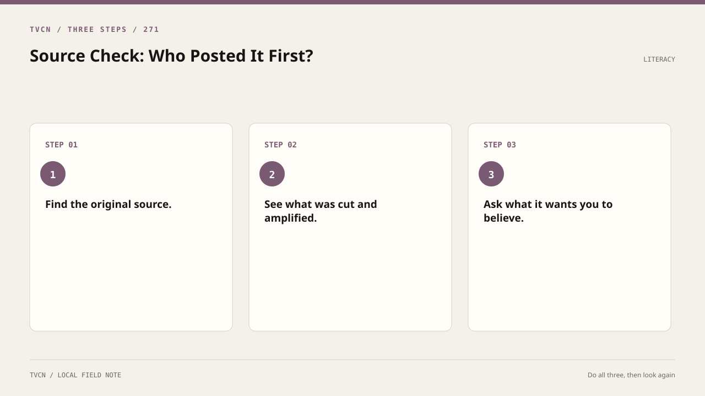

A claim needs at least two independent sources, or one verifiable original document. Reposts, screenshots and reaction videos are not independent; they may all come from the same first post.

<!-- DIAGRAM_START -->
<h2>Diagram</h2>
<figure>
  
  <figcaption>Watch “Find the earliest account, original video or image,” and “Use reverse image or keyframe search to find”; judge what old problem it replaced and what new limit it added.</figcaption>
</figure>
<!-- DIAGRAM_END -->
<section><h2 id="section-1">Find the first post, then a second independent source</h2>
Log who published first, when, and where the original file is. If the first post cannot be found, say “source unconfirmed” in the film.
<h2 id="section-2">Limits</h2>
Two sources are not “two people said the same thing.” If both cite one article, there is still one source.
</section><section><h2 id="section-3">On set</h2>
Find the earliest account and original file before the repost chain. Use reverse image or video search and save the original link.
</section><section><h2 id="section-4">Do this</h2>
Find the first publisher and the original file, then read the repost chain. Ten thousand shares do not make it true.
<ol><li>Find the earliest account, original video or image, and save the link and timestamp.</li><li>Use reverse image or keyframe search to find a second independent source.</li><li>Check time, place, weather, and signage; at least three of four must agree.</li></ol></section><section><h2 id="section-5">Avoid</h2>
Do not treat “many people shared it” as evidence; sharing is only distribution.
</section><aside class="regional-note">
<strong>Regional note for US / UK / EU readers</strong>

This English page keeps mainland-China examples where they are part of the method. Read platform names as examples, not as the only market: Douyin ↔ TikTok/Reels, Bilibili ↔ YouTube, Xiaohongshu ↔ Instagram/Pinterest; RMB figures are not converted here. Film-history examples are kept in their original market context; distribution and rights clearance still follow your local law.
</aside><section><h2>Use it today</h2>
Put the history back into a job: archive, restoration, teaching or a short film. Ask what it solved, then what it still cannot do.
<ul><li>Find one contemporary work and mark one old limit it inherited.</li><li>Find one condition it no longer needs and say why.</li><li>Write one thing it still cannot do today.</li></ul></section><section><h2>Source boundary</h2>
This is interpretation, not a primary archive. Check years, people and statutes against the original links in <a href="../../about/">SOURCES.md</a>. A secondhand summary is a lead, not evidence.
</section>
<h2>Check</h2><ul><li>The earliest account, original file, and timestamp are saved.</li><li>Reverse image or keyframe search found a second independent source.</li><li>At least three of four match: time, place, weather, signage.</li></ul>

<!-- SOURCES_START -->
## References

- [S17] Reuters Trust Principles
- [S16] BBC Editorial Guidelines

Full links and notes: [`SOURCES.md`](../../about/).
<!-- SOURCES_END -->

<!-- DEEP_DIVE_START -->
## Deep dive

<strong>About 8 minutes.</strong> Source checking is not finding a link that supports you. It is finding the earliest original record.

### Find the original

A screenshot, screen recording, or repost is not the original. Find the earliest publisher, the original file, the full version. Check publish time, account history, location; do not judge by whether it looks right.

If the original is deleted, look for archives, mirrors, and another angle of the same event. At least two independent sources pointing to the same time and place before it stands.

### Time and place must match

Check shadow direction, weather, sign language, plates, sockets, shop names. If a video claims Beijing and the street sign is traditional Chinese, stop.

Match the location on a map and street view. If it does not match, do not fill the gap with “maybe.” Source checking is elimination, not rescuing the video.

### Source checking in the AI era

The cleaner the image, the more you check the source. AI skies, skin, and text often look “too smooth.” Zoom into edges, teeth, ears, fingers, background lettering, then check metadata.

Metadata can be forged, so it is a clue, not a conclusion. Return to independent sources, time, and place. Detection gives probability; editorial judgment carries responsibility.

### Five-minute drill: trace one repost

Take one unattributed repost. Find the earliest publisher, the original link, and a second independent source. If none, write “unverified,” not “fake.”

Write the three pieces of evidence in three lines with timestamps. If one line says “it is said,” delete it and check again.

### When a source is verified

Verified means the original file exists, the publish time exists, the location matches, and a second independent source points to the same event. Four pass.

One is a lead, two is possible, three is pending, four is citable. Do not publish a lead as a conclusion.

### Ten source checks
<ul><li>A screenshot is not the original</li><li>Find the earliest publisher</li><li>Find the original file and full version</li><li>Check account history and time</li><li>Shadows, weather, signs match place</li><li>Map and street view match</li><li>At least two independent sources</li><li>Zoom into edges, teeth, ears, fingers</li><li>Metadata is a clue only</li><li>All four pass before citing</li></ul>
Source checking is not finding evidence for a video. It is deciding whether the video is citable at all.

<!-- DEEP_DIVE_END -->
