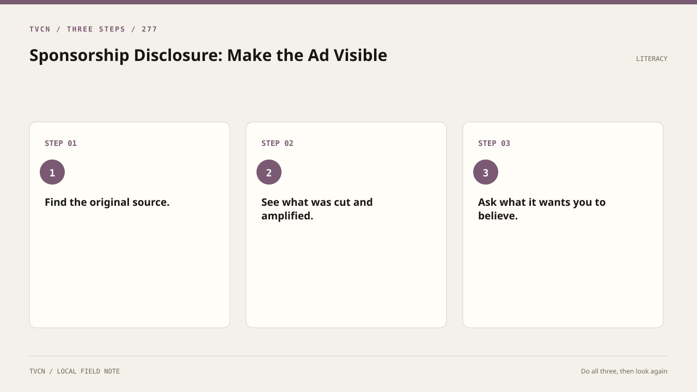

Disclose a commercial relationship before the viewer forms a purchase judgment, not in small print at the end. Say at the top “this film is supported by X,” or keep an “ad” label on screen so they can keep watching with that knowledge.

<!-- DIAGRAM_START -->
<h2>Diagram</h2>
<figure>
  
  <figcaption>Watch “Say “this video is sponsored by X” in” and “Add an on-screen label and repeat it in”; judge what old problem it replaced and what new limit it added.</figcaption>
</figure>
<!-- DIAGRAM_END -->
<section><h2 id="section-1">The audience must know who paid</h2>
Be specific: who paid, what they paid, and whether they have final approval. “Partnership” is not disclosure.
<h2 id="section-2">Limits</h2>
Disclosure does not automatically destroy trust; hiding the relationship and being caught does. Do not stage an ad as an independent review; that is the fastest way to lose the audience.
</section><section><h2 id="section-3">On set</h2>
Put the ad label in the first three seconds or the title, not the last line of the description.
</section><section><h2 id="section-4">Do this</h2><ol><li>Say “this video is sponsored by X” in the first three seconds or the first line of voice-over.</li><li>Add an on-screen label and repeat it in the first line of the description.</li><li>State whether the sponsor reviewed or changed the content; do not hide the interest.</li></ol></section><section><h2 id="section-5">Avoid</h2>
Do not use “thanks for the support” instead of “sponsored”; the audience needs to know who paid.
</section><section><h2>Use it today</h2>
Put the history back into a job: archive, restoration, teaching or a short film. Ask what it solved, then what it still cannot do.
<ul><li>Find one contemporary work and mark one old limit it inherited.</li><li>Find one condition it no longer needs and say why.</li><li>Write one thing it still cannot do today.</li></ul></section><section><h2>Source boundary</h2>
This is interpretation, not a primary archive. Check years, people and statutes against the original links in <a href="../../about/">SOURCES.md</a>. A secondhand summary is a lead, not evidence.
</section>
<h2>Check</h2><ul><li>The first three seconds or first voice-over line discloses the sponsor.</li><li>An on-screen label and the first description line repeat it.</li><li>It states whether the sponsor reviewed or changed the content.</li></ul>

<!-- SOURCES_START -->
## References and further reading

- [S14] [YouTube Community Guidelines](https://support.google.com/youtube/answer/2801973) — Accessed 2026-11-26. Used to check the terminology and public context in the opening paragraph (“Disclose sponsorship before the recommendation, not in the l”) against Current platform rules on misleading content, dangerous acts, copyright and disclosure; not a substitute for an on-set test.
- [S15] [TikTok Community Guidelines](https://www.tiktok.com/community-guidelines/en/) — Accessed 2026-11-26. Used to check the terminology and public context in the opening paragraph (“Disclose sponsorship before the recommendation, not in the l”) against Short-video platform rules on content, AI-generated media and commercial disclosure; not a substitute for an on-set test.
- [S01] [Media and Information Literacy](https://www.unesco.org/mil4teachers/en/module1) — Accessed 2026-11-26. Used to check the terminology and public context in the opening paragraph (“Disclose sponsorship before the recommendation, not in the l”) against Definitions, teacher modules and critical questions; not a substitute for an on-set test.
- [S02] [Copyright FAQ](https://www.wipo.int/en/web/copyright/faq-copyright) — Accessed 2026-11-26. Used to check the terminology and public context in the opening paragraph (“Disclose sponsorship before the recommendation, not in the l”) against What copyright protects, economic rights and moral rights; not a substitute for an on-set test.
- [S03] [National People's Congress: Personal Information Protection Law](http://www.npc.gov.cn/npc/c2/c30834/202108/t20210820_313088.html) — Accessed 2026-11-26. Used to check the terminology and public context in the opening paragraph (“Disclose sponsorship before the recommendation, not in the l”) against The statutory text on personal data, sensitive data, notice and consent; not a substitute for an on-set test.
<!-- SOURCES_END -->

