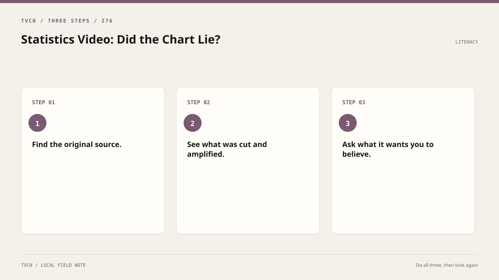

For a data video, put three things on screen first: time range, sample size, source. A zero-based or truncated axis changes how the gap reads; leaving it unstated is misleading.

<!-- DIAGRAM_START -->
<h2>Diagram</h2>
<figure>
  
  <figcaption>Watch “See whether the vertical axis starts at zero;” and “Find the denominator and sample size, and confirm”; judge what old problem it replaced and what new limit it added.</figcaption>
</figure>
<!-- DIAGRAM_END -->
<section><h2 id="section-1">Read the axis and sample before the conclusion</h2>
Animation must not invent a trend. A straight line between two points implies every day in between; draw the gap if there is one.
<h2 id="section-2">Limits</h2>
Charts are not decoration. Do not change color, scale or add 3D for beauty; every visual choice must map to a data relationship.
</section><section><h2 id="section-3">On set</h2>
Check whether the axis starts at zero, the sample size, and who is being compared. Only compare the same group.
</section><section><h2 id="section-4">Do this</h2>
Data videos: check the axis start, the total, and whether the groups are comparable.
<ol><li>See whether the vertical axis starts at zero; truncation exaggerates difference.</li><li>Find the denominator and sample size, and confirm the same definition across groups.</li><li>Redraw the chart yourself; if the numbers do not match, label it unverifiable.</li></ol></section><section><h2 id="section-5">Avoid</h2>
Do not read only the bar heights; look at what the chart leaves out.
</section><section><h2>Use it today</h2>
Put the history back into a job: archive, restoration, teaching or a short film. Ask what it solved, then what it still cannot do.
<ul><li>Find one contemporary work and mark one old limit it inherited.</li><li>Find one condition it no longer needs and say why.</li><li>Write one thing it still cannot do today.</li></ul></section><section><h2>Source boundary</h2>
This is interpretation, not a primary archive. Check years, people and statutes against the original links in <a href="../../about/">SOURCES.md</a>. A secondhand summary is a lead, not evidence.
</section>
<h2>Check</h2><ul><li>The vertical axis start is checked.</li><li>Denominator, sample size, and definitions are confirmed.</li><li>The chart was redrawn; mismatches are labeled unverifiable.</li></ul>

<!-- SOURCES_START -->
## References and further reading

- [S01] [Media and Information Literacy](https://www.unesco.org/mil4teachers/en/module1) — Accessed 2026-11-26. Used to check the terminology and public context in the opening paragraph (“Check where the axis starts, what the total is, and whether ”) against Definitions, teacher modules and critical questions; not a substitute for an on-set test.
- [S02] [Copyright FAQ](https://www.wipo.int/en/web/copyright/faq-copyright) — Accessed 2026-11-26. Used to check the terminology and public context in the opening paragraph (“Check where the axis starts, what the total is, and whether ”) against What copyright protects, economic rights and moral rights; not a substitute for an on-set test.
- [S03] [National People's Congress: Personal Information Protection Law](http://www.npc.gov.cn/npc/c2/c30834/202108/t20210820_313088.html) — Accessed 2026-11-26. Used to check the terminology and public context in the opening paragraph (“Check where the axis starts, what the total is, and whether ”) against The statutory text on personal data, sensitive data, notice and consent; not a substitute for an on-set test.
- [S16] [BBC Editorial Guidelines](https://www.bbc.co.uk/editorialguidelines/) — Accessed 2026-11-26. Used to check the terminology and public context in the opening paragraph (“Check where the axis starts, what the total is, and whether ”) against Editorial standards on accuracy, fairness, privacy and secret recording; not a substitute for an on-set test.
- [S10] [Film history and moving-image research](https://www.bfi.org.uk/) — Accessed 2026-11-26. Used to check the terminology and public context in the opening paragraph (“Check where the axis starts, what the total is, and whether ”) against Entry point to BFI film history, archives and moving-image research; not a substitute for an on-set test.
<!-- SOURCES_END -->

