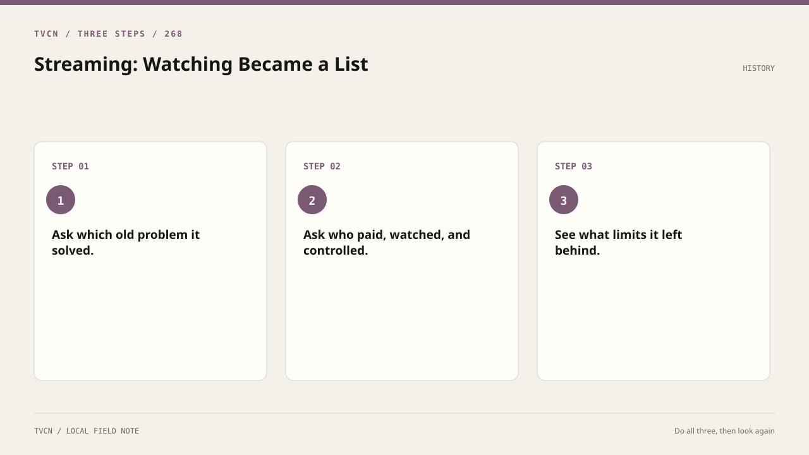

Streaming turned viewing from a schedule into a list, and redesigned length and openings.

<!-- DIAGRAM_START -->
<h2>Diagram</h2>
<figure>
  
  <figcaption>Do the three steps in order, then look again at the image or file.</figcaption>
</figure>
<!-- DIAGRAM_END -->
<h2>On set</h2>

Streaming recommends by list, and the first thirty seconds decide retention. Watch how length and openings changed.

<h2>Do this</h2>

Streaming turned viewing from a channel schedule into a list, redesigning episode length and openings.
<ol><li>Compare runtimes for the same genre on streaming and TV.</li><li>Count what the first thirty seconds deliver.</li><li>See how list recommendation changes a first episode's opening.</li></ol>
<h2>Avoid</h2>

Do not open streaming like a theatrical film; viewers can swipe away at any second.

<h2>Check</h2>
<ul><li>Runtime differences between streaming and TV are named.</li><li>The first thirty seconds carry a hook, not credits.</li><li>One concrete effect of list recommendation on the opening is identified.</li></ul>

<!-- SOURCES_START -->
## References

- [S10] BFI: Film history and moving-image research

Full links and notes: [`SOURCES.md`](../../SOURCES.md).
<!-- SOURCES_END -->
