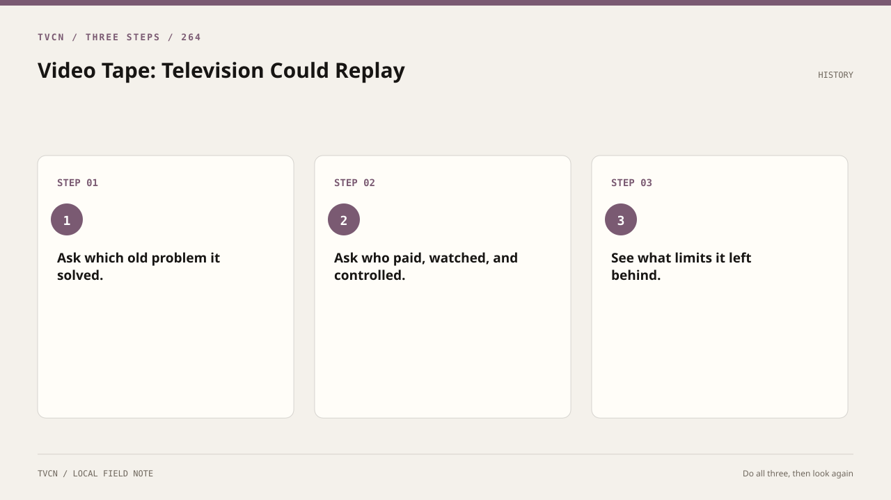

Video tape freed television from live-only and made recording, editing, and replay possible.

<!-- DIAGRAM_START -->
<h2>Diagram</h2>
<figure>
  
  <figcaption>Do the three steps in order, then look again at the image or file.</figcaption>
</figure>
<!-- DIAGRAM_END -->
<h2>On set</h2>

Tape editing was linear and could not jump back. Watch the hard cuts and tape artifacts in old television.

<h2>Do this</h2>

Video tape freed TV from live-only broadcasting; programs could be recorded, cut, and replayed.
<ol><li>Edit linearly, without jumping back.</li><li>Log each hard cut.</li><li>Look for tape artifacts in old programs, such as wobble and color edges.</li></ol>
<h2>Avoid</h2>

Do not read tape with nonlinear assumptions; it cannot jump back, and one change re-records what follows.

<h2>Check</h2>
<ul><li>The edit proceeds linearly with no jump back.</li><li>Every hard cut has a logged position.</li><li>At least one tape artifact is named, such as wobble or color edging.</li></ul>

<!-- SOURCES_START -->
## References

- [S10] BFI: Film history and moving-image research

Full links and notes: [`SOURCES.md`](../../SOURCES.md).
<!-- SOURCES_END -->
