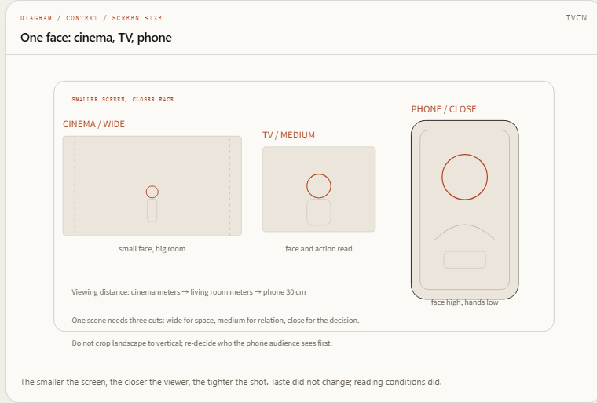

<!-- DIAGRAM_START -->
## Diagram

<figure>
  
  <figcaption>The smaller the screen, the closer the viewer, the tighter the shot. Taste did not change; reading conditions did.</figcaption>
</figure>
<!-- DIAGRAM_END -->

Shot size did not change because directors fell in love with close-ups. The screen and the viewing distance changed together.

## Cinema: the wide shot is the default

The cinema screen is large, the audience sits in the dark, and the eye can scan the whole frame. A wide shot can hold the room, the people, and the background without losing information. A face can be small because the screen is half a wall.

This is not “directors used to be better.” The viewing conditions allowed them to spread information out. The audience had no phone and no pause button; it followed the frame.

## TV: the medium shot becomes living-room language

Television moved into the living room. The screen shrank to 4:3 and the viewing distance became a few meters. A face in a wide shot turned into a dot, so shows moved to medium and close shots. Sitcoms, talk shows, and news all held the viewer with one face and one line.

A smaller screen pulls the framing closer. That is reading conditions, not taste. TV composition also became more centered, because the edges were often blocked by furniture.

## Phone: one face, one action

A vertical phone is a thumb wide, and the viewer is thirty centimeters away. A wide shot reads as a pile of small people and background; the space is gone. The most useful frame is “face high, hands or object low,” one action per shot.

For the same scene, a cinema version can establish the room with a wide. The phone version has to be re-cut from close shots and inserts. Do not crop a landscape frame into vertical; decide again who the audience sees first.

Vertical is not a smaller movie. It has its own shot sizes, pace, and viewing distance. Shooting for the phone beats cropping for it.

## Checks

- You can explain why a wide shot fails on a phone.
- The same scene has cinema, TV, and phone framing plans.
- The phone version holds one face and one action per scene.

<!-- SOURCES_START -->
## References

- [S10] BFI: Film history and moving-image research

Full links and notes: [`SOURCES.md`](../../../SOURCES.md).
<!-- SOURCES_END -->
