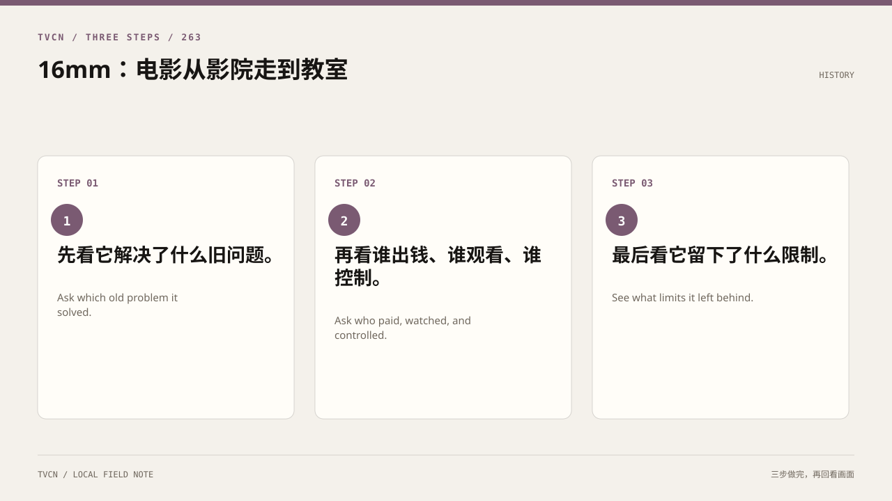

16mm 把摄影机从摄影棚和重型三脚架上解放出来，让纪录片、教育片和独立制作可以用更小的机组、更低的成本到现场。它带来的不是“更清楚”，而是“更多人能拍”。

<!-- DIAGRAM_START -->
<h2>图解</h2>
<figure>
  
  <figcaption>看“用广角镜头拍一段，注意景深和颗粒”和“在教室投影，看边缘和暗部”两处，判断它替代了什么旧办法，又新增了什么限制。</figcaption>
</figure>
<!-- DIAGRAM_END -->
<section><h2 id="section-1">当时改变了什么</h2><h2 id="section-2">今天怎么用</h2><ul><li>需要颗粒、宽容度和老镜头质感时，可以研究 16mm 的曝光与色彩反应，但不要用数字滤镜假装纪录片现场。</li><li>做档案或修复项目时，先确认片基、帧率、片门和扫描规格，不要用一个“胶片 LUT”套所有素材。</li><li>短片里想用颗粒，先决定它服务什么情绪；颗粒不是“电影感”的快捷键。</li></ul><h2 id="section-3">不要误用</h2>
不要把 16mm 的粗颗粒当成低照度许可证；它同样需要准确曝光和镜头支持。
<h2 id="section-4">16mm 不是“廉价 35mm”，是另一套工作方式</h2>

16mm 的胶片面积小，宽容度和细节少，但机器轻、可以手持、可以进真实场景。它带来的不是“低画质”，是更近的身体和更快的拍摄。

<h3>常见误读</h3>

“16mm 只用于业余”不准确。新闻、纪录片、实验电影和部分广告都用过。另一个误读是“颗粒就是 16mm 的全部”——镜头、曝光和冲洗同样决定质感。

<h3>对今天的一个用处</h3>

用数码模仿 16mm，不要只加颗粒。先接受低动态范围：保护高光，允许暗部有噪点；再用轻便机位靠近人物。
</section><section><h2 id="section-5">现场</h2>
16mm 片门小，广角景深大、颗粒明显；看教室放映的颗粒和边缘。
</section><section><h2 id="section-6">怎么做</h2><ol><li>用广角镜头拍一段，注意景深和颗粒。</li><li>在教室投影，看边缘和暗部。</li><li>记录它相对 35mm 轻了多少、便宜了多少。</li></ol></section><section><h2 id="section-7">别踩</h2>
别拿 35mm 的清晰度要求 16mm；它的价值在轻和近。
</section><section><h2>来源边界</h2>
这是解释，不是原始档案；关键年份、人物和法律条文回到 <a href="../../about/">SOURCES.md</a> 的原始链接复核。二手叙述只能当线索，不能当证据。
</section>
<h2>验收</h2><ul><li>画面能看出明显颗粒和较深景深。</li><li>教室投影时边缘和暗部有可描述的退化。</li><li>能说出至少一项相对 35mm 的重量或成本优势。</li></ul>

<!-- SOURCES_START -->
## 参考与延伸阅读

- [S10] BFI：电影史与影像研究入口

完整链接与用途见 [`SOURCES.md`](../../about/)。
<!-- SOURCES_END -->
