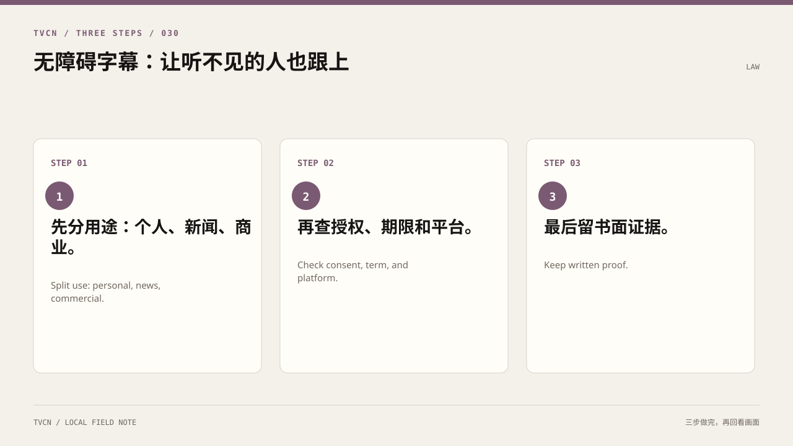

无障碍字幕要高对比、位置避开主体、速度可读。白字加黑边或半透明底，不要用细字体和低对比灰；移动端每行不超过两行，停留时间按每秒 12–15 字估算。

<!-- DIAGRAM_START -->
<h2>图解</h2>
<figure>
  
  <figcaption>看“标说话人，换人时写名字”和“重要音效写成 [门响]、[脚步靠近]”两处，判断它替代了什么旧办法，又新增了什么限制。</figcaption>
</figure>
<!-- DIAGRAM_END -->
<section><h2 id="section-1">字幕先保“能读”，再谈好看</h2>
重要画面信息用文字补充，但不要遮住画面关键动作；位置随构图调整。
<h2 id="section-2">边界</h2>
自动字幕不能直接上线。专有名词、数字、否定句最容易错；至少人工校对一遍，再交付。
</section><section><h2 id="section-3">现场</h2>
字幕标说话人、音效、语气；语速每秒 9 字以内，重要声音写 [门响]，不要只写对白。
</section><section><h2 id="section-4">怎么做</h2><ol><li>标说话人，换人时写名字。</li><li>重要音效写成 [门响]、[脚步靠近]。</li><li>语速控制在每秒 9 字以内，语气用文字标。</li></ol></section><section><h2 id="section-5">别踩</h2>
别只写对白；门响、脚步和语气丢了，听不见的人就断片。
</section><section><h2>今天怎么用</h2>
把这条历史放回一个今天的工作：做档案、修复、教学或短片时，先问它解决了什么，再问它今天还缺什么。
<ul><li>找一条今天的同类作品，标出一个它继承的旧限制。</li><li>找一个它已经不再需要的条件，说明为什么。</li><li>写一句今天仍不能做的事。</li></ul></section><section><h2>来源边界</h2>
这是解释，不是原始档案；关键年份、人物和法律条文回到 <a href="../../about/">SOURCES.md</a> 的原始链接复核。二手叙述只能当线索，不能当证据。
</section>
<h2>验收</h2><ul><li>换人说话时有说话人标签。</li><li>至少三个关键音效用方括号写出。</li><li>语速不超过每秒 9 字，语气有文字标注。</li></ul>

<!-- SOURCES_START -->
## 参考与延伸阅读

- [S06] [W3C：字幕与说明指南](https://www.w3.org/WAI/media/av/captions/) — 2026-11-26 访问。用于核对「字幕先保“能读”，再谈好看」一节的术语/方法/规则（W3C 字幕/说明指南，不是平台审核规则）；不核对其中由本页经验得出的数字、型号与现场结论，也不替代测试。
- [S39] [W3C：WCAG](https://www.w3.org/WAI/standards-guidelines/wcag/) — 2026-11-26 访问。用于核对「现场」一节的术语/方法/规则（WCAG 无障碍标准，不是平台审核清单）；不核对其中由本页经验得出的数字、型号与现场结论，也不替代测试。
<!-- SOURCES_END -->

