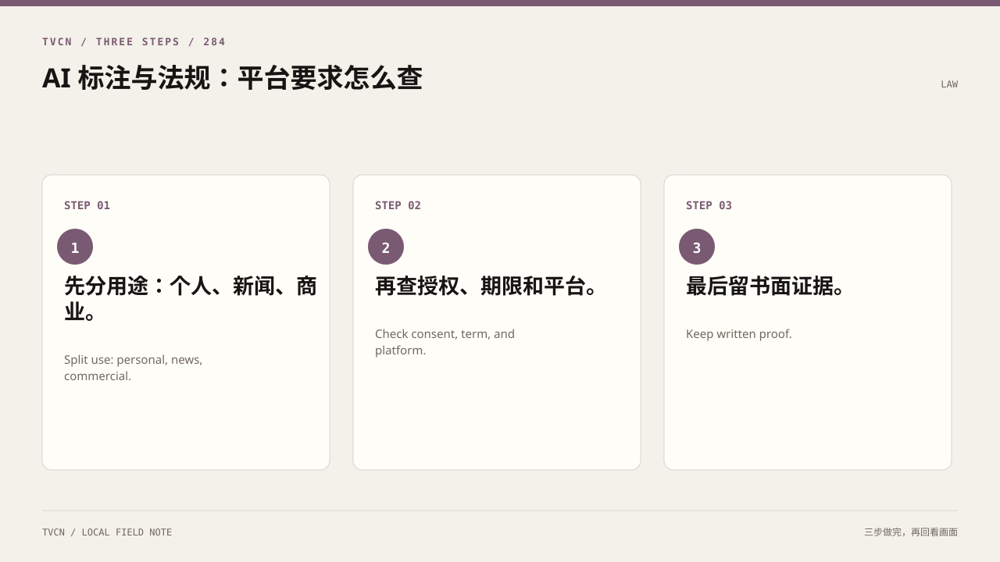

<!-- DIAGRAM_START -->
<h2>图解</h2>
<figure>
  
  <figcaption>示意：生成工具、编辑流程、发布平台，三段分别有标识义务。</figcaption>
</figure>
<!-- DIAGRAM_END -->
<h2>适用边界</h2>
本页讨论中国大陆 AI 生成合成内容标识的一般合规路径，不构成法律意见。核心法规包括《生成式人工智能服务管理暂行办法》《人工智能生成合成内容标识办法》及配套强制性国家标准；具体适用以现行文本为准。新闻、广告、医疗、金融等场景还有额外监管。
<h2>关键条款：显式与隐式</h2>
<strong>显式标识</strong>：用户能感知的文字/图形/声音提示，例如“AI 生成”角标、片头/片尾声明、音频提示。要让普通用户看得见、听得见，不能藏在角落。<strong>隐式标识</strong>：写在文件元数据、数字水印、内容指纹里，供平台/监管识别。工具提供者要在生成环节加入；发布平台要核验并保留。<strong>不得删除/篡改</strong>：编辑时不能故意移除标识；二次合成要重新标注。
<h2>执行流程：从工具到发布</h2>
选工具时确认它是否按标识办法提供显式/隐式标识与元数据。剪辑时保留生成记录、提示词、模型/版本、素材来源。发布前按平台要求勾选“AI 生成”声明；广告/品牌片在片尾加文字声明，并在合同里写明由谁负责标注。发布后保存平台审核截图与元数据，作为合规证据。
<h2>常见争议：四个误区</h2>
<strong>“只是辅助，不算 AI”</strong>：只要生成/合成达到规则定义的程度，就可能要标；不能靠“人工修改过”免责。<strong>“平台会自动标”</strong>：发布者仍有责任，平台标识不能替代你的声明。<strong>“换脸是特效”</strong>：涉及真人肖像/声音时，还要肖像与声音授权。<strong>“删元数据没人知道”</strong>：隐式标识与内容指纹可能仍可识别；故意删除风险更高。
<h2>模板要点：AI 合规包</h2>
工具清单与条款截图；模型/版本/日期；提示词与生成记录；人工修改说明；显式标识位置（画面/音频/片尾）；隐式标识与元数据截图；平台申报截图；肖像/声音/音乐授权；广告审查材料；责任人。交付时把合规包附在项目档案。
<h2>验收</h2><ul><li>显式标识用户可见/可听。</li><li>隐式标识与元数据保留。</li><li>编辑未删除/篡改标识。</li><li>二次合成重新标注。</li><li>平台申报与截图存档。</li><li>肖像/声音/音乐授权齐全。</li></ul>

<!-- SOURCES_START -->
## 参考与延伸阅读

- [S04] [国家互联网信息办公室：《生成式人工智能服务管理暂行办法》](https://www.cac.gov.cn/2023-07/13/c_1690898327029107.htm) — 2026-11-26 访问。用于核对首段“AI 生成内容不是“标注一下”就合规。中国大陆的标识规则区分显式标识与隐式标识，平台、工具提供者、发布者各有义务；广告与”中的术语与公开背景（面向境内公众提供生成式 AI 服务的备案、标识与内容责任）；不替代现场测试。
- [S05] [欧盟委员会：AI Act 政策页](https://digital-strategy.ec.europa.eu/en/policies/regulatory-framework-ai) — 2026-11-26 访问。用于核对首段“AI 生成内容不是“标注一下”就合规。中国大陆的标识规则区分显式标识与隐式标识，平台、工具提供者、发布者各有义务；广告与”中的术语与公开背景（风险分级、透明度义务与合成内容标识的官方入口）；不替代现场测试。
- [S01] [UNESCO](https://www.unesco.org/mil4teachers/en/module1) — 2026-11-26 访问。用于核对首段“AI 生成内容不是“标注一下”就合规。中国大陆的标识规则区分显式标识与隐式标识，平台、工具提供者、发布者各有义务；广告与”中的术语与公开背景（媒介素养的定义、教师模块与批判性问题）；不替代现场测试。
- [S02] [WIPO](https://www.wipo.int/en/web/copyright/faq-copyright) — 2026-11-26 访问。用于核对首段“AI 生成内容不是“标注一下”就合规。中国大陆的标识规则区分显式标识与隐式标识，平台、工具提供者、发布者各有义务；广告与”中的术语与公开背景（版权保护对象、经济权利与精神权利）；不替代现场测试。
- [S03] [全国人民代表大会：《个人信息保护法》](http://www.npc.gov.cn/npc/c2/c30834/202108/t20210820_313088.html) — 2026-11-26 访问。用于核对首段“AI 生成内容不是“标注一下”就合规。中国大陆的标识规则区分显式标识与隐式标识，平台、工具提供者、发布者各有义务；广告与”中的术语与公开背景（处理个人信息、敏感信息与告知同意的法律文本）；不替代现场测试。
<!-- SOURCES_END -->

