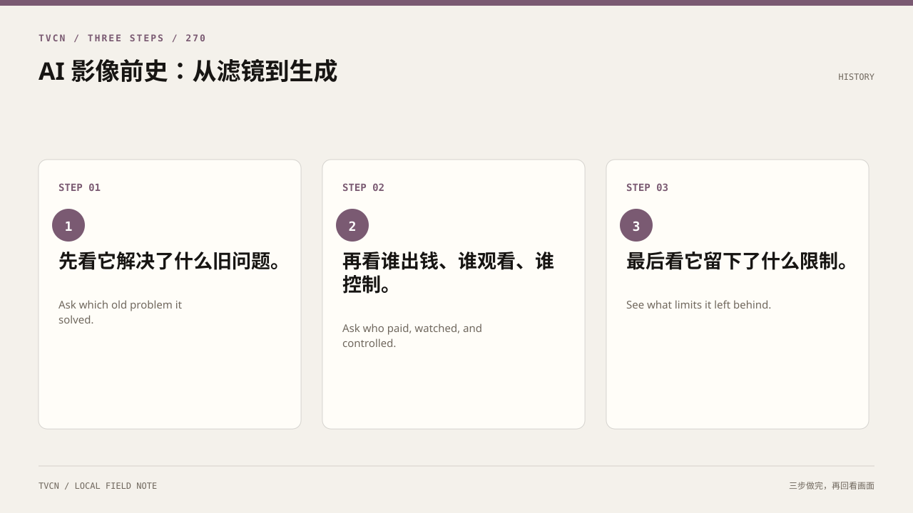

AI 影像不是从生成视频开始；滤镜、修复、抠像、换脸，每一步都在训练“自动修改画面”。

<!-- DIAGRAM_START -->
<h2>图解</h2>
<figure>
  
  <figcaption>把三步按顺序做完，再回看画面或文件。</figcaption>
</figure>
<!-- DIAGRAM_END -->
<h2>现场</h2>

从滤镜、修复、抠像到生成，关键变化是可控性；prompt 不是导演。

<h2>怎么做</h2>

AI 影像不是从生成视频开始；滤镜、修复、抠像、换脸，每一步都在训练“自动修改画面”。
<ol><li>按滤镜、修复、抠像、换脸、生成排时间线。</li><li>每一步标出“人还能控制什么”。</li><li>看 prompt 能控制什么、不能控制什么。</li></ol>
<h2>别踩</h2>

别把 prompt 当导演；它给的是概率，不是调度。

<h2>验收</h2>
<ul><li>时间线从滤镜、修复、抠像、换脸排到生成。</li><li>每一步都标出人类剩余的控制点。</li><li>能说出 prompt 控制不了的一项，比如精确走位或连续性。</li></ul>

<!-- SOURCES_START -->
## 参考与延伸阅读

- [S19] GAN 原始论文（2014）
- [S20] DDPM 原始论文（2020）

完整链接与用途见 [`SOURCES.md`](../../SOURCES.md)。
<!-- SOURCES_END -->
