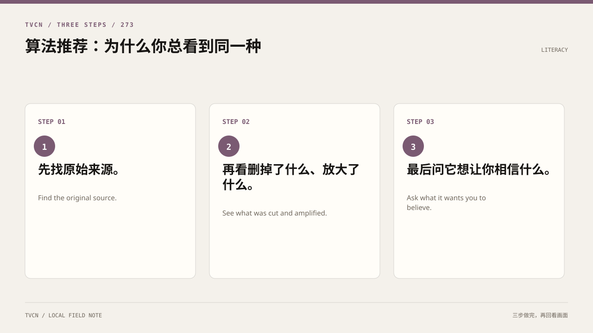

算法推荐按停留和互动放大相似内容；你越停，它越认定你喜欢。

<!-- DIAGRAM_START -->
<h2>图解</h2>
<figure>
  
  <figcaption>把三步按顺序做完，再回看画面或文件。</figcaption>
</figure>
<!-- DIAGRAM_END -->
<h2>现场</h2>

同一话题用两个账号刷 10 分钟，记录推荐差异；停得越久，推荐越重复。

<h2>怎么做</h2>

算法按停留和互动放大相似内容；你越停，它越认定你喜欢。
<ol><li>同一话题用两个账号各刷十分钟，记录前二十条。</li><li>标出重复账号、观点和情绪，比较差异。</li><li>主动搜相反观点、清兴趣标签，观察推荐变化。</li></ol>
<h2>别踩</h2>

别把推荐当世界全貌；它只反映你的停留。

<h2>验收</h2>
<ul><li>两个账号同话题各刷十分钟，记录了前二十条。</li><li>标出重复账号、观点和情绪。</li><li>主动搜相反观点、清标签，观察了推荐变化。</li></ul>

<!-- SOURCES_START -->
## 参考与延伸阅读

- [S01] UNESCO：媒介与信息素养

完整链接与用途见 [`SOURCES.md`](../../SOURCES.md)。
<!-- SOURCES_END -->
