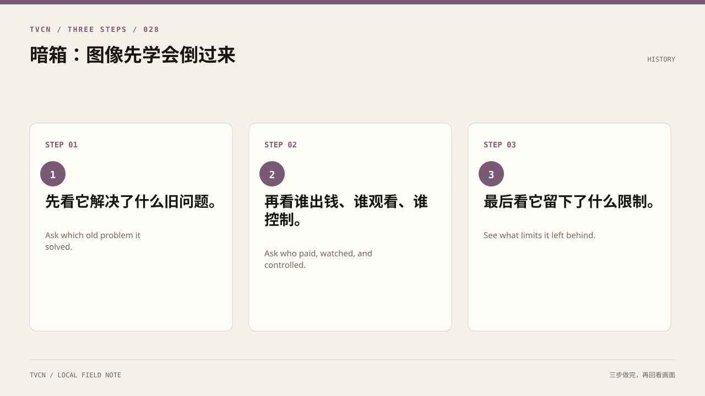

暗箱证明图像可以先被投影、再被描绘或记录。它把“观看”变成一个可以被装置化的过程，为镜头、取景和后来的摄影提供了物理基础。

<!-- DIAGRAM_START -->
<h2>图解</h2>
<figure>
  
  <figcaption>看“用鞋盒做暗箱：针孔 0.5 毫米，屏…”和“看像是否倒置，量清楚倒像的大小”两处，判断它替代了什么旧办法，又新增了什么限制。</figcaption>
</figure>
<!-- DIAGRAM_END -->
<section><h2 id="section-1">当时改变了什么</h2><h2 id="section-2">今天怎么用</h2><ul><li>理解镜头成像时，先用小孔或暗箱观察倒像，再谈焦距和透视。</li><li>做装置或投影时，注意环境光、投影面材质和观看距离。</li><li>研究影像史时，把暗箱与绘画、科学观察和摄影分开看，不要混成一个发明故事。</li></ul><h2 id="section-3">不要误用</h2>
不要把暗箱当成“复古滤镜”。它是成像原理，不是视觉风格。
<h2 id="section-4">暗箱不是“古代相机”，是投影几何</h2>

暗箱的关键不是镜头，是小孔成像：光线穿过小孔，在暗面形成倒像。它证明“影像可以被投射”，但还不能被固定。理解这一点，才能理解后来摄影为什么先解决“定影”，而不是先解决“清晰”。

<h3>常见误读</h3>

把暗箱说成“第一台相机”不准确。它是光学装置，没有感光材料；达盖尔等人的贡献是把影像固定下来。另一个误读是“小孔越小越清晰”——孔太小会衍射，反而变软。

<h3>对今天的一个用处</h3>

拍室内强逆光时，暗箱思维提醒你：画面里的亮部会投射到暗部，遮光比加灯更重要。先挡住不需要的光，再决定哪里需要补。
</section><section><h2 id="section-5">现场</h2>
用鞋盒做暗箱：针孔 0.5 毫米，屏幕距孔 15 厘米，像会倒置；这就是暗箱的基本关系。
</section><section><h2 id="section-6">怎么做</h2><ol><li>用鞋盒做暗箱：针孔 0.5 毫米，屏幕距孔 15 厘米。</li><li>看像是否倒置，量清楚倒像的大小。</li><li>把针孔扩大一倍，再看亮度与清晰度的交换。</li></ol></section><section><h2 id="section-7">别踩</h2>
别把暗箱当成“发明了摄影”；它只成像，不能定影。
</section><section><h2>来源边界</h2>
这是解释，不是原始档案；关键年份、人物和法律条文回到 <a href="../../about/">SOURCES.md</a> 的原始链接复核。二手叙述只能当线索，不能当证据。
</section>
<h2>验收</h2><ul><li>鞋盒暗箱能投出倒像，针孔约 0.5 毫米、屏距约 15 厘米。</li><li>能量出倒像的大小，并说清它与孔距的关系。</li><li>针孔扩大后画面变亮但变糊，这个交换被记录。</li></ul>

<!-- SOURCES_START -->
## 参考与延伸阅读

- [S07] [美国国会图书馆](https://www.loc.gov/pictures/collection/dag/background.html) — 2026-11-26 访问。用于核对首段“暗箱早就知道光会成像，真正的新东西是它把“看见”变成可以复制的证据。”中的术语与公开背景（银版收藏的背景、数量与早期摄影的材料说明）；不替代现场测试。
- [S08] [大都会博物馆](https://www.metmuseum.org/TOAH/hd/dagu/hd_dagu.htm) — 2026-11-26 访问。用于核对首段“暗箱早就知道光会成像，真正的新东西是它把“看见”变成可以复制的证据。”中的术语与公开背景（1839 年公布、银版工艺与早期传播的博物馆年表）；不替代现场测试。
- [S01] [UNESCO](https://www.unesco.org/mil4teachers/en/module1) — 2026-11-26 访问。用于核对首段“暗箱早就知道光会成像，真正的新东西是它把“看见”变成可以复制的证据。”中的术语与公开背景（媒介素养的定义、教师模块与批判性问题）；不替代现场测试。
- [S02] [WIPO](https://www.wipo.int/en/web/copyright/faq-copyright) — 2026-11-26 访问。用于核对首段“暗箱早就知道光会成像，真正的新东西是它把“看见”变成可以复制的证据。”中的术语与公开背景（版权保护对象、经济权利与精神权利）；不替代现场测试。
- [S03] [全国人民代表大会：《个人信息保护法》](http://www.npc.gov.cn/npc/c2/c30834/202108/t20210820_313088.html) — 2026-11-26 访问。用于核对首段“暗箱早就知道光会成像，真正的新东西是它把“看见”变成可以复制的证据。”中的术语与公开背景（处理个人信息、敏感信息与告知同意的法律文本）；不替代现场测试。
<!-- SOURCES_END -->

