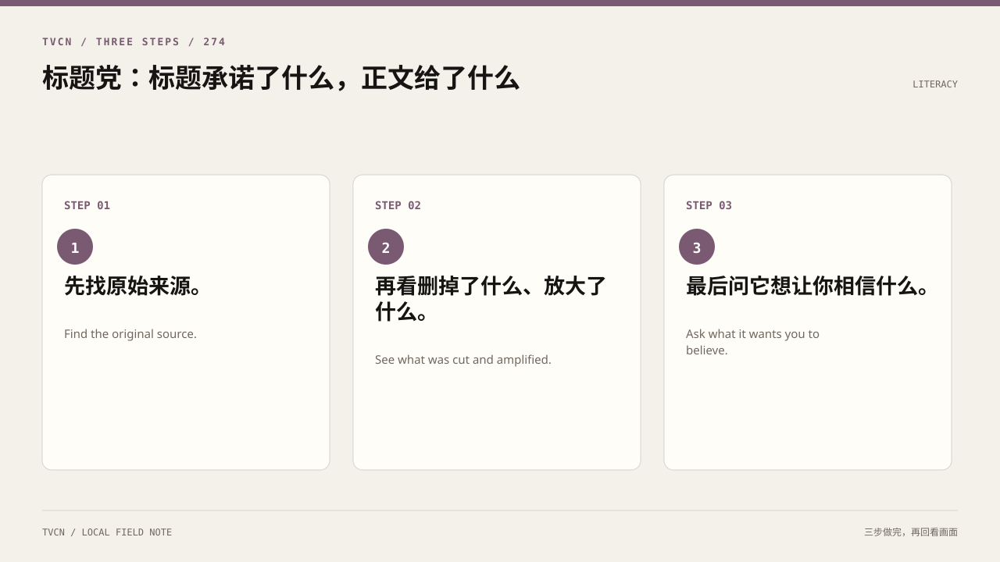

标题党先承诺一个强结果，正文只给一个弱例子；判断方法是把标题和正文各写一句。

<!-- DIAGRAM_START -->
<h2>图解</h2>
<figure>
  
  <figcaption>把三步按顺序做完，再回看画面或文件。</figcaption>
</figure>
<!-- DIAGRAM_END -->
<h2>现场</h2>

把标题和正文各写一句，看是否同一件事；标题承诺 A，正文给 B 就是标题党。

<h2>怎么做</h2>

标题党先承诺一个强结果，正文只给一个弱例子；把标题和正文各写一句。
<ol><li>把标题改写成一句“承诺”，把正文改写成一句“证据”。</li><li>看两句是否同一件事，证据是否支撑承诺。</li><li>标题承诺 A、正文给 B，就判为标题党。</li></ol>
<h2>别踩</h2>

别只骂标题夸张；要说出正文缺了哪条证据。

<h2>验收</h2>
<ul><li>标题写成承诺句，正文写成证据句。</li><li>检查了两者是否同一件事、证据是否支撑。</li><li>能指出标题承诺 A、正文给 B 的地方。</li></ul>

<!-- SOURCES_START -->
## 参考与延伸阅读

- [S01] UNESCO：媒介与信息素养

完整链接与用途见 [`SOURCES.md`](../../SOURCES.md)。
<!-- SOURCES_END -->
