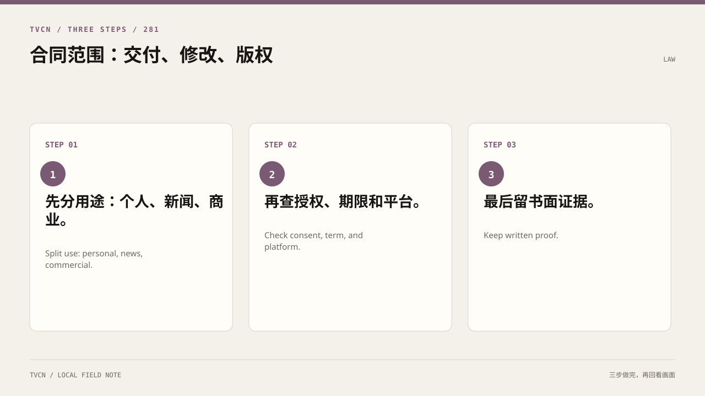

<!-- DIAGRAM_START -->
<h2>图解</h2>
<figure>
  
  <figcaption>示意：八项写进合同，才有讨论“加钱”的基础。</figcaption>
</figure>
<!-- DIAGRAM_END -->
<h2>适用边界</h2>
本页讨论中国大陆商业影视制作合同的一般条款，不构成法律意见。真实项目请让执业律师按客户、平台、题材审阅；涉及未成年人、肖像、场地、音乐时，还要叠加对应授权。
<h2>关键条款：八个必须写清</h2>
<strong>1. 交付物</strong>：成片数量、时长、比例、字幕、封面、竖版/横版、源文件是否交付。不要写“一条片子”。<strong>2. 修改轮次</strong>：几轮、每轮范围、超出怎么计费、客户多久反馈。<strong>3. 验收</strong>：以什么为准（脚本/分镜/审片表），几日内视为通过。<strong>4. 版权</strong>：素材、音乐、字体、AI 生成内容的授权范围；客户能不能二次剪辑/投流。<strong>5. 付款</strong>：预付、开机、初稿、终稿的比例与逾期利息。<strong>6. 终止</strong>：客户取消、不可抗力、延期怎么结算。<strong>7. 违约</strong>：逾期、未付款、超范围使用的责任。<strong>8. 保密与署名</strong>：NDA、作品集使用权、署名方式。
<h2>执行流程：从报价到变更单</h2>
先写一页 Scope of Work，再报价；报价单每一项都对应交付物。开机前开 Kickoff，确认审片人只有一位。每次修改用同一张修改表，标注“范围内/范围外”。范围外先出 Change Order，写明加多少钱、延几天，客户书面确认后再做。终稿前做一次交付清单核对，不要让“再补一个竖版”变成默认赠送。
<h2>常见争议：三类最容易翻车</h2>
<strong>“感觉不对”</strong>：没有审片表，客户用主观感受反复推翻。解决：把脚本、参考片、分镜、样片作为阶段验收物。<strong>“就改一下”</strong>：改结构等于重拍/重剪。解决：合同写明结构性修改按新版本计费。<strong>“先上线再付款”</strong>：平台排期倒逼制作方垫资。解决：终稿前付清或交付带水印低码，验收后换正式文件。
<h2>模板要点：一页 Scope of Work</h2>
项目名称 / 客户 / 制作方 / 版本日期；目标与受众；交付物表（数量、时长、比例、语言、字幕、封面、源文件）；制作阶段与审片节点；修改轮次与超范围单价；素材与音乐授权；付款节点；终止与不可抗力；双方签字。附件：参考片、分镜、审片表、素材清单。
<h2>验收</h2><ul><li>交付物有数量、时长、比例、语言。</li><li>修改轮次与超范围单价写明。</li><li>验收标准与审片人唯一。</li><li>素材/音乐/字体/AI 授权写明。</li><li>付款节点覆盖成本。</li><li>终止与不可抗力可执行。</li></ul>

<!-- SOURCES_START -->
## 参考与延伸阅读

- [S02] [WIPO](https://www.wipo.int/en/web/copyright/faq-copyright) — 2026-11-26 访问。用于核对首段“影视合同最常见的争议不是付款，是范围。交付物、修改轮次、素材版权、验收标准、终止条件没写清，最后都会变成免费加班。”中的术语与公开背景（版权保护对象、经济权利与精神权利）；不替代现场测试。
- [S22] [全国人民代表大会：《民法典》](http://www.npc.gov.cn/npc/c2/c30834/202006/t20200602_306457.html) — 2026-11-26 访问。用于核对首段“影视合同最常见的争议不是付款，是范围。交付物、修改轮次、素材版权、验收标准、终止条件没写清，最后都会变成免费加班。”中的术语与公开背景（肖像、隐私、合同与场地权利的上位法文本）；不替代现场测试。
- [S01] [UNESCO](https://www.unesco.org/mil4teachers/en/module1) — 2026-11-26 访问。用于核对首段“影视合同最常见的争议不是付款，是范围。交付物、修改轮次、素材版权、验收标准、终止条件没写清，最后都会变成免费加班。”中的术语与公开背景（媒介素养的定义、教师模块与批判性问题）；不替代现场测试。
- [S03] [全国人民代表大会：《个人信息保护法》](http://www.npc.gov.cn/npc/c2/c30834/202108/t20210820_313088.html) — 2026-11-26 访问。用于核对首段“影视合同最常见的争议不是付款，是范围。交付物、修改轮次、素材版权、验收标准、终止条件没写清，最后都会变成免费加班。”中的术语与公开背景（处理个人信息、敏感信息与告知同意的法律文本）；不替代现场测试。
- [S16] [BBC 编辑准则](https://www.bbc.co.uk/editorialguidelines/) — 2026-11-26 访问。用于核对首段“影视合同最常见的争议不是付款，是范围。交付物、修改轮次、素材版权、验收标准、终止条件没写清，最后都会变成免费加班。”中的术语与公开背景（准确性、公正、隐私与隐蔽拍摄的编辑标准）；不替代现场测试。
<!-- SOURCES_END -->

