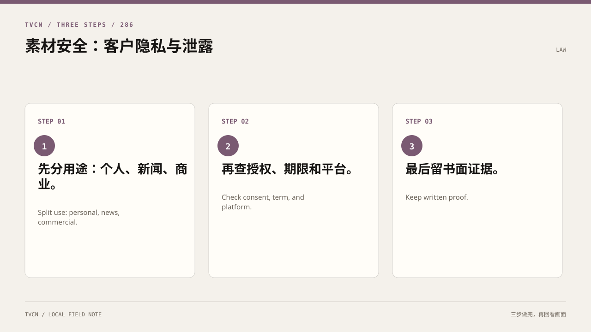

把素材分三级：可公开、仅客户、含个人信息。含个人信息的素材单独加密盘、单独权限、单独归档；不要和宣传素材混在一个共享文件夹。

<!-- DIAGRAM_START -->
<h2>图解</h2>
<figure>
  
  <figcaption>看“移动硬盘加密，云盘按项目设权限”和“聊天记录不转发原片，只发受控链接”两处，判断它替代了什么旧办法，又新增了什么限制。</figcaption>
</figure>
<!-- DIAGRAM_END -->
<section><h2 id="section-1">项目数据先分级，再谈加密</h2>
交付用加密链接或硬盘，设置有效期；项目结束撤销共享权限，保留一份归档清单。
<h2 id="section-2">边界</h2>
加密不是万能。弱密码、重复密码、把密钥和文件放一起，等于没加密；权限和流程比算法更重要。
</section><section><h2 id="section-3">现场</h2>
硬盘加密、云盘权限、聊天记录、转发权限；客户隐私包括废片和备份。
</section><section><h2 id="section-4">怎么做</h2><ol><li>移动硬盘加密，云盘按项目设权限。</li><li>聊天记录不转发原片，只发受控链接。</li><li>废片和备份同样按客户隐私管理。</li></ol></section><section><h2 id="section-5">别踩</h2>
别把废片当没用的东西；废片里一样有客户隐私。
</section><section><h2>今天怎么用</h2>
把这条历史放回一个今天的工作：做档案、修复、教学或短片时，先问它解决了什么，再问它今天还缺什么。
<ul><li>找一条今天的同类作品，标出一个它继承的旧限制。</li><li>找一个它已经不再需要的条件，说明为什么。</li><li>写一句今天仍不能做的事。</li></ul></section><section><h2>来源边界</h2>
这是解释，不是原始档案；关键年份、人物和法律条文回到 <a href="../../about/">SOURCES.md</a> 的原始链接复核。二手叙述只能当线索，不能当证据。
</section>
<h2>验收</h2><ul><li>移动硬盘加密，云盘按项目分级授权。</li><li>聊天里没有直接转发原片，只用受控链接。</li><li>废片和备份与正片执行同一套隐私规则。</li></ul>

<!-- SOURCES_START -->
## 参考与延伸阅读

- [S02] [WIPO：版权常见问题](https://www.wipo.int/en/web/copyright/faq-copyright) — 2026-11-26 访问。用于核对「项目数据先分级，再谈加密」一节的术语/方法/规则（WIPO 版权常见问题，不是中国法条）；不核对其中由本页经验得出的数字、型号与现场结论，也不替代测试。
- [S03] [全国人大：《个人信息保护法》](http://www.npc.gov.cn/npc/c2/c30834/202108/t20210820_313088.html) — 2026-11-26 访问。用于核对「现场」一节的术语/方法/规则（《个人信息保护法》条文，不是内容版权）；不核对其中由本页经验得出的数字、型号与现场结论，也不替代测试。
- [S22] [全国人大：《民法典》](http://www.npc.gov.cn/npc/c2/c30834/202006/t20200602_306457.html) — 2026-11-26 访问。用于核对「怎么做」一节的术语/方法/规则（《民法典》条文，不是行业惯例）；不核对其中由本页经验得出的数字、型号与现场结论，也不替代测试。
<!-- SOURCES_END -->

