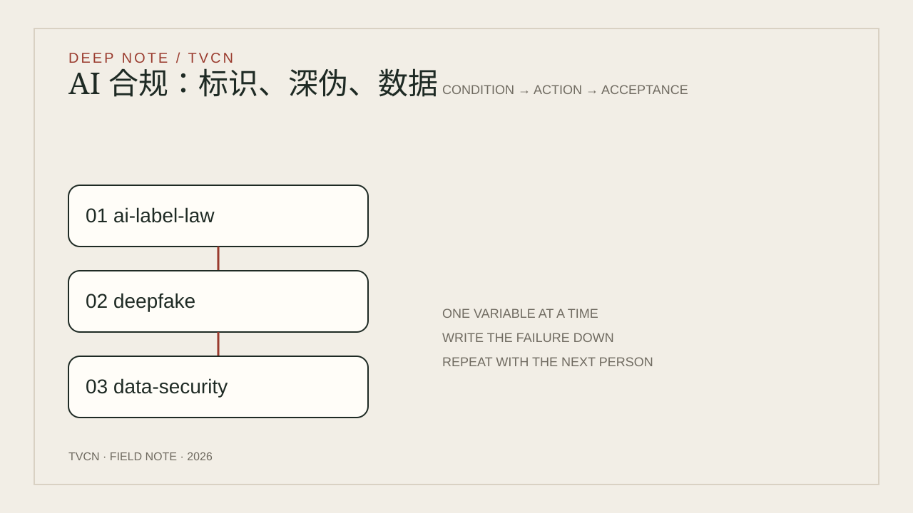

AI 合规不是加一行免责声明；标识、深伪和数据来源要一起过。 单看《AI 内容标识：显式、隐式与平台责任》只能解决一个局部；把《AI 内容标识：显式、隐式与平台责任》《深伪识别：看脸之外看什么》《素材安全：客户隐私与泄露》接成一条链，才会暴露“条件没写、变量太多、结果无法复现”的真问题。

<!-- DEEP_DIVE_START -->
<!-- DIAGRAM_START -->
<h2>图解</h2>
<figure>
  
  <figcaption>看“AI 内容标识：显式、隐式与平台责任”和“深伪识别：看脸之外看什么”两处，先定条件，再看失败能不能被记录下来。</figcaption>
</figure>
<!-- DIAGRAM_END -->

<section><h2 id="section-1">问题</h2>
这一页的问题不是“方法不够多”，而是三个环节各自成立、合起来却不成立：条件没写、变量太多、结果不能复现。

本页按“先定条件—再做判断—只改一个变量—留下证据”的顺序；每一步都能被下一个人复述，才算完成。
</section>
<section><h2 id="section-2">判断</h2><ul><li>《AI 内容标识：显式、隐式与平台责任》的第一道门槛：显式标识用户可见/可听</li><li>《深伪识别：看脸之外看什么》的第二道门槛：隐式标识与元数据保留</li><li>《素材安全：客户隐私与泄露》的第三道门槛：编辑未删除/篡改标识</li></ul>
三条里有一条不成立，就先回到对应单页；不要用整条链掩盖一个没解决的单点。
</section>
<section><h2 id="section-3">做法</h2><ol><li>先写条件：把《AI 内容标识：显式、隐式与平台责任》里“逐帧看五秒：牙齿是否一排、耳朵是否对称、眨眼是否自然”落到一张三行表：素材、环境、验收。</li><li>再做一次最小动作：只按《AI 内容标识：显式、隐式与平台责任》的步骤做 30 秒，不加入第二页的方法。</li><li>把《深伪识别：看脸之外看什么》的步骤接上：看背景文字、招牌和眼镜反光是否连贯。</li><li>用《素材安全：客户隐私与泄露》做对照：找原始来源、本人回应或第二角度；三项对不上再判高风险。</li><li>每改一次只动一个变量；其他条件写进记录，不靠记忆。</li><li>把失败也拍下来：失败版本和成功版本并排，才知道哪一步不能省。</li><li>让下一个人按记录复现一次；他做不出来，说明记录还不够。</li></ol></section>
<section><h2 id="section-4">现场案例</h2>
可复现实验（不是客户案例）：拿 30 秒素材，先按《AI 内容标识：显式、隐式与平台责任》的“显式标识用户可见/可听”做 A 版；再按《深伪识别：看脸之外看什么》的“隐式标识与元数据保留”做 B 版；两版只允许一个变量不同。把两版并排看，记录《素材安全：客户隐私与泄露》里最先崩的是哪一项：条件、动作还是验收。如果一次就成功，说明变量还不够多，再加一个现实限制重做。
</section>
<section><h2 id="section-5">失败表</h2>
<table class="data-table"><thead><tr><th>现象</th><th>原因</th><th>替换动作</th></tr></thead><tbody><tr><td>别用“看着假”当结论；说出哪几处对不上</td><td>条件没写清</td><td>回到第一页重写三行表</td></tr><tr><td>别把废片当没用的东西；废片里一样有客户隐私</td><td>条件没写清</td><td>回到第一页重写三行表</td></tr><tr><td>只看结果，不记条件</td><td>条件没写清</td><td>回到第一页重写三行表</td></tr></tbody></table>
</section>
<section><h2 id="section-6">验收</h2><ul><li>显式标识用户可见/可听。</li><li>隐式标识与元数据保留。</li><li>编辑未删除/篡改标识。</li><li>二次合成重新标注。</li><li>平台申报与截图存档。</li><li>肖像/声音/音乐授权齐全。</li><li>五秒逐帧看过牙齿、耳朵和眨眼。</li><li>背景文字、招牌和眼镜反光的连续性看过。</li><li>原始来源、本人回应或第二角度三项对不上。</li><li>移动硬盘加密，云盘按项目分级授权。</li></ul></section>
<section><h2 id="section-7">替代方案</h2><ul><li>只处理《AI 内容标识：显式、隐式与平台责任》里的单点问题：回到<a href="https://context.tvcn.org/article/ai-label-law/">《AI 内容标识：显式、隐式与平台责任》</a>，不要用整条链。</li><li>只比较两个动作：看<a href="https://context.tvcn.org/article/deepfake/">《深伪识别：看脸之外看什么》</a>，先不改第三页。</li><li>只做验收：看<a href="https://context.tvcn.org/article/data-security/">《素材安全：客户隐私与泄露》</a>，把判断表拿去做自测。</li></ul></section>
