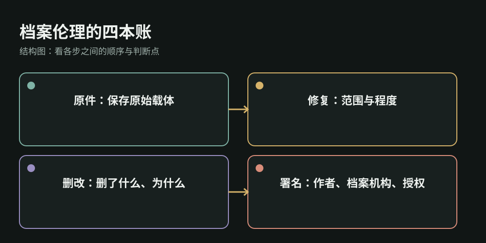

一段老影像被修复、调色、加字幕、配上音乐，放进新片，观众会以为看到的是“当时的画面”。但修复本身已经是一次编辑：去掉了划痕，也去掉了时间；改了速度，也改了动作。档案伦理不是不修，是让观众知道你修了什么。

<!-- DIAGRAM_START -->
<h2 id="diagram">图解</h2>
<figure class="diagram">
  
  <figcaption>看“原件、修复、删改、署名”四本账是否都在；只给修复后的画面，观众会把编辑当成历史。</figcaption>
</figure>
<!-- DIAGRAM_END -->

<section><h2 id="section-1">现场</h2>
一段 16mm 家庭影像，1968 年拍的，画面有划痕、颜色偏红、声音缺失。新片想用它讲“一个家庭的迁移”。家属同意使用，但要求删掉一段争吵。制作方修复了画面、加了音乐、用字幕补了旁白，但没有标“修复/删改”。观众以为看到的是完整原片。
</section>
<section><h2 id="section-2">判断</h2><ul><li><strong>原件是否保存：</strong>修复前有没有保留未处理的扫描/原始文件；没有原件，修复就无法被检验。</li><li><strong>修复范围是否写明：</strong>只去划痕，还是改了速度、颜色、构图、声音；范围越大，越要说明。</li><li><strong>删改是否标注：</strong>删掉一段争吵，是伦理决定，也是历史编辑；不标就是让观众误读。</li><li><strong>署名是否完整：</strong>拍摄者、档案机构、修复者、授权方；缺一个，来源链就断。</li></ul></section>
<section><h2 id="section-3">怎么做</h2><ol><li>先存原件：扫描/转录一份未处理文件，单独存放，写清来源、日期、格式、哈希；修复从副本做。</li><li>写修复日志：每一步做了什么，用了什么工具，改了多少；保留 before/after 对比帧。</li><li>删改要三方确认：家属/版权方、导演、档案机构；写清删了什么、为什么、谁批准。</li><li>片中标明：修复、删改、重建、配音/字幕，用一行说明，不藏在片尾小字。</li><li>署名完整：拍摄者、档案机构、修复者、授权编号；如果匿名，写明匿名原因。</li></ol></section>
<section><h2 id="section-4">失败</h2><ul><li><strong>把修复当原貌：</strong>去划痕、改颜色、补帧，却不说明；观众以为历史本来就这样。</li><li><strong>无声删改：</strong>删掉一段争吵，不标；家庭史被改成“和睦版”，观众不知道。</li><li><strong>不标来源：</strong>用了档案影像，只写“资料画面”；作者、机构、授权全缺。</li></ul></section>
<section><h2 id="section-5">边界</h2>
这篇是编辑伦理框架，不替代版权、隐私和档案机构的许可条款。家庭档案的授权要区分“使用”与“修改”；同意使用不等于同意删改。新闻档案的公共性更强，但也不等于可以随意编辑；涉及未成年人、受害者、隐私时，优先保护人，再谈历史完整。
</section>
<section><h2 id="section-6">验收</h2><ul><li>原件、修复副本、修复日志三样都在。</li><li>片中对修复/删改有一行明确标注。</li><li>署名包含拍摄者、档案机构、修复者、授权编号。</li><li>删改有至少两方书面确认，能追溯到日期。</li></ul></section>
<!-- DEEP_DIVE_START -->
## 深读

<strong>约 8 分钟。</strong> 下面把同一套判断放进两个不同条件，再看一个反例和一个可复用模型；不是重复前文，而是决定什么时候该换做法。

### 条件 A：家庭/私人档案

家庭档案的第一权利人是被拍的人，不是导演。使用前要问三件事：谁在画面里、谁有权同意、同意到什么程度。家属说“可以用”，要追问“能不能删、能不能改速度、能不能配音乐”；三个问题分开问，不要打包成一句“授权”。

家庭档案的删改要特别小心：删掉一段争吵，可能保护了某个人，也可能抹掉了另一个人的经历。做法不是不删，而是把删改写进片尾/片头说明，并保留删改前的版本在档案里。观众有权知道这是“选择过的记忆”。

### 条件 B：新闻/公共档案

新闻档案的伦理重心是“公共知情”与“个人伤害”的平衡。公共人物在公共场合的影像，使用范围更宽；但未成年人、受害者、病人、私人住宅，必须打码或不用。不要用“历史完整”当借口，把不该公开的脸放出去。

新闻档案的修复要更保守：不要补帧、不要改速度、不要加生成式放大；这些操作会改变证据。可以去尘、去划痕，但要在说明里写“仅做清洁，未改变时间/顺序/声音”。修复者不是作者，不能替历史做决定。

### 反例：修复过度，变成新片

一段 1960 年代街景，修复时用了 AI 补帧、上色、超分，划痕没了，颜色鲜艳，人脸清晰。观众说“那时候真好看”。但原片是 18 帧/秒、黑白、颗粒明显；修复后的画面已经不再是那个年代的颜色和运动。

修法不是完全不修，而是分两版：一版“清洁修复”，只去尘、去划痕、稳定，保留原始帧率和黑白；一版“解释性修复”，可以上色/补帧，但必须标“重建，不是原貌”。两版都放，观众自己选。

### 可复用模型

<strong>原件 → 修复 → 删改 → 署名。</strong> 原件是证据，修复是编辑，删改是选择，署名是责任。四本账都留着，档案使用才不是“拿来就用”。

每次使用档案，写一张 A4 说明：来源、授权、修复范围、删改内容、署名、联系人。说明跟着片子走，不跟着项目走；三年后有人质疑，你能拿出这张纸。

<!-- DEEP_DIVE_END -->
<!-- SOURCES_START -->
## 参考与延伸阅读

- [S43] [BFI：BFI 国家电影档案](https://www.bfi.org.uk/bfi-national-archive) — 2026-11-26 访问。用于核对“判断”一节的术语、方法或规则；不核对本页由经验得出的数字、型号与现场结论，也不替代测试或合同。
- [S44] [奥斯卡电影档案馆：电影档案与修复](https://www.oscars.org/film-archive) — 2026-11-26 访问。用于核对“边界”一节的术语、方法或规则；不核对本页由经验得出的数字、型号与现场结论，也不替代测试或合同。
<!-- SOURCES_END -->
