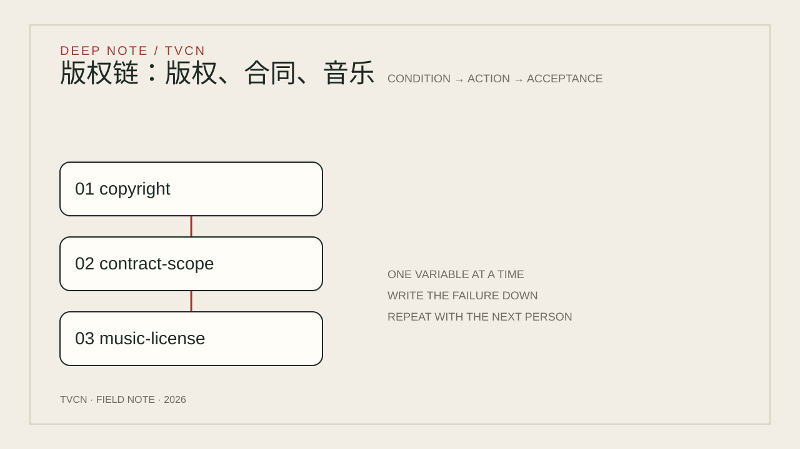

版权不是一句“已授权”；版权、合同和音乐许可要能对上使用场景、期限和地域。 单看《copyright》只能解决一个局部；把《copyright》《合同范围：把“再改一版”写进价格之前》《音乐授权：同步权、表演权与平台曲库》接成一条链，才会暴露“条件没写、变量太多、结果无法复现”的真问题。

<!-- DEEP_DIVE_START -->
<!-- DIAGRAM_START -->
<h2>图解</h2>
<figure>
  
  <figcaption>看“copyright”和“合同范围：把“再改一版”写进价格之前”两处，先定条件，再看失败能不能被记录下来。</figcaption>
</figure>
<!-- DIAGRAM_END -->

<section><h2 id="section-1">问题</h2>
这一页的问题不是“方法不够多”，而是三个环节各自成立、合起来却不成立：条件没写、变量太多、结果不能复现。

本页按“先定条件—再做判断—只改一个变量—留下证据”的顺序；每一步都能被下一个人复述，才算完成。
</section>
<section><h2 id="section-2">判断</h2><ul><li>《copyright》的第一道门槛：交付物有数量、时长、比例、语言</li><li>《合同范围：把“再改一版”写进价格之前》的第二道门槛：修改轮次与超范围单价写明</li><li>《音乐授权：同步权、表演权与平台曲库》的第三道门槛：验收标准与审片人唯一</li></ul>
三条里有一条不成立，就先回到对应单页；不要用整条链掩盖一个没解决的单点。
</section>
<section><h2 id="section-3">做法</h2><ol><li>先写条件：把《copyright》里“能做/不能做”落到一张三行表：素材、环境、验收。</li><li>再做一次最小动作：只按《copyright》的步骤做 30 秒，不加入第二页的方法。</li><li>把《合同范围：把“再改一版”写进价格之前》的步骤接上：只改一个变量，保持其他条件不变。</li><li>用《音乐授权：同步权、表演权与平台曲库》做对照：再拍一条同条件版本，比较差异。</li><li>每改一次只动一个变量；其他条件写进记录，不靠记忆。</li><li>把失败也拍下来：失败版本和成功版本并排，才知道哪一步不能省。</li><li>让下一个人按记录复现一次；他做不出来，说明记录还不够。</li></ol></section>
<section><h2 id="section-4">现场案例</h2>
可复现实验（不是客户案例）：拿 30 秒素材，先按《copyright》的“交付物有数量、时长、比例、语言”做 A 版；再按《合同范围：把“再改一版”写进价格之前》的“修改轮次与超范围单价写明”做 B 版；两版只允许一个变量不同。把两版并排看，记录《音乐授权：同步权、表演权与平台曲库》里最先崩的是哪一项：条件、动作还是验收。如果一次就成功，说明变量还不够多，再加一个现实限制重做。
</section>
<section><h2 id="section-5">失败表</h2>
<table class="data-table"><thead><tr><th>现象</th><th>原因</th><th>替换动作</th></tr></thead><tbody><tr><td>只看结果，不记条件</td><td>条件没写清</td><td>回到第一页重写三行表</td></tr><tr><td>只看结果，不记条件</td><td>条件没写清</td><td>回到第一页重写三行表</td></tr><tr><td>只看结果，不记条件</td><td>条件没写清</td><td>回到第一页重写三行表</td></tr></tbody></table>
</section>
<section><h2 id="section-6">验收</h2><ul><li>交付物有数量、时长、比例、语言。</li><li>修改轮次与超范围单价写明。</li><li>验收标准与审片人唯一。</li><li>素材/音乐/字体/AI 授权写明。</li><li>付款节点覆盖成本。</li><li>终止与不可抗力可执行。</li><li>用途、媒介、地区、期限写清。</li><li>词曲与录音分别授权。</li><li>平台曲库范围已确认。</li><li>改编/投流/海外单独确认。</li></ul></section>
<section><h2 id="section-7">替代方案</h2><ul><li>只处理《copyright》里的单点问题：回到<a href="https://context.tvcn.org/article/copyright/">《copyright》</a>，不要用整条链。</li><li>只比较两个动作：看<a href="https://context.tvcn.org/article/contract-scope/">《合同范围：把“再改一版”写进价格之前》</a>，先不改第三页。</li><li>只做验收：看<a href="https://context.tvcn.org/article/music-license/">《音乐授权：同步权、表演权与平台曲库》</a>，把判断表拿去做自测。</li></ul></section>
