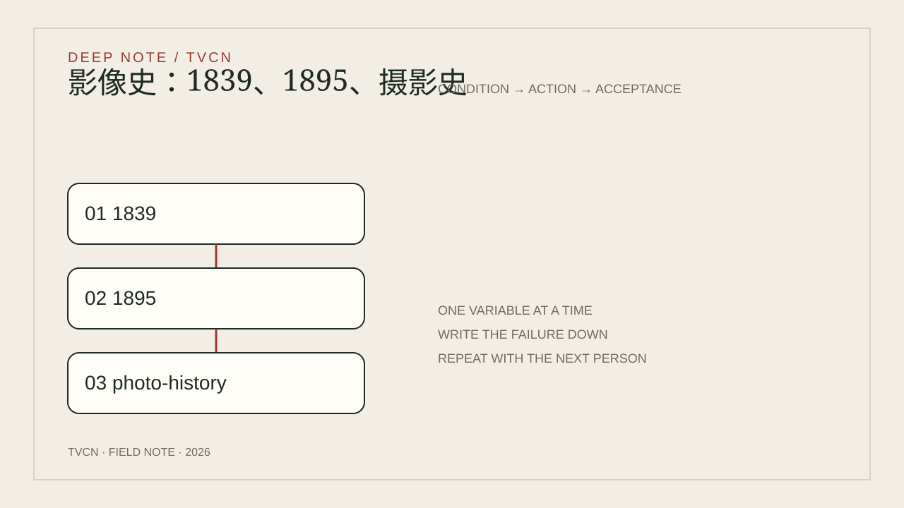

影像史不是年份表；1839、1895 和摄影史放在一起，才看得出“记录”如何变成“叙事”。 单看《1839》只能解决一个局部；把《1839》《1895》《photo-history》接成一条链，才会暴露“条件没写、变量太多、结果无法复现”的真问题。

<!-- DEEP_DIVE_START -->
<!-- DIAGRAM_START -->
<h2>图解</h2>
<figure>
  
  <figcaption>看“1839”和“1895”两处，先定条件，再看失败能不能被记录下来。</figcaption>
</figure>
<!-- DIAGRAM_END -->

<section><h2 id="section-1">问题</h2>
这一页的问题不是“方法不够多”，而是三个环节各自成立、合起来却不成立：条件没写、变量太多、结果不能复现。

本页按“先定条件—再做判断—只改一个变量—留下证据”的顺序；每一步都能被下一个人复述，才算完成。
</section>
<section><h2 id="section-2">判断</h2><ul><li>《1839》的第一道门槛：把 1839 的条件写成一行，能复述给下一个人</li><li>《1895》的第二道门槛：只改一个变量，另一页的结果还能复现</li><li>《photo-history》的第三道门槛：失败现象能被记录成“条件—动作—结果”，不是一句感觉</li></ul>
三条里有一条不成立，就先回到对应单页；不要用整条链掩盖一个没解决的单点。
</section>
<section><h2 id="section-3">做法</h2><ol><li>先写条件：把《1839》里“能做/不能做”落到一张三行表：素材、环境、验收。</li><li>再做一次最小动作：只按《1839》的步骤做 30 秒，不加入第二页的方法。</li><li>把《1895》的步骤接上：只改一个变量，保持其他条件不变。</li><li>用《photo-history》做对照：再拍一条同条件版本，比较差异。</li><li>每改一次只动一个变量；其他条件写进记录，不靠记忆。</li><li>把失败也拍下来：失败版本和成功版本并排，才知道哪一步不能省。</li><li>让下一个人按记录复现一次；他做不出来，说明记录还不够。</li></ol></section>
<section><h2 id="section-4">现场案例</h2>
可复现实验（不是客户案例）：拿 30 秒素材，先按《1839》的“把 1839 的条件写成一行，能复述给下一个人”做 A 版；再按《1895》的“只改一个变量，另一页的结果还能复现”做 B 版；两版只允许一个变量不同。把两版并排看，记录《photo-history》里最先崩的是哪一项：条件、动作还是验收。如果一次就成功，说明变量还不够多，再加一个现实限制重做。
</section>
<section><h2 id="section-5">失败表</h2>
<table class="data-table"><thead><tr><th>现象</th><th>原因</th><th>替换动作</th></tr></thead><tbody><tr><td>只看结果，不记条件</td><td>条件没写清</td><td>回到第一页重写三行表</td></tr><tr><td>只看结果，不记条件</td><td>条件没写清</td><td>回到第一页重写三行表</td></tr><tr><td>只看结果，不记条件</td><td>条件没写清</td><td>回到第一页重写三行表</td></tr></tbody></table>
</section>
<section><h2 id="section-6">验收</h2><ul><li>把 1839 的条件写成一行，能复述给下一个人。</li><li>只改一个变量，另一页的结果还能复现。</li><li>失败现象能被记录成“条件—动作—结果”，不是一句感觉。</li><li>下一位同事不问你，也能按记录做出同一版。</li></ul></section>
<section><h2 id="section-7">替代方案</h2><ul><li>只处理《1839》里的单点问题：回到<a href="https://context.tvcn.org/article/1839/">《1839》</a>，不要用整条链。</li><li>只比较两个动作：看<a href="https://context.tvcn.org/article/1895/">《1895》</a>，先不改第三页。</li><li>只做验收：看<a href="https://context.tvcn.org/article/photo-history/">《photo-history》</a>，把判断表拿去做自测。</li></ul></section>
<section><h2 id="section-8">边界</h2>
这条链不适合用来证明“某一种影像一定比另一种更真实”。1839 与 1895 之间不是一条单线进步，而是记录、放映和观看制度各自变化；把三个节点压成一条因果链，会抹掉不同地区的实践。本页只把三个节点当作三种“记录如何变成叙事”的样本，不把它们当成分期表。
</section>

<!-- SOURCES_START -->
## 参考与延伸阅读

- [S10] [BFI：电影史与动态影像研究](https://www.bfi.org.uk/) — 2026-11-26 访问。用于核对「问题」一节的术语/方法/规则（BFI 电影史与档案资料，不是设备评测）；不核对其中由本页经验得出的数字、型号与现场结论，也不替代测试。
- [S11] [Britannica：摄影](https://www.britannica.com/technology/photography) — 2026-11-26 访问。用于核对「判断」一节的术语/方法/规则（Britannica 摄影史条目，不是操作手册）；不核对其中由本页经验得出的数字、型号与现场结论，也不替代测试。
- [S50] [Kodak：动态影像](https://www.kodak.com/en/motion/home) — 2026-11-26 访问。用于核对「做法」一节的术语/方法/规则（Kodak 胶片与动态影像资料，不是数码参数）；不核对其中由本页经验得出的数字、型号与现场结论，也不替代测试。
<!-- SOURCES_END -->

