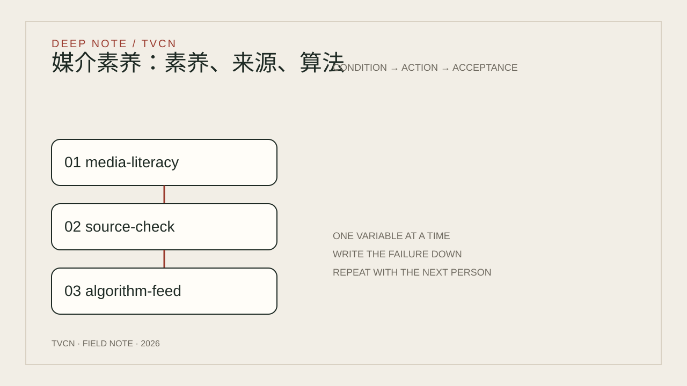

媒介素养不是“别信网上的”；来源、算法和情绪触发要拆成可检查的步骤。 单看《media-literacy》只能解决一个局部；把《media-literacy》《来源核查：这条视频最初是谁发的》《算法推荐：为什么你总看到同一种》接成一条链，才会暴露“条件没写、变量太多、结果无法复现”的真问题。

<!-- DEEP_DIVE_START -->
<!-- DIAGRAM_START -->
<h2>图解</h2>
<figure>
  
  <figcaption>看“media-literacy”和“来源核查：这条视频最初是谁发的”两处，先定条件，再看失败能不能被记录下来。</figcaption>
</figure>
<!-- DIAGRAM_END -->

<section><h2 id="section-1">问题</h2>
这一页的问题不是“方法不够多”，而是三个环节各自成立、合起来却不成立：条件没写、变量太多、结果不能复现。

本页按“先定条件—再做判断—只改一个变量—留下证据”的顺序；每一步都能被下一个人复述，才算完成。
</section>
<section><h2 id="section-2">判断</h2><ul><li>《media-literacy》的第一道门槛：最早账号、原始文件和时间戳保存了</li><li>《来源核查：这条视频最初是谁发的》的第二道门槛：反向图搜或关键帧搜索找到第二个独立来源</li><li>《算法推荐：为什么你总看到同一种》的第三道门槛：时间、地点、天气、招牌至少三项一致</li></ul>
三条里有一条不成立，就先回到对应单页；不要用整条链掩盖一个没解决的单点。
</section>
<section><h2 id="section-3">做法</h2><ol><li>先写条件：把《media-literacy》里“找最早账号、原始视频或图片，保存链接和发布时间”落到一张三行表：素材、环境、验收。</li><li>再做一次最小动作：只按《media-literacy》的步骤做 30 秒，不加入第二页的方法。</li><li>把《来源核查：这条视频最初是谁发的》的步骤接上：用反向图搜或关键帧搜索，找第二个独立来源。</li><li>用《算法推荐：为什么你总看到同一种》做对照：对时间、地点、天气、招牌，四项至少三项一致。</li><li>每改一次只动一个变量；其他条件写进记录，不靠记忆。</li><li>把失败也拍下来：失败版本和成功版本并排，才知道哪一步不能省。</li><li>让下一个人按记录复现一次；他做不出来，说明记录还不够。</li></ol></section>
<section><h2 id="section-4">现场案例</h2>
可复现实验（不是客户案例）：拿 30 秒素材，先按《media-literacy》的“最早账号、原始文件和时间戳保存了”做 A 版；再按《来源核查：这条视频最初是谁发的》的“反向图搜或关键帧搜索找到第二个独立来源”做 B 版；两版只允许一个变量不同。把两版并排看，记录《算法推荐：为什么你总看到同一种》里最先崩的是哪一项：条件、动作还是验收。如果一次就成功，说明变量还不够多，再加一个现实限制重做。
</section>
<section><h2 id="section-5">失败表</h2>
<table class="data-table"><thead><tr><th>现象</th><th>原因</th><th>替换动作</th></tr></thead><tbody><tr><td>别把“很多人转发”当证据；转发只是传播</td><td>条件没写清</td><td>回到第一页重写三行表</td></tr><tr><td>别把推荐当世界全貌；它只反映你的停留</td><td>条件没写清</td><td>回到第一页重写三行表</td></tr><tr><td>只看结果，不记条件</td><td>条件没写清</td><td>回到第一页重写三行表</td></tr></tbody></table>
</section>
<section><h2 id="section-6">验收</h2><ul><li>最早账号、原始文件和时间戳保存了。</li><li>反向图搜或关键帧搜索找到第二个独立来源。</li><li>时间、地点、天气、招牌至少三项一致。</li><li>截图不是原件</li><li>找最早发布者</li><li>找原始文件和完整版</li><li>看账号历史和发布时间</li><li>影子天气招牌对地点</li><li>两个账号同话题各刷十分钟，记录了前二十条。</li><li>标出重复账号、观点和情绪。</li></ul></section>
<section><h2 id="section-7">替代方案</h2><ul><li>只处理《media-literacy》里的单点问题：回到<a href="https://context.tvcn.org/article/media-literacy/">《media-literacy》</a>，不要用整条链。</li><li>只比较两个动作：看<a href="https://context.tvcn.org/article/source-check/">《来源核查：这条视频最初是谁发的》</a>，先不改第三页。</li><li>只做验收：看<a href="https://context.tvcn.org/article/algorithm-feed/">《算法推荐：为什么你总看到同一种》</a>，把判断表拿去做自测。</li></ul></section>
