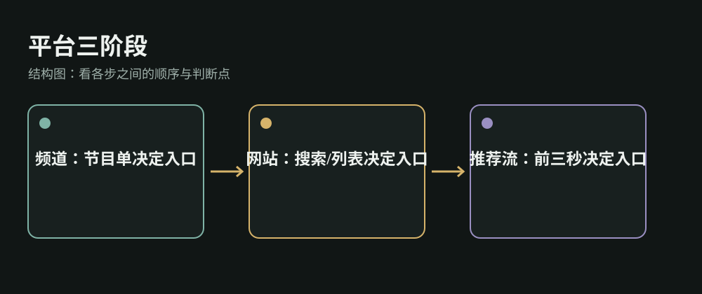

同一条 3 分钟片子，放在电视频道、视频网站和推荐流里，开头应该不一样。不是观众变了，是入口变了：频道靠节目单，网站靠搜索和列表，推荐流靠前三秒。平台史不是界面史，是观看条件的历史。

<!-- DIAGRAM_START -->
<h2 id="diagram">图解</h2>
<figure class="diagram">
  
  <figcaption>看“频道、网站、推荐流”三阶段的入口变化；入口一变，开头、时长和结尾都要重写。</figcaption>
</figure>
<!-- DIAGRAM_END -->

<section><h2 id="section-1">现场</h2>
一位导演把同一支 3 分钟短片分别放到三个地方：电视台午夜栏目、视频网站首页、短视频推荐流。电视版开场 20 秒是黑场和字幕；网站版前 10 秒是 logo；推荐流版前 3 秒没有人物，完播率极低。导演说“片子没变”，平台说“观众没等到”。
</section>
<section><h2 id="section-2">判断</h2><ul><li><strong>入口在哪：</strong>观众是打开频道、搜索片名，还是被推荐流推过来；入口决定开头。</li><li><strong>时长由什么决定：</strong>节目单给固定档期，网站给进度条，推荐流给划走成本。</li><li><strong>前 3 秒有没有人物/问题：</strong>推荐流没有人物，观众不知道自己在看谁。</li><li><strong>结尾是否可循环：</strong>推荐流会重播，结尾接开头；频道不会。</li></ul></section>
<section><h2 id="section-3">怎么做</h2><ol><li>先列平台阶段：频道、网站、推荐流，各写一句“观众怎么找到这条片”。</li><li>对比同一题材的开头：频道可以慢，网站要信息，推荐流要人物/冲突；不要一套开头通吃。</li><li>标出语法变化：镜头长度、字幕位置、竖屏安全区、声音先入还是画面先入。</li><li>把平台规则当条件，不当美学：规则说“前 3 秒”，不是“前 3 秒必须爆炸”。</li><li>做两版结尾：频道版收束，推荐流版留一个可循环的动作/问题。</li></ol></section>
<section><h2 id="section-4">失败</h2><ul><li><strong>把算法当创作：</strong>为了完播率，把片子剪成三秒一个反转，故事没了。</li><li><strong>只看界面：</strong>以为平台史就是 App 改版，不看见入口、注意力和发行关系的变化。</li><li><strong>忽略发行：</strong>片子只在推荐流发，没有频道/网站版本，长尾观众找不到。</li></ul></section>
<section><h2 id="section-5">边界</h2>
这篇是观看条件的历史框架，不是产业研究，也不替代平台规则原文。不同地区、不同平台的阶段不完全同步；中国、美国、欧洲的频道/网站/推荐流时间线不一样。写平台史要标出地区和时间，不要用一条线概括全世界。
</section>
<section><h2 id="section-6">验收</h2><ul><li>能说出三个阶段的入口分别是什么。</li><li>同一题材有三个不同开头，不是为了炫技，是为了入口。</li><li>平台规则被写成条件，不是被写成风格。</li><li>至少有一个长尾版本，不只有推荐流版本。</li></ul></section>
<!-- DEEP_DIVE_START -->
## 深读

<strong>约 8 分钟。</strong> 下面把同一套判断放进两个不同条件，再看一个反例和一个可复用模型；不是重复前文，而是决定什么时候该换做法。

### 条件 A：频道时代

频道时代的入口是节目单，观众先决定“看哪个频道”，再决定“看不看这条”。开头可以慢，因为观众已经坐在电视机前；但结尾必须准时，下一档节目不会等。片长由档期决定，不是由内容决定；导演要在固定时长里完成一个完整变化。

频道时代的语法偏“段落”：一条片子由几个可独立成立的段落组成，观众中途进来也能看懂。字幕承担“谁在说话”，因为屏幕小、声音差；音乐承担“情绪连续”，因为不能停。今天的推荐流把这两件事都改了。

### 条件 B：推荐流时代

推荐流的入口是“划走成本”：观众不认识你，也没有承诺；前三秒没有人物、问题或冲突，他就走了。开头不是“交代背景”，是“让人物先要东西”；背景可以放在第 8 秒、第 20 秒，甚至永远不放。片长不是由故事决定，是由留存曲线决定。

推荐流的语法偏“钩子—回报—再钩子”：每 10–20 秒给一次小回报，结尾留一个可循环的动作或问题。不是所有题材都适合；慢纪录片、长镜头、氛围片在推荐流里会被切碎，应该回到网站/频道版本。

### 反例：平台变了，片头没变

一位导演把电视纪录片直接上传到推荐流，开头保留了 40 秒的航拍和旁白。电视版完播率正常，推荐流版 3 秒留存不到一半。导演说“内容好，观众不识货”；平台说“观众没看到内容”。

问题不是内容，是入口。修法不是把航拍删掉，而是把航拍往后放，前三秒先给人物一句话或一个动作；航拍变成第 15 秒的呼吸。同一个素材，两个入口，两种开头。

### 可复用模型

<strong>入口 → 注意力 → 时长 → 反馈。</strong> 入口决定观众怎么来；注意力决定前几秒给什么；时长决定故事怎么收；反馈决定结尾是否可循环。四件事按平台阶段变，不按导演偏好变。

做一张“平台版本表”：频道、网站、推荐流各一行，列入口、前 3 秒、时长、结尾、字幕位置。同一支片子可以有三种版本，但只能有一个核心变化。版本变的是入口，不是主题。

<!-- DEEP_DIVE_END -->
<!-- SOURCES_START -->
## 参考与延伸阅读

- [S10] [BFI：BFI](https://www.bfi.org.uk/) — 2026-11-26 访问。用于核对“判断”一节的术语、方法或规则；不核对本页由经验得出的数字、型号与现场结论，也不替代测试或合同。
- [S14] [YouTube 社区准则：YouTube 社区准则](https://support.google.com/youtube/answer/2801973) — 2026-11-26 访问。用于核对“边界”一节的术语、方法或规则；不核对本页由经验得出的数字、型号与现场结论，也不替代测试或合同。
<!-- SOURCES_END -->
