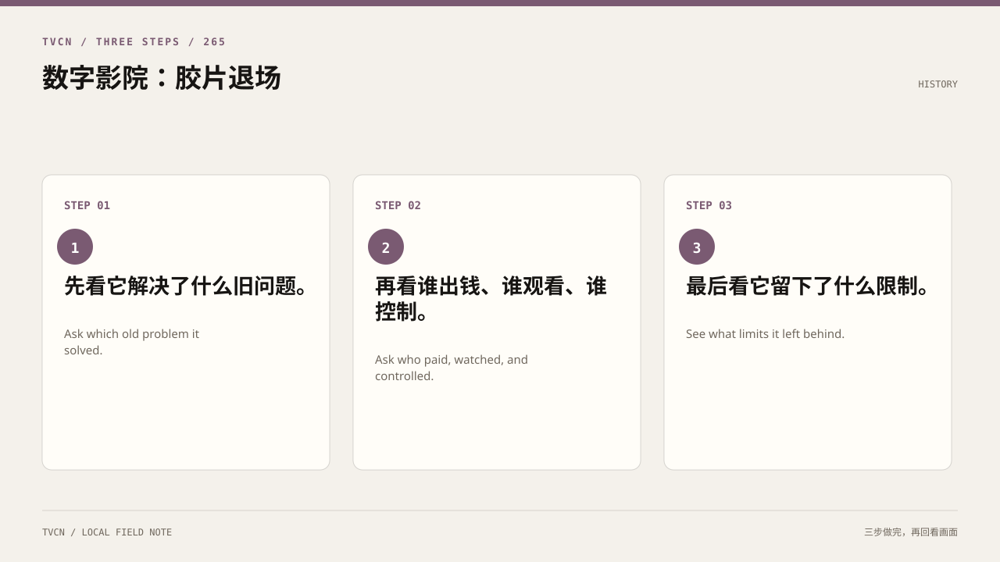

数字影院把发行从洗印和运输胶片，变成加密文件和服务器密钥。影院的放映机、色彩标准和声道被统一到一套可复制的规格，胶片逐渐退出日常放映。

<!-- DIAGRAM_START -->
<h2>图解</h2>
<figure>
  
  <figcaption>看“查放映机是 DCI 2K 还是 4K”和“确认 P3 色域和服务器密钥有效期”两处，判断它替代了什么旧办法，又新增了什么限制。</figcaption>
</figure>
<!-- DIAGRAM_END -->
<section><h2 id="section-2">今天怎么用</h2><ul><li>做交付时先确认影院或平台的色彩空间、亮度、声道和包装要求，不要只交一个“看起来对”的母版。</li><li>做 DCP 或流媒体版本时，分别检查黑位、白位、肤色和字幕；两者不是同一个交付。</li><li>研究胶片退场时，关注放映标准与发行成本，不要把“数字”简单等同于“更好”。</li></ul><h2 id="section-3">不要误用</h2>
不要用胶片颗粒预设掩盖数字母版的色彩管理错误。先通过标准放映链，再谈风格。
<h2 id="section-4">数字电影不是“把胶片换成传感器”，是交付标准变了</h2>

DCI 规范把分辨率、色彩、声音和加密打包成一套可互操作的影院交付。它让电影从“每个影院自己调”变成“全国/全球同一版”。

<h3>常见误读</h3>

“数字电影就是 4K”不准确。2K 和 4K 都在 DCI 范围内，关键是色彩空间、亮度、帧率和打包格式。另一个误读是“数字没有成本”——母版、加密、密钥和影院服务器维护都是成本。</h3>
<h3>对今天的一个用处</h3>

做投屏或影院放映，先问交付标准，不要只问分辨率。亮度、色彩和声音格式不匹配，4K 也会难看。
</section><section><h2 id="section-5">现场</h2>
DCI 2K 或 4K、P3 色域；数字放映没有胶片抖动，但有压缩和服务器密钥。
</section><section><h2 id="section-6">怎么做</h2><ol><li>查放映机是 DCI 2K 还是 4K。</li><li>确认 P3 色域和服务器密钥有效期。</li><li>看画面没有胶片抖动，但可能有压缩和密钥限制。</li></ol></section><section><h2 id="section-7">别踩</h2>
别以为数字放映没有限制；密钥过期，场次直接放不出来。
</section><section><h2>来源边界</h2>
这是解释，不是原始档案；关键年份、人物和法律条文回到 <a href="../../about/">SOURCES.md</a> 的原始链接复核。二手叙述只能当线索，不能当证据。
</section>
<h2>验收</h2><ul><li>放映分辨率明确是 DCI 2K 或 4K。</li><li>P3 色域和密钥有效期都有记录。</li><li>能说出一个数字放映的新失败点，如密钥或压缩。</li></ul>

<!-- SOURCES_START -->
## 参考与延伸阅读

- [S13] [DCI：数字电影系统规范](https://www.dcimovies.com/dci-specification/) — 2026-11-26 访问。用于核对「数字电影不是“把胶片换成传感器”，是交付标准变了」一节的术语/方法/规则（DCI 数字电影规范，不是流媒体上传规则）；不核对其中由本页经验得出的数字、型号与现场结论，也不替代测试。
<!-- SOURCES_END -->

