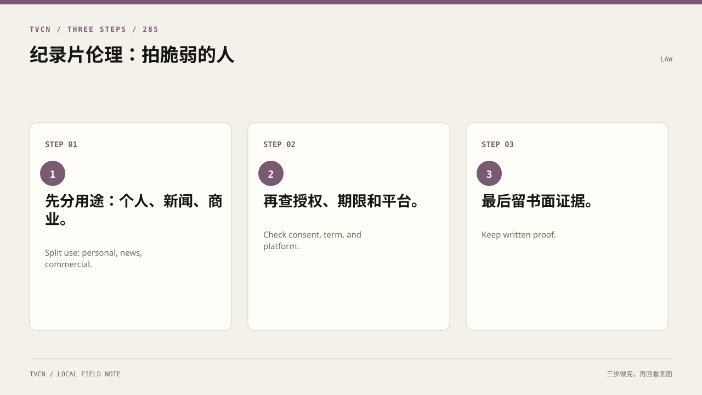

拍真实人物， consent 不只是签一张纸。要让他知道片子上线后谁会看到、可能带来什么麻烦、他能不能在剪辑前看片。没有能力承担后果的人，尤其要谨慎。

<!-- DIAGRAM_START -->
<h2>图解</h2>
<figure>
  
  <figcaption>看“用他能听懂的话说明片子上线后谁能看到”和“写清他可以随时退出，并留下书面记录”两处，判断它替代了什么旧办法，又新增了什么限制。</figcaption>
</figure>
<!-- DIAGRAM_END -->
<section><h2 id="section-1">先问“他能不能承担被看见的后果”</h2>
把“对观众好看”与“对拍摄对象安全”分开评估；两者冲突时，先保人。
<h2 id="section-2">边界</h2>
真实不是把镜头贴到脸上。可以拒绝拍、可以停机、可以删掉已经拍到的素材；纪录片的力量不靠伤害换。
</section><section><h2 id="section-3">现场</h2>
问三件事：他知道后果吗、能退出吗、片子会伤害他吗；答案不清楚就不拍。
</section><section><h2 id="section-4">怎么做</h2><ol><li>用他能听懂的话说明片子上线后谁能看到。</li><li>写清他可以随时退出，并留下书面记录。</li><li>预判片子播出后可能对他造成的伤害，答案不清就不拍。</li></ol></section><section><h2 id="section-5">别踩</h2>
别拿“他同意了”当伦理过关；他可能不知道上线后谁能看到。
</section><section><h2>今天怎么用</h2>
把这条历史放回一个今天的工作：做档案、修复、教学或短片时，先问它解决了什么，再问它今天还缺什么。
<ul><li>找一条今天的同类作品，标出一个它继承的旧限制。</li><li>找一个它已经不再需要的条件，说明为什么。</li><li>写一句今天仍不能做的事。</li></ul></section><section><h2>来源边界</h2>
这是解释，不是原始档案；关键年份、人物和法律条文回到 <a href="../../about/">SOURCES.md</a> 的原始链接复核。二手叙述只能当线索，不能当证据。
</section>
<h2>验收</h2><ul><li>用对方能懂的话说明了发布范围和后果。</li><li>退出机制是书面的，且随时可用。</li><li>能写出至少一项潜在伤害及应对，答案不清就不拍。</li></ul>

<!-- SOURCES_START -->
## 参考与延伸阅读

- [S18] [Dangerous Documentaries（CMSI）](https://cmsimpact.org/wp-content/uploads/2015/12/dangerousdocs-feb2015.pdf) — 2026-11-26 访问。用于核对首段“拍脆弱的人先问三件事：他知不知道后果、能不能退出、片子会不会伤害他。”中的术语与公开背景（纪录片拍摄中的知情同意、风险与伦理决策）；不替代现场测试。
- [S01] [UNESCO](https://www.unesco.org/mil4teachers/en/module1) — 2026-11-26 访问。用于核对首段“拍脆弱的人先问三件事：他知不知道后果、能不能退出、片子会不会伤害他。”中的术语与公开背景（媒介素养的定义、教师模块与批判性问题）；不替代现场测试。
- [S02] [WIPO](https://www.wipo.int/en/web/copyright/faq-copyright) — 2026-11-26 访问。用于核对首段“拍脆弱的人先问三件事：他知不知道后果、能不能退出、片子会不会伤害他。”中的术语与公开背景（版权保护对象、经济权利与精神权利）；不替代现场测试。
- [S03] [全国人民代表大会：《个人信息保护法》](http://www.npc.gov.cn/npc/c2/c30834/202108/t20210820_313088.html) — 2026-11-26 访问。用于核对首段“拍脆弱的人先问三件事：他知不知道后果、能不能退出、片子会不会伤害他。”中的术语与公开背景（处理个人信息、敏感信息与告知同意的法律文本）；不替代现场测试。
- [S16] [BBC 编辑准则](https://www.bbc.co.uk/editorialguidelines/) — 2026-11-26 访问。用于核对首段“拍脆弱的人先问三件事：他知不知道后果、能不能退出、片子会不会伤害他。”中的术语与公开背景（准确性、公正、隐私与隐蔽拍摄的编辑标准）；不替代现场测试。
<!-- SOURCES_END -->

