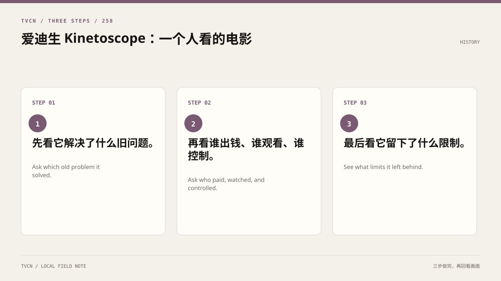

活动电影放映机把影像装进盒子，一次只给一个人看；电影还没成为公共空间。

<!-- DIAGRAM_START -->
<h2>图解</h2>
<figure>
  
  <figcaption>把三步按顺序做完，再回看画面或文件。</figcaption>
</figure>
<!-- DIAGRAM_END -->
<h2>现场</h2>

Kinetoscope 一次一人，片长约 20 秒，循环播放；看盒子上的窥孔，不是投影。

<h2>怎么做</h2>

活动电影放映机把影像装进盒子，一次只给一个人看；电影还没成为公共空间。
<ol><li>做一个带窥孔的箱子模型。</li><li>把片长控制在 20 秒左右并循环。</li><li>一次只让一个人看，记录他的反应。</li></ol>
<h2>别踩</h2>

别把它当成投影放映；Kinetoscope 是单人窥孔观看。

<h2>验收</h2>
<ul><li>模型有窥孔，观看方式是一人一次。</li><li>片长控制在约 20 秒并循环。</li><li>能说清它与投影放映的差别：没有银幕和集体观众。</li></ul>

<!-- SOURCES_START -->
## 参考与延伸阅读

- [S10] BFI：电影史与影像研究入口

完整链接与用途见 [`SOURCES.md`](../../SOURCES.md)。
<!-- SOURCES_END -->
