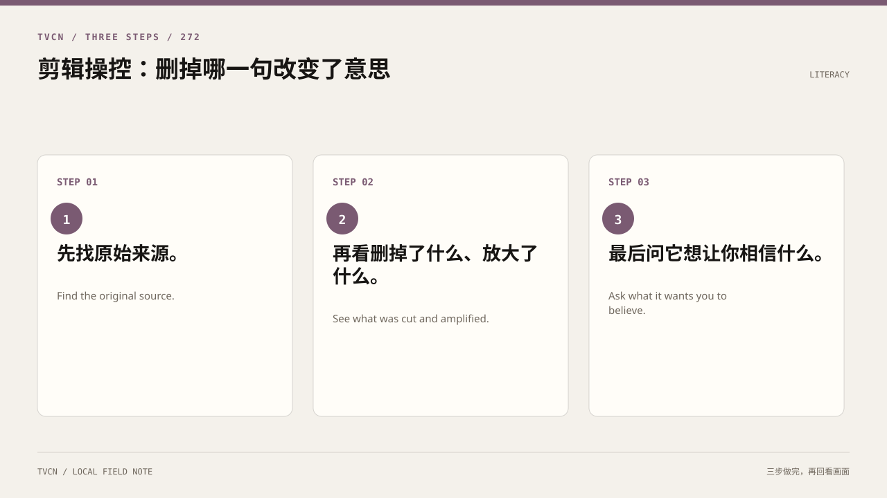

看一条可疑视频，先找三处剪切：画面跳变、声音断点、口型不连续。每个剪切点前后各看两秒，问“中间缺了什么”。

<!-- DIAGRAM_START -->
<h2>图解</h2>
<figure>
  
  <figcaption>看“找未剪辑原片或完整采访，前后各看十秒”和“标出被删的前提、反对意见和时间跨度”两处，判断它替代了什么旧办法，又新增了什么限制。</figcaption>
</figure>
<!-- DIAGRAM_END -->
<section><h2 id="section-1">先找“剪切点”，再判断删了什么</h2>
再看速度：音频波形是否被拉长、人物动作是否不自然、环境声是否循环。剪辑可以制造因果，也可以删掉因果。
<h2 id="section-2">边界</h2>
有剪切不等于造假。正常剪辑也会删时间；判断标准是删掉的部分是否改变了意思，而不是“剪过”。
</section><section><h2 id="section-3">现场</h2>
找被删的前提：把同一段采访前后各看 10 秒，问删掉哪句会改变结论。
</section><section><h2 id="section-4">怎么做</h2><ol><li>找未剪辑原片或完整采访，前后各看十秒。</li><li>标出被删的前提、反对意见和时间跨度。</li><li>问“删掉这句后，结论变了没有”；变了就是操控。</li></ol></section><section><h2 id="section-5">别踩</h2>
别只说“剪过”；要指出删了什么、怎么改变意思。
</section><section><h2>今天怎么用</h2>
把这条历史放回一个今天的工作：做档案、修复、教学或短片时，先问它解决了什么，再问它今天还缺什么。
<ul><li>找一条今天的同类作品，标出一个它继承的旧限制。</li><li>找一个它已经不再需要的条件，说明为什么。</li><li>写一句今天仍不能做的事。</li></ul></section><section><h2>来源边界</h2>
这是解释，不是原始档案；关键年份、人物和法律条文回到 <a href="../../about/">SOURCES.md</a> 的原始链接复核。二手叙述只能当线索，不能当证据。
</section>
<h2>验收</h2><ul><li>找到未剪辑原片或完整采访，前后各看十秒。</li><li>标出被删的前提、反对意见和时间跨度。</li><li>能说出删掉那句后结论变了没有。</li></ul>

<!-- SOURCES_START -->
## 参考与延伸阅读

- [S01] UNESCO：媒介与信息素养

完整链接与用途见 [`SOURCES.md`](../../about/)。
<!-- SOURCES_END -->
