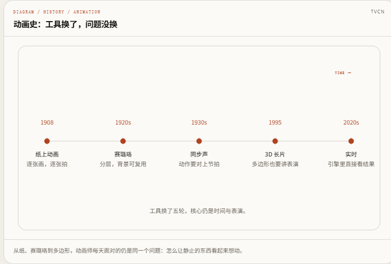

<!-- DIAGRAM_START -->
## 图解

<figure>
  
  <figcaption>从纸、赛璐珞到多边形，动画师每天面对的仍是同一个问题：怎么让静止的东西看起来想动。</figcaption>
</figure>
<!-- DIAGRAM_END -->

动画不是一种风格，是一套逐帧控制时间的方法。介质从纸、赛璐珞到多边形，问题没变。

## 逐帧

动画最早的核心不是“画得像”，而是“让一张张静止的图产生运动”。一秒 12 张、24 张，动作被拆成时间的单位。

这也是动画和实拍的根本差别：实拍记录已经发生的运动，动画必须决定运动如何发生。

## 赛璐珞

赛璐珞把角色、前景、背景分层，让同一个背景可以重复使用。分层不只省钱，它建立了“角色在空间中”的工业方法。

今天的分层逻辑仍在：角色层、背景层、特效层、文字层。你用的软件变了，图层思维没有变。

## 3D

3D 把“每一帧画什么”变成“场景里有什么、相机在哪、光从哪来”。控制从线条转向空间，但 timing 仍然是核心。

不要被“逼真”带走。观众记住的是动作的重量和节奏，不是多边形数量。先做能读懂的 blockout，再谈材质。

## 3 条验收

- 能说出动画与实拍在“运动来源”上的差别。
- 能解释赛璐珞分层为什么是工业方法。
- 能在 3D 里先做 blockout，而不是先做材质。

<!-- SOURCES_START -->
## 参考与延伸阅读

- [S12] Britannica：动画

完整链接与用途见 [`SOURCES.md`](../../../../SOURCES.md)。
<!-- SOURCES_END -->
