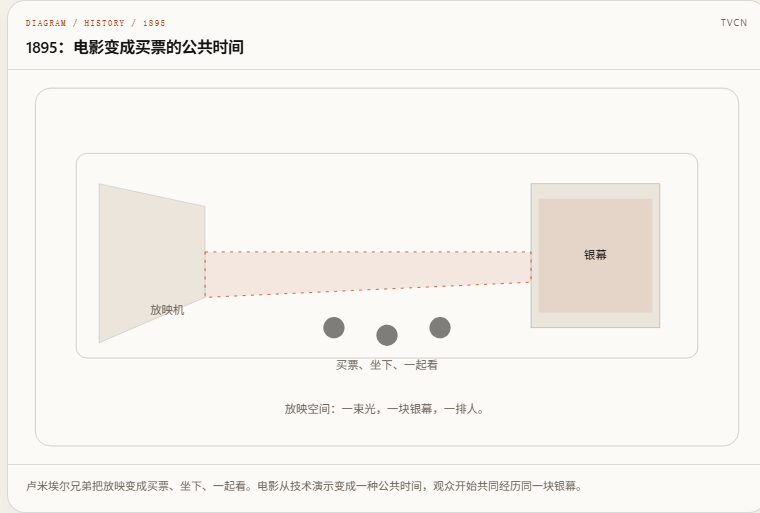

<!-- DIAGRAM_START -->
## 图解

<figure>
  
  <figcaption>卢米埃尔兄弟把放映变成买票、坐下、一起看。电影从技术演示变成一种公共时间，观众开始共同经历同一块银幕。</figcaption>
</figure>
<!-- DIAGRAM_END -->

卢米埃尔兄弟把放映变成买票、坐下、一起看。电影从技术演示变成了一种公共时间。

## 第一次集体放映

1895 年 12 月，卢米埃尔兄弟在巴黎一家咖啡馆的地下室售票放映。观众坐在黑暗里，一起看一块屏幕上的运动影像。

这不是第一次有电影，但它是第一次把“看电影”变成一种可重复的公共活动：买票、进场、坐下、一起笑、一起走。

## 时长与观众

早期的片子只有几十秒，内容常常是“火车进站”“工人下班”。观众不是为了故事，而是为了“看见真实的地方”。

当放映变成节目单，剪辑、配乐、解说和观众反应开始互相影响。电影不只是画面，它是一个场。

## 今天

今天我们在手机上“看片子”，但“坐下、一起看完”仍然有力量。做短片时，先想清楚你要的是滑过，还是让人停留 60 秒。

这两个目标对应不同的开头、节奏和结尾。不要用影院预告片的方式，做一条会被静音滑过的信息流视频。

## 3 条验收

- 能说出 1895 年放映为什么是“公共娱乐”的起点。
- 能区分“技术演示”和“节目单”的差别。
- 能为一条片子明确选择“滑过”还是“停留”。

## 不是一夜之间发生的

1895 年 12 月 28 日，卢米埃尔兄弟在巴黎大咖啡馆的地下室做第一次公开售票放映。一次放十部短片，每部约 50 秒。

它不是“电影诞生”的孤零零一刻，而是放映机、胶片、电力、观众和售票制度同时到位的结果。缺一项，电影就还停在实验室。

## 当时的观众在看什么

固定机位、单镜头、无声音，观众看的是一段真实动作：火车进站、工人下班、婴儿吃饭。吸引力来自“动的照片”，不是剧情。

手摇放映的速度不绝对稳定，现场常有钢琴或解说。今天按 16–18 格回放，更接近当时的观感。

## 今天怎么用它

找一部一分钟实景片，数三个东西：摄影机放在哪、人物从哪进画、镜头在哪一刻停。

这三项就是最早的场面调度。把它换成今天的手机，仍然成立：先定机位，再等动作，最后留一个结束点。

<!-- V11_DEEPEN -->

<!-- DEEP_DIVE_START -->
## 深读

<strong>约 7 分钟。</strong> 这一节不重复前面的做法，只补三个东西：两种条件、一个反例、一个可复用模型；读完能判断什么时候换做法。

### 条件 A：放映/观众史

1895 年不是“电影发明”的单点，是“电影成为公共娱乐”的起点。卢米埃尔兄弟的放映有场地、票价、节目单和观众；观众不是被动接受，他们会笑、会躲、会讨论。电影从一开始就是一场集体观看。

把 1895 当成“技术奇迹”会漏掉商业条件：放映机、胶片、场地、发行、观众动线。技术只提供可能，商业把它变成日常。理解这一点，才能理解后来的影院、电视和推荐流。

### 条件 B：制作/技术史

制作史角度看，1895 的片子很短，因为片盒容量有限；机位固定，因为摄影机很重；主题是日常，因为不用布景和演员。不是创作者不想拍长，是设备不允许。技术限制塑造了早期电影的语法。

今天的短视频又回到“短、固定、日常”，不是历史重复，是条件相似：拍摄门槛低、观看时间碎、发行靠平台。比较两个时代，不要只看长度，要看“谁在拍、谁在看、怎么发行”。

### 反例：一部片子改变世界

常见说法是“火车进站吓坏了观众，所以电影诞生了”。这个故事很好听，但把复杂的历史压成一个瞬间。观众确实可能躲，但放映的成功还靠场地、票价、节目单和口碑；没有这些，一部片子只是一次新奇。

修法不是否定这个故事，而是把它放回条件里：技术、放映、观众、商业四条线同时成立，电影才成为公共娱乐。讲故事可以，但不要把故事当因果。

### 可复用模型

<strong>技术 → 放映 → 观众 → 商业。</strong> 四条线同时看，历史才不是“谁发明了什么”。技术给可能，放映给场景，观众给意义，商业给持续。

分析任何一次影像变革，都问四个问题：什么技术变了、在哪看、谁在看、谁付钱。四个答案都在，变革才成立；只有一个，通常只是实验室事件。

<!-- DEEP_DIVE_END -->

<!-- SOURCES_START -->
## 参考与延伸阅读

- [S09] [卢米埃尔研究院：电影机与博物馆](https://www.institut-lumiere.org/en/lumiere-museum) — 2026-11-26 访问。用于核对「第一次集体放映」一节的术语/方法/规则（卢米埃尔电影机史料，不是现代拍摄规范）；不核对其中由本页经验得出的数字、型号与现场结论，也不替代测试。
- [S10] [BFI：电影史与动态影像研究](https://www.bfi.org.uk/) — 2026-11-26 访问。用于核对「时长与观众」一节的术语/方法/规则（BFI 电影史与档案资料，不是设备评测）；不核对其中由本页经验得出的数字、型号与现场结论，也不替代测试。
<!-- SOURCES_END -->

